# Hệ thống Quản lý Thư viện — Product Roadmap (R0–R3)

> Trạng thái: `PROPOSAL` toàn bộ — chờ L1 approval đợt 2 (sau PRD). Không có ngày/quý hay capacity estimate: thứ tự release theo dependency, không theo lịch. Nhãn FACT/PROPOSAL theo `prd.md` §0.

## 1. Nguyên tắc xếp release

- Mỗi release tạo một năng lực vận hành khép kín với dữ liệu thật; không để producer đứng sau consumer bắt buộc.
- Critical path bắt buộc (FACT — phase-02 contract): `governance/legal → privileged identity/RBAC → policy/state → import/QR reconciliation → audit/backup/restore → catalog/copy/member → circulation/fine/damage → pilot/reporting`.
- Release `R3` là **candidate/discovery**, không phải cam kết; chỉ lập release sau quyết định riêng.
- Bảy readiness gate (`GATE-*`, chi tiết ở `readiness-gates.md`) gắn vào entry/exit của từng release; `GATE-GNG` là non-waivable go-live gate.

## 2. Sơ đồ phụ thuộc release

```mermaid
graph LR
    GD[GATE-DEC: quyết định governance/legal] --> R0
    R0[R0 Nền tảng & dữ liệu] --> GM[GATE-MIG]
    GM --> R1A[R1A Lưu thông lõi]
    R1A --> R1B[R1B Hoàn thiện & Pilot]
    R1B --> GU[GATE-UAT + GATE-TRN + GATE-OPS]
    GU --> GP[GATE-PILOT]
    GP --> GNG[GATE-GNG non-waivable]
    GNG --> PILOT[Go-live pilot 1 cơ sở / 2 quầy]
    PILOT --> R2[R2 Đặt trước & báo cáo xu hướng]
    R2 -.candidate.-> R3[R3 Mở rộng - candidate]
```

## 3. Release R0 — Nền tảng, quyết định và dữ liệu

**Outcome:** có danh tính/phân quyền, bộ quy định cấu hình được, kho đầu sách/bản sao thật đã import–dán QR–đối soát, audit capture và backup/restore hoạt động — sẵn sàng để bật giao dịch. **Chưa có nghiệp vụ mượn–trả.**

| Hạng mục | Nội dung |
|---|---|
| Scope | CAP-IDENT (đăng nhập, RBAC 3 vai trò, đặt lại mật khẩu, hồ sơ); CAP-ACCT (đăng ký + kích hoạt người đọc, CRUD tài khoản); CAP-CATALOG (đầu sách, danh mục, bản sao, sinh/in QR); CAP-IMPORT (dry-run, lỗi theo dòng, đối soát, rollback batch); CAP-POLICY (tham số BR-01..13 + lifecycle engine); CAP-AUDIT capture; CAP-OPS (backup hằng ngày, restore). Nguồn: FR-C01..C03, FR-R01, FR-L02..L07, NFR-02/04/07. |
| Dependency | GATE-DEC: duyệt privileged identity (OQ-01), giá trị BR (OQ-04), luồng kích hoạt (OQ-03), retention/privacy (OQ-12) tối thiểu để build; file Excel đại diện (external blocker, owner Thủ thư). |
| Entry criteria | Decision register có owner/approver/due gate cho mọi hard-stop; PRD đã L1-approved. |
| Exit criteria | GATE-MIG đạt: dry-run 100% lỗi được chỉ rõ; đối soát vật lý khớp (sai lệch ≤ 1% target); tài khoản seed/Thủ thư hoạt động; audit capture ghi được thao tác; ≥1 lần restore thành công trên dữ liệu import. |
| KPI | % bản ghi import hợp lệ sau làm sạch; sai lệch kho sau đối soát; thời gian restore (đo lần diễn tập đầu — baseline). |
| Rủi ro | Excel thật không có/kém chất lượng → entry blocked; policy chốt muộn → dời CAP-POLICY hardening, không dời giao dịch. |
| Rollback boundary | Toàn bộ R0 là dữ liệu + cấu hình, chưa có giao dịch: rollback = restore backup trước import hoặc re-import batch (import có rollback theo batch). |
| Non-goal | Không mượn/trả, không đặt trước, không cổng người đọc tự phục vụ, không báo cáo nghiệp vụ. |

## 4. Release R1A — Lưu thông lõi tại quầy

**Outcome:** quầy mượn–trả chạy trọn vòng với QR trên dữ liệu thật: kiểm tra điều kiện ngay khi quét, giao dịch nguyên tử, quá hạn/phạt/hư hỏng/mất có đường kết thúc — khắc phục blocker audit "Giai đoạn 1 tạo ngoại lệ nhưng xử lý ở Giai đoạn 2".

| Hạng mục | Nội dung |
|---|---|
| Scope | CAP-CIRC (quét thẻ/sách, mượn nhiều cuốn một transaction BR-01/02/03/13, nhận trả); CAP-OVERDUE (job 00:05 chuyển OVERDUE + tính phạt tạm tính, nhắc hạn 08:00, RP-04); CAP-FINE (ledger tự động theo BR-05..07; ghi nhận thu tiền mặt **tối thiểu** — `PROPOSAL` DEC-P2-04); CAP-DAMAGE (báo cáo có ảnh 1–5, bản sao → Chờ duyệt ngay OQ-11, disposition tối thiểu Bác bỏ/Sửa/Thanh lý, ghi nhận mất — `PROPOSAL` DEC-P2-07); CAP-READER (tra cứu, thẻ QR, đang mượn, lịch sử — FR-R02..R05); CAP-NOTIFY tối thiểu (in-app + email cho sự kiện quan trọng — `PROPOSAL` DEC-P2-01); CAP-REPORT vận hành (RP-01, RP-02, RP-04). |
| Dependency | R0 exit đạt; trong release: fine ledger + job quá hạn phải live **trước khi** bật chặn mượn BR-03 (internal ordering — FACT từ audit dependency); damage disposition trước khi mở tạo DamageReport cho dữ liệu thật. |
| Entry criteria | GATE-MIG passed; mọi state transition Loan/Copy/đã-mô-tả có owner và đường kết thúc (lifecycle gate của Phase 3 nếu đã sinh, ngược lại checklist trong readiness-gates). |
| Exit criteria | Không còn double-loan trên một bản sao trong kiểm thử đồng thời; 100% giao dịch thử có audit; trả quá hạn/hư hỏng/mất đóng phiếu và tạo khoản phạt đúng BR; thông báo sự kiện quan trọng gửi được. |
| KPI | Quét QR → hiển thị < 1s; tra cứu < 2s @50.000 bản sao (NFR-01); 0 Loan mở trùng bản sao; 100% thao tác ghi có audit. |
| Rủi ro | Lỗi tính phạt/quá hạn trên dữ liệu thật → rollback R1A (xem dưới); hai quầy tranh chấp cùng bản sao → khóa lạc quan BR-13 + message wording chuẩn. |
| Rollback boundary | Tắt endpoint giao dịch (feature flag circulation-off): dữ liệu Loan/Fine/DamageReport đã ghi được giữ nguyên và xử lý thủ công theo SOP; quay về trạng thái chỉ-đọc của R0. Không xóa dữ liệu nghiệp vụ đã ghi — sửa sai bằng quy trình điều chỉnh có audit. |
| Non-goal | Không phân bổ hàng chờ đặt trước (điểm quyết định D5 luôn "không có hàng chờ" — DEC-P2-05); không gia hạn; không biên nhận in/xuất; không miễn/điều chỉnh phạt; không trung tâm thông báo đầy đủ; không audit viewer. |

## 5. Release R1B — Hoàn thiện nghiệp vụ & sẵn sàng pilot

**Outcome:** các năng lực P1 còn lại hoàn thiện (gia hạn, thu phạt nâng cao, trung tâm thông báo, audit viewer) và toàn bộ readiness gate vận hành được vượt qua → **go-live pilot**.

| Hạng mục | Nội dung |
|---|---|
| Scope | CAP-RENEW + gia hạn online (FR-R06, FR-S06, BR-04); CAP-FINE nâng cao (biên nhận, miễn/điều chỉnh theo thẩm quyền — cần financial-control decision, `PROPOSAL` DEC-P2-04); CAP-NOTIFY đầy đủ (FR-C04 trung tâm thông báo, đánh dấu đã đọc); CAP-AUDIT viewer (FR-L10); FR-S09 danh sách quá hạn cho Nhân viên; FR-S10 quản lý người đọc giới hạn; FR-R09 người đọc xem công nợ; deliverable vận hành: SOP, runbook, owner cho từng tác vụ nền, kênh hỗ trợ pilot. |
| Dependency | R1A exit đạt; GATE-DEC phần financial-control (miễn/điều chỉnh phạt, thẩm quyền) và privacy/retention **phải Resolved + Approved trước GATE-GNG**; BR-04 điều kiện "có người đặt trước" chạy trên hàng chờ rỗng cho tới R2 — không phải dependency đảo (DEC-P2-05). |
| Entry criteria | R1A ổn định trên dữ liệu thật nội bộ (dogfood tại quầy); không còn lỗi blocker mở. |
| Exit criteria | GATE-UAT đạt (scenario traceability đầy đủ, không còn blocker); GATE-TRN đạt (SOP + diễn tập Nhân viên/Thủ thư); GATE-OPS đạt (restore drill thành công, runbook, job owner); GATE-PILOT đạt (người dùng/thiết bị/dữ liệu đại diện, tiêu chí dừng, kênh hỗ trợ); **GATE-GNG ký go-live**. |
| KPI | Thời gian giao dịch quầy trong UAT vs baseline thủ công; % nhân viên qua diễn tập; số lỗi blocker mở = 0; restore drill đạt. |
| Rủi ro | UAT phát hiện lỗi nghiệp vụ lõi → rollback về R1A cố định, pilot dời; financial-control chưa duyệt → tắt chức năng miễn/điều chỉnh, giữ thu tiền mặt tối thiểu (không block go-live nếu Thủ thư trưởng chấp nhận — quyết định ghi trong GATE-GNG). |
| Rollback boundary | Trước go-live: rollback là không bật pilot (feature flag). Sau go-live: không rollback dữ liệu; kích hoạt quy trình xử lý thủ công song song và hotfix; tiêu chí dừng pilot định nghĩa tại GATE-PILOT. |
| Non-goal | Đặt trước, báo cáo xu hướng, mọi candidate R3; cam kết SLA dài hạn. |

## 6. Release R2 — Đặt trước trọn vòng & báo cáo xu hướng

**Outcome:** người đọc đặt trước khi hết sách; hệ thống giữ chỗ FIFO 48h và phân bổ lại khi hết hạn; Thủ thư có báo cáo xu hướng để ra quyết định mua/sửa/thanh lý.

| Hạng mục | Nội dung |
|---|---|
| Scope | CAP-RESERVE trọn vòng (FR-R07, FR-R08, BR-08..10; job hết hạn giữ 15 phút; bật điểm quyết định D5 trong luồng trả); CAP-REPORT xu hướng (RP-03, RP-05, RP-06, RP-07). |
| Dependency | Pilot live ổn định; CAP-CIRC, CAP-NOTIFY, CAP-POLICY đã có (không phụ thuộc capability nào chưa phát hành — verified). |
| Entry criteria | Không còn sự cố pilot mức blocker; quy tắc hàng chờ BR-08..10 đã có giá trị duyệt (kế thừa GATE-DEC R0 hoặc quyết định bổ sung). |
| Exit criteria | Luồng đặt trước–giữ–nhận–hết hạn chạy đúng FIFO trên dữ liệu pilot; không kẹt bản sao ở Đang giữ; báo cáo xu hướng xuất Excel/PDF đúng. |
| KPI | Tỷ lệ đặt trước được phục vụ trong 48h; số bản sao kẹt Đang giữ quá hạn = 0; độ dài hàng chờ trung bình (đo trên pilot — baseline mới). |
| Rủi ro | Bật D5 thay đổi hành vi trả trên dữ liệu đang vận hành → phát hành sau feature flag + kiểm thử regression luồng trả. |
| Rollback boundary | Tắt CAP-RESERVE bằng cấu hình: hàng chờ đóng băng (không nhận yêu cầu mới), các giữ chỗ đang READY được xử lý tay theo SOP, bản sao về Sẵn sàng. |
| Non-goal | Điểm danh, thanh toán online, đa chi nhánh, offline — vẫn candidate. |

## 7. Release R3 — Candidate (không cam kết)

**Outcome:** chỉ xác lập sau quyết định riêng từng initiative; roadmap này **không** cam kết bất kỳ mục nào trong R3.

| Candidate | Evidence hiện có | Điều kiện để lập release |
|---|---|---|
| Điểm danh (CAP-ATTEND, FR-S11, RP-08) | OQ-02 chưa rõ là chấm công nhân viên hay ghi nhận người đọc vào | OQ-02 resolved + business case |
| Thanh toán online (CAP-PAY, OQ-08) | Mặc định tiền mặt tại quầy | Quyết định cổng thanh toán + financial-control |
| Nhiều chi nhánh (CAP-BRANCH, OQ-09) | Mặc định một cơ sở | Nhu cầu liên thư viện thực tế |
| Offline (CAP-OFFLINE, OQ-13) | Mặc định không hỗ trợ | Đánh giá độ phức tạp riêng |
| SMS/push/Zalo (CAP-MSGALT, OQ-07) | Baseline in-app + email | Chi phí/độ phức tạp tích hợp |
| Phân loại người đọc (ReaderType, OQ-04) | Một bộ quy định chung MVP | Nhu cầu chính sách khác biệt |

## 8. Kiểm tra dependency (verification)

| Kiểm tra | Kết quả |
|---|---|
| Producer sau consumer bắt buộc | Không có: mọi dependency của R1A nằm trong R0/R1A; R1B chỉ phụ thuộc R0–R1A + decision gate; R2 chỉ phụ thuộc capability đã phát hành. |
| R1B phụ thuộc R2? | Không. Điều kiện BR-04 "có người đặt trước" kiểm tra hàng chờ — hàng chờ rỗng tới R2, rule vẫn đúng ngữ nghĩa (DEC-P2-05). |
| Trùng scope giữa release | Không: Reservation chỉ một release owner (R2); báo cáo chia RP-id rõ ràng; fine chia basic (R1A) / advanced (R1B) theo audit. |
| Cam kết ngầm | Không có ngày/quý/capacity; R3 gắn nhãn Candidate. |
| Metric thiếu baseline | Ghi phương pháp đo + owner ở `prd.md` §8, không bịa số. |

## 9. Gate mapping tóm tắt

| Gate | Gắn vào | Non-waivable? |
|---|---|---|
| GATE-DEC | Entry R0; tiếp tục financial/privacy trước GATE-GNG | Có (các quyết định hard-stop) |
| GATE-MIG | Exit R0 | Có |
| GATE-UAT | Trong R1B | Có |
| GATE-OPS | Một phần exit R0; đầy đủ trong R1B | Có (restore trước go-live) |
| GATE-TRN | Trong R1B | Có |
| GATE-PILOT | Cuối R1B | Có |
| GATE-GNG | Cuối R1B, quyết định go-live | **Có — go-live gate không được waive** |

## 10. Câu hỏi mở ảnh hưởng roadmap

- [ ] OQ-01/OQ-03/OQ-04/OQ-12: quyết định nguồn cho GATE-DEC (xem `decision-register.md`).
- [ ] DEC-P2-01..09: các mâu thuẫn priority đã resolve dạng PROPOSAL — roadmap này chỉ hợp lệ sau khi các DEC liên quan được duyệt hoặc điều chỉnh.

## 11. Bước tiếp theo

- Xin L1 approval cho PRD (`prd.md`), sau đó cho roadmap này; lưu approver/thời điểm/evidence vào §12 `prd.md` và decision register.
- Sau khi roadmap approved: Phase 3 phục hồi lifecycle/state machine (Copy 7 trạng thái, Loan, Reservation, Fine, DamageReport) trước khi khóa SRS.

<!-- Phase 2 deliverable — QuanLyThuVIen BA workflow -->
