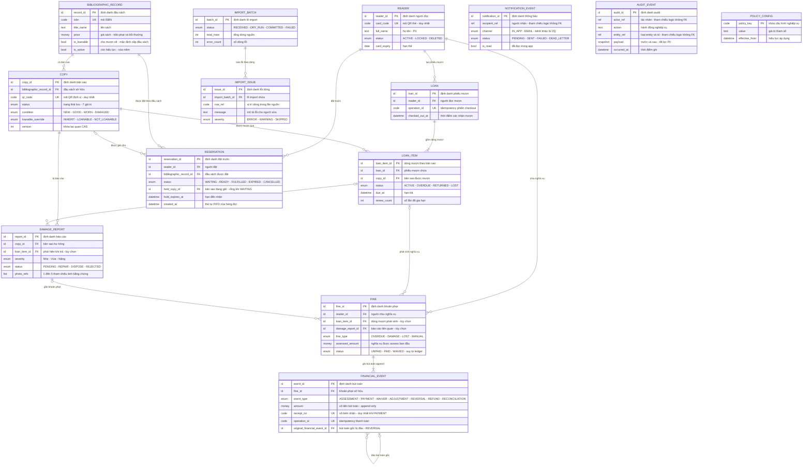

# Domain — ERD + Data Dictionary (draft Phase 4)

> Draft SRS Tier 2. File đích khi approved: `docs/_shared/domain/library-erd.md` (đã khai báo trong frontmatter `core-spec.md` §links).
>
> **Mức độ mô hình: data model nghiệp vụ.** Không chỉ định physical type, DB engine, index, phân vùng — đó là ranh giới SRS ↔ thiết kế kỹ thuật. Cột "Kiểu nghiệp vụ" dùng tập kiểu logic: `định danh`, `mã`, `văn bản`, `số nguyên`, `tiền (VND)`, `thời điểm`, `ngày`, `boolean`, `enum`, `tham chiếu logic`, `danh sách tham chiếu`, `snapshot`.

## 0. Quy ước đọc

| Nhãn | Nghĩa |
|------|-------|
| `FACT` | Có căn cứ trực tiếp: `docs/he_thong_quan_ly_thu_vien.md` (đặc biệt §7 Mô hình dữ liệu), roadmap baseline, FR/BR trong SRS spec. |
| `PROPOSAL` | Suy diễn để khép kín model — gắn decision id khi có (`DEC-D3-*`, `DEC-P2-*`). Không được xem là requirement. |
| `derived` | Giá trị tính toán, **không lưu** (quy tắc lưu-vs-tính ở `lifecycle-inventory.md` §1.1). |
| `[NEEDS CLARIFICATION]` / `OQ-core-NNN` | Chưa có nguồn; đăng ký ở Mục 6 và cần đưa vào `id-registry.md` + spec §12. |

Quy ước chung (áp cho mọi entity, không lặp trong từng bảng):

- Mọi entity nghiệp vụ có `created_at`/`updated_at` theo quy ước audit chung — `PROPOSAL` (chuẩn hóa; nguồn chỉ nêu `created_at` ở một số bảng). Field thời điểm mang nghĩa nghiệp vụ riêng (vd `Reservation.created_at` quyết định FIFO) vẫn liệt kê tường minh.
- Mọi cột `*_by` / `actor_ref` / `recipient_ref` là **tham chiếu logic** tới tài khoản người dùng hệ thống (Thủ thư / Quản trị viên / Người đọc / Hệ thống — theo mapping spec §2). Tài khoản hệ thống **không nằm trong 13 aggregate §8 của spec** (ERD này vẽ 14 node: 13 aggregate + `ImportIssue` tách từ `ImportBatch`) — vẽ như FK cứng sẽ sai phạm vi → không vẽ quan hệ, xem `OQ-core-005` (Mục 6).
- QR/barcode chỉ là **locator**, không phải credential (BR-copy-inventory-001, FR-copy-inventory-002) — `qr_code`, `card_code` là business key duy nhất, không mang quyền.
- Xóa mềm theo SRC-BR12: entity có lịch sử chỉ vô hiệu hóa (`status`/`is_active`), không xóa vật lý.
- Soft FK sang danh mục phụ trợ (`Author`, `Category`, `Publisher`, `Shelf`): nguồn §7 gọi là "danh mục phụ trợ"; ở mức SRS chỉ ghi nhận thuộc tính tham chiếu, không khai entity riêng.

## 1. ERD tổng

**Entity không vẽ quan hệ — chủ đích:**

- `AUDIT_EVENT`: record **append** — `entity_ref` trỏ bản ghi nghiệp vụ bất kỳ nhưng **không phải FK** (audit phải tồn tại độc lập vòng đời của entity bị audit, kể cả khi entity bị vô hiệu hóa/xóa mềm). FR-ops-foundation-001, `lifecycle-inventory.md` §1.1.
- `NOTIFICATION_EVENT`: `recipient_ref` có thể là Reader **hoặc** tài khoản nhân viên/thủ thư (sự kiện "có báo cáo hư hỏng mới → Thủ thư", nguồn §8) — tham chiếu logic, không FK; `related_ref` trỏ sự kiện nghiệp vụ nguồn cũng là ref logic.
- `POLICY_CONFIG`: tham số độc lập, `updated_by` là ref logic.

## 2. Cardinality nghiệp vụ

| Quan hệ | Bản số | Ràng buộc bổ sung | Nhãn | Nguồn |
|---------|--------|-------------------|------|-------|
| BibliographicRecord → Copy | 1 : 0..n | Mọi Copy thuộc đúng 1 đầu sách | FACT | nguồn §7 |
| Reader → Loan | 1 : 0..n | | FACT | nguồn §7 |
| Loan → LoanItem | 1 : 1..n | Phiếu ≥1 dòng; commit all-or-nothing (BR-checkout-001) | FACT tính nguyên tử / PROPOSAL tách dòng | FR-checkout-001; OQ-core-004 |
| Copy → LoanItem | 1 : 0..n | Tại một thời điểm **tối đa 1 LoanItem mở** trên một Copy (không double-loan, SRC-BR13/NFR-core-002) | FACT | nguồn §7; SC-checkout-02 |
| Reader → Reservation | 1 : 0..n | ≤ N đặt trước đang mở (default 3 — SRC-BR08); ≤1 reservation mở cho cùng một đầu sách (AT-RSV-02) | FACT + PROPOSAL | RES-T01 |
| BibliographicRecord → Reservation | 1 : 0..n | Đặt theo **đầu sách**, không theo bản sao; hàng đợi FIFO theo `created_at` (SRC-BR09) | FACT | nguồn §7 |
| Copy → Reservation (giữ chỗ) | 0..1 : 0..n (lịch sử) | `held_copy_id` chỉ có khi READY; tối đa 1 Reservation READY giữ cùng Copy (AT-RSV-02) | FACT + PROPOSAL | RES-T02; §2.2 |
| Reader → Fine | 1 : 0..n | | FACT | nguồn §7 |
| LoanItem → Fine | 0..1 : 0..n | Fine thường gắn dòng mượn (quá hạn/hư hỏng/mất); fine manual có thể không gắn | FACT + PROPOSAL | nguồn §7 (`loan_id`); §5.2 manual |
| DamageReport → Fine | 0..1 : 0..n | Disposition "fine-linked" (BR-damage-lifecycle-001); fine DAMAGE giữ độc lập khi thanh lý (DMG-T03) | PROPOSAL | §6 |
| Fine → FinancialEvent | 1 : 1..n | Mọi Fine mở bằng ≥1 `ASSESSMENT`; ledger **append-only** — không UPDATE/DELETE (BR-core-002) | FACT | §5.2; §7.3 |
| FinancialEvent → FinancialEvent | 0..1 : 0..n | `REVERSAL` trỏ `original_financial_event_id` của bút toán bị đảo | PROPOSAL | §5.2; OQ-fine-collection-adv-002 |
| Copy → DamageReport | 1 : 0..n | Tối đa 1 report `PENDING` trên một Copy — report lặp gộp vào report đang mở | FACT + PROPOSAL | §6 |
| LoanItem → DamageReport | 0..1 : 0..n | Link khi phát hiện hư hỏng lúc trả (DMG-T01) | FACT (field) / PROPOSAL (đổi tên từ `loan_id`) | nguồn §7; §6.4 |
| ImportBatch → ImportIssue | 1 : 0..n | Lỗi báo theo dòng, gắn đúng batch | FACT | FR-data-import-001 |
| (bất kỳ) → AuditEvent | không quan hệ | Record append; `entity_ref` là ref logic | FACT | FR-ops-foundation-001 |
| (bất kỳ) → NotificationEvent | không FK nghiệp vụ | `recipient_ref`, `related_ref` là ref logic | PROPOSAL | FR-notification-core-001; OQ-core-005 |
| (bất kỳ) → PolicyConfig | không quan hệ | Tham chiếu theo `policy_key` tại thời điểm dùng | FACT | FR-policy-config-001 |

## 3. Data dictionary

### 3.1 `BibliographicRecord` — Đầu sách (SRS alias của `Title`)

| Field | Kiểu nghiệp vụ | Khóa | Nhãn | Mô tả / nguồn |
|-------|----------------|------|------|----------------|
| `record_id` | định danh | PK | FACT | nguồn `Title.id` |
| `isbn` | mã | UK (duy nhất: PROPOSAL) | FACT field / PROPOSAL ràng buộc | FR-catalog-admin-001; nguồn không nói rõ unique |
| `title_name` | văn bản | — | FACT | nguồn `name` |
| `authors` | danh sách tham chiếu danh mục | — | FACT | n–n `Author` (nguồn §7); danh mục phụ trợ, không tách entity ở mức SRS |
| `categories` | danh sách tham chiếu danh mục | — | FACT | n–n `Category`; tra cứu theo thể loại SRC-FR-R02 |
| `publisher` | tham chiếu danh mục | — | FACT | nguồn `publisher_id` → `Publisher` phụ trợ |
| `publish_year` | năm | — | FACT | nguồn `year` |
| `price` | tiền (VND) | — | FACT | Cơ sở trần phạt SRC-BR05 và bồi thường SRC-BR06/SRC-BR07 |
| `cover_ref` | tham chiếu ảnh | — | FACT | nguồn `cover_url`; SRC-FR-L02 ảnh bìa |
| `description` | văn bản | — | FACT | FR-catalog-admin-001 |
| `is_loanable` | boolean | — | PROPOSAL | Mặc định loanability cấp đầu sách — DEC-D3-09, default OQ-10 |
| `is_active` | boolean | — | FACT | Ẩn/vô hiệu hóa (SRC-FR-L02, SRC-BR12) |
| `available_count` | số nguyên | — | **derived** | = số Copy `AVAILABLE` ∧ loanable hiệu dụng; **không lưu** — SRC-BR11, CP-AVL-01 |

### 3.2 `Copy` — Bản sao vật lý

| Field | Kiểu nghiệp vụ | Khóa | Nhãn | Mô tả / nguồn |
|-------|----------------|------|------|----------------|
| `copy_id` | định danh | PK | FACT | nguồn `Copy.id` |
| `bibliographic_record_id` | định danh | FK → BibliographicRecord | FACT | nguồn `title_id` (Title là alias của BibliographicRecord) |
| `qr_code` | mã | UK | FACT | Locator duy nhất (SRC-FR-L03, FR-copy-inventory-002); chỉ để định vị |
| `shelf` | tham chiếu danh mục | — | FACT | nguồn `shelf_id` → `Shelf` phụ trợ (vị trí kệ, SRC-FR-R02) |
| `condition` | enum(`NEW`,`GOOD`,`WORN`,`DAMAGED`) | — | FACT | Tình trạng vật lý; cập nhật khi trả/sửa xong |
| `status` | enum(`AVAILABLE`,`ON_LOAN`,`ON_HOLD`,`PENDING_REVIEW`,`IN_REPAIR`,`LOST`,`DISPOSED`) | — | FACT tên trạng thái / PROPOSAL ma trận transition | **Trạng thái LƯU duy nhất** của vòng đời — DEC-D3-01 |
| `loanable_override` | enum(`INHERIT`,`LOANABLE`,`NOT_LOANABLE`) | — | PROPOSAL | Override `BibliographicRecord.is_loanable` — DEC-D3-09; mặc định `INHERIT` |
| `version` | số nguyên | — | FACT | Khóa lạc quan CAS — SRC-BR13, NFR-core-002 |
| `acquired_at` | thời điểm | — | FACT | Ngày nhập kho |
| `effective_loanable` | boolean | — | **derived** | = `loanable_override` nếu ≠ INHERIT, ngược lại `Title.is_loanable` — CP-AVL-02 |

**Lưu-vs-tính (DEC-D3-09):** `status` là trạng thái lưu; "cho mượn được" = `status=AVAILABLE` ∧ `effective_loanable` ∧ không bị chặn rule khác (BR-checkout-002) — **không** phải trạng thái thứ 8 và không lưu.

### 3.3 `Reader` — Người đọc (SRS gộp `User` + `ReaderProfile` của nguồn ở mức nghiệp vụ)

| Field | Kiểu nghiệp vụ | Khóa | Nhãn | Mô tả / nguồn |
|-------|----------------|------|------|----------------|
| `reader_id` | định danh | PK | FACT | nguồn `User.id` / `ReaderProfile.user_id` |
| `card_code` | mã | UK | FACT | QR thẻ người đọc (SRC-FR-R03); validation: thuộc tài khoản còn hiệu lực, đã kích hoạt |
| `full_name` | văn bản | — | FACT | PII — mask theo quyền (NFR-core-004) |
| `email` | văn bản | — | FACT | PII; kênh đăng nhập/reset (SRC-FR-C01/C02) |
| `phone` | văn bản | — | FACT | PII |
| `dob` | ngày | — | FACT | PII — nguồn `ReaderProfile.dob` |
| `address` | văn bản | — | FACT | PII |
| `status` | enum(`ACTIVE`,`LOCKED`,`DELETED`) | — | FACT | DELETED = xóa mềm SRC-BR12; chặn xóa khi còn phiếu mở/nợ phạt (SRC-FR-L05); khóa/mở có lý do (FR-account-admin-002) |
| `card_expiry` | ngày | — | FACT | nguồn `expiry_date`; policy hạn 1 năm là default OQ-05 |
| `lock_reason` | văn bản | — | PROPOSAL | Lý do bắt buộc khi khóa (FR-account-admin-002) |
| `auth_account_ref` | tham chiếu logic | — | **[NEEDS CLARIFICATION: OQ-access-control-001 + OQ-core-005]** | Nguồn tách `User`(password_hash, role) ↔ `ReaderProfile`; SRS để ngỏ identity model — tách entity tài khoản hay gộp là quyết định thiết kế |
| `open_loan_count` / `open_reservation_count` / `fine_balance` | số nguyên / tiền | — | **derived** | Dùng cho BR-core-001 eligibility; tính từ Loan/Reservation/FinancialEvent, không lưu |

### 3.4 `Loan` — Phiếu mượn (header của một lần xác nhận nguyên tử)

Nhãn tổng entity: **PROPOSAL** — SRS §8 tách `Loan`/`LoanItem`; nguồn §7 mô hình một Loan = một bản sao và để mở OQ-06 "có cần phiếu cha". Header ở đây chính là "phiếu cha" tối thiểu để neo giao dịch all-or-nothing (BR-checkout-001) và in gộp. **OQ-core-004** (Mục 6).

| Field | Kiểu nghiệp vụ | Khóa | Nhãn | Mô tả / nguồn |
|-------|----------------|------|------|----------------|
| `loan_id` | định danh | PK | FACT | nguồn `Loan.id` |
| `reader_id` | định danh | FK → Reader | FACT | Chủ phiếu; đủ điều kiện BR-core-001 tại thời điểm xác nhận |
| `checked_out_at` | thời điểm | — | FACT | nguồn `borrowed_at` (mức phiếu) |
| `operation_id` | mã | UK | PROPOSAL | Idempotency phiên checkout — AT-CHK-02; replay trả kết quả gốc (E-core-005) |
| `created_by` | tham chiếu logic | — | FACT | Thủ thư xác nhận — nguồn `created_by` |
| `loan_status` | enum | — | **derived** | Trạng thái phiếu suy từ các LoanItem (còn dòng mở = phiếu mở) — không lưu, tránh 2 nguồn sự thật |

### 3.5 `LoanItem` — Dòng mượn theo bản sao (chủ thể vòng đời mượn)

Nhãn tổng entity: **PROPOSAL** (vị trí gắn hạn trả/gia hạn/trạng thái → OQ-core-004). Trạng thái kế thừa state machine Loan của nguồn.

| Field | Kiểu nghiệp vụ | Khóa | Nhãn | Mô tả / nguồn |
|-------|----------------|------|------|----------------|
| `loan_item_id` | định danh | PK | PROPOSAL | |
| `loan_id` | định danh | FK → Loan | PROPOSAL | |
| `copy_id` | định danh | FK → Copy | FACT | nguồn `Loan.copy_id`; unique trong phạm vi "đang mở" (chống double-loan) |
| `status` | enum(`ACTIVE`,`OVERDUE`,`RETURNED`,`LOST`) | — | FACT trạng thái / PROPOSAL gắn ở dòng | §5 nguồn; `RETURNED`/`LOST` terminal, không reopen (LOAN-T05) |
| `due_at` | thời điểm | — | FACT | = `checked_out_at` + policy `loan_days` tại thời điểm mượn (LOAN-T01) |
| `renew_count` | số nguyên | — | FACT | SRC-BR04 / FR-renewal-001; chặn khi quá hạn/có hàng chờ/vượt limit |
| `returned_at` | thời điểm | — | FACT | Đóng bằng trả (LOAN-T04) |
| `return_condition` | enum(`OK`,`DAMAGED`,`LOST`) | — | FACT field / PROPOSAL giá trị | Điều khiển nhánh Copy sau trả (D5); nguồn `return_condition` |
| `closed_by` | tham chiếu logic | — | FACT | Ai đóng phiếu — nguồn `closed_by` |

### 3.6 `Reservation` — Đặt trước + hàng đợi FIFO

| Field | Kiểu nghiệp vụ | Khóa | Nhãn | Mô tả / nguồn |
|-------|----------------|------|------|----------------|
| `reservation_id` | định danh | PK | FACT | |
| `reader_id` | định danh | FK → Reader | FACT | |
| `bibliographic_record_id` | định danh | FK → BibliographicRecord | FACT | Đặt theo đầu sách — nguồn `title_id` |
| `status` | enum(`WAITING`,`READY`,`FULFILLED`,`EXPIRED`,`CANCELLED`) | — | FACT | §5 nguồn; terminal: FULFILLED/EXPIRED/CANCELLED |
| `created_at` | thời điểm | — | FACT | Thứ tự hàng đợi FIFO (SRC-BR09, AT-RSV-05) |
| `held_copy_id` | định danh | FK → Copy (tùy chọn) | FACT | Chỉ set khi READY; một Copy tối đa 1 Reservation giữ (AT-RSV-02) |
| `hold_expires_at` | thời điểm | — | FACT | = thời điểm READY + `hold_hours` (default 48h — SRC-BR10, ngưỡng OQ-policy-config-001) |
| `queue_position` | số nguyên | — | **derived** | = rank theo `created_at` trong tập reservation mở của đầu sách — **không lưu** (AT-RSV-05) |

### 3.7 `Fine` — Nghĩa vụ tài chính (trạng thái & số dư suy từ ledger)

| Field | Kiểu nghiệp vụ | Khóa | Nhãn | Mô tả / nguồn |
|-------|----------------|------|------|----------------|
| `fine_id` | định danh | PK | FACT | |
| `reader_id` | định danh | FK → Reader | FACT | |
| `loan_item_id` | định danh | FK → LoanItem (tùy chọn) | PROPOSAL | nguồn `loan_id` — trỏ dòng mượn sau khi tách; fine manual không gắn — OQ-core-004 |
| `damage_report_id` | định danh | FK → DamageReport (tùy chọn) | PROPOSAL | Truy vết fine gắn báo cáo hư hỏng (BR-damage-lifecycle-001 "fine-linked") |
| `fine_type` | enum(`OVERDUE`,`DAMAGE`,`LOST`; `MANUAL`) | — | FACT 3 giá trị / PROPOSAL `MANUAL` | §5.2: assessment manual của Thủ thư là PROPOSAL |
| `assessed_amount` | tiền (VND) | — | FACT | Nghĩa vụ ban đầu (SRC-BR05/06/07 theo policy); assess bổ sung = event mới, không sửa field |
| `status` | enum(`UNPAID`,`PAID`,`WAIVED`) | — | FACT giá trị / PROPOSAL cơ chế | Suy từ ledger: `PAID` khi balance=0 do PAYMENT, `WAIVED` khi do WAIVER (§5.1); không có `PARTIALLY_PAID` (DEC-D3-04) |
| `balance` | tiền (VND) | — | **derived** | = ΣASSESSMENT + ΣADJUSTMENT(+) − ΣPAYMENT − ΣWAIVER − ΣADJUSTMENT(−) − ΣREVERSAL (§5.1); có thể cache **chỉ khi đối soát được** (AT-FIN-01) |
| `paid_at` | thời điểm | — | **derived** / PROPOSAL | Thời điểm balance về 0; nguồn lưu field này trên Fine |
| `collected_by` | — | — | đã chuyển | Nguồn đặt trên Fine; SRS đưa vào `PAYMENT` event (`actor_ref`) |

### 3.8 `FinancialEvent` — Bút toán append-only của Fine

| Field | Kiểu nghiệp vụ | Khóa | Nhãn | Mô tả / nguồn |
|-------|----------------|------|------|----------------|
| `event_id` | định danh | PK | FACT | |
| `fine_id` | định danh | FK → Fine | FACT | |
| `event_type` | enum(`ASSESSMENT`,`PAYMENT`,`WAIVER`,`ADJUSTMENT`,`REVERSAL`,`REFUND`,`RECONCILIATION`) | — | FACT bảng loại / PROPOSAL một số loại | §5.2: WAIVER/ADJUSTMENT/REVERSAL/REFUND/RECONCILIATION chờ finance — OQ-fine-collection-adv-001/OQ-fine-collection-adv-002, DEC-D3-04/08 |
| `amount` | tiền (VND, có dấu ±) | — | FACT | Chiều tiền theo bảng §5.2; `RECONCILIATION` = 0 |
| `reason` | văn bản | — | PROPOSAL | Bắt buộc cho WAIVER/ADJUSTMENT/REVERSAL/REFUND (§5.2) |
| `receipt_no` | mã | UK | PROPOSAL | Phát hành duy nhất cho `PAYMENT` — DEC-D3-08, AT-FIN-02 |
| `operation_id` | mã | UK | PROPOSAL | Idempotency thanh toán — BR-fine-collection-basic-001; double-submit không tạo 2 PAYMENT (E-fine-collection-basic-002) |
| `original_financial_event_id` | định danh | FK → FinancialEvent (tùy chọn) | PROPOSAL | `REVERSAL` trỏ bút toán gốc bị đảo — §5.2, ledger integrity #1 |
| `actor_ref` | tham chiếu logic | — | FACT | Hệ thống (auto-assess) hoặc staff; SoD: người duyệt WAIVER/ADJUSTMENT ≠ người tạo ASSESSMENT thủ công (DEC-D3-04) |
| `occurred_at` | thời điểm | — | FACT | |

**Ràng buộc ledger:** append-only — không UPDATE/DELETE (BR-core-002, AT-FIN-01); ghi cùng transaction với business action (integrity #2); reconcile job đối chiếu `Fine.balance` vs Σ events, lệch → `RECONCILIATION` + cảnh báo (AT-FIN-03).

### 3.9 `DamageReport` — Báo cáo hư hỏng/mất

| Field | Kiểu nghiệp vụ | Khóa | Nhãn | Mô tả / nguồn |
|-------|----------------|------|------|----------------|
| `report_id` | định danh | PK | FACT | |
| `copy_id` | định danh | FK → Copy | FACT | |
| `loan_item_id` | định danh | FK → LoanItem (tùy chọn) | FACT field / PROPOSAL đổi tên | nguồn `loan_id` — link khi phát hiện lúc trả (DMG-T01) |
| `reported_by` | tham chiếu logic | — | FACT | Thủ thư tạo |
| `severity` | enum(`MINOR`/`MODERATE`/`SEVERE` = Nhẹ/Vừa/Nặng) | — | FACT | §6.4 nguồn; ánh xạ % bồi thường SRC-BR07 là policy |
| `note` | văn bản | — | FACT | |
| `photo_refs` | danh sách tham chiếu (1–5 phần tử) | — | FACT | SRC-NFR05: chỉ lưu tham chiếu object-storage, ≤500KB/ảnh; qua trust boundary BR-damage-lifecycle-002. Nhúng list hay tách entity `Attachment` — **OQ-damage-lifecycle-001** |
| `status` | enum(`PENDING`,`REPAIR`,`DISPOSE`,`REJECTED`) | — | FACT | §7 nguồn; terminal cho report — Copy đi tiếp theo disposition |
| `reviewed_by` | tham chiếu logic | — | FACT | Thủ thư duyệt (SRC-FR-L08) |
| `reviewed_at` | thời điểm | — | FACT | |

**Ràng buộc:** tối đa 1 report `PENDING` trên một Copy (PROPOSAL §6); report chỉ đóng khi có disposition + audit (BR-damage-lifecycle-001); disposition `REJECTED` khôi phục trạng thái lưu trước đó nếu còn hợp lệ (DMG-T04 — phần khôi phục là PROPOSAL).

### 3.10 `NotificationEvent` — Outbox thông báo bền

| Field | Kiểu nghiệp vụ | Khóa | Nhãn | Mô tả / nguồn |
|-------|----------------|------|------|----------------|
| `notification_id` | định danh | PK | FACT | nguồn `Notification.id` |
| `recipient_ref` | tham chiếu logic | — | FACT khái niệm / PROPOSAL kiểu | Người nhận = Reader **hoặc** staff (báo hư hỏng → Thủ thư) — không FK cứng; OQ-core-005 |
| `notif_type` | enum theo bảng sự kiện | — | FACT | loan_created / due_soon / overdue / hold_ready / hold_expired / fine_created / damage_reported / account_locked (nguồn §8) |
| `channel` | enum(`IN_APP`,`EMAIL`; `SMS`,`PUSH`,`ZALO`) | — | FACT `IN_APP` / PROPOSAL `EMAIL` / mở `SMS`,`PUSH`,`ZALO` | OQ-07 default in-app+email; DEC-P2-01; kênh khác OQ-notification-core-001 → R3 |
| `content` | văn bản | — | FACT | |
| `is_read` | boolean | — | FACT | Đánh dấu đã đọc in-app (SRC-FR-C04) |
| `status` | enum(`PENDING`,`SENT`,`FAILED`,`DEAD_LETTER`) | — | PROPOSAL | Vòng đời outbox — FR-notification-core-001, NFR-notification-core-001 |
| `retry_count` | số nguyên | — | PROPOSAL | Retry có kiểm soát; vượt ngưỡng → dead-letter + cảnh báo vận hành (§4 — kênh escalation thuộc DEC-D3-08) |
| `sent_at` | thời điểm | — | FACT | |
| `related_ref` | tham chiếu logic | — | PROPOSAL | Sự kiện nghiệp vụ nguồn — truy vết FR-notification-audit-ui-003 |
| `created_at` | thời điểm | — | PROPOSAL | Ghi cùng commit của business event (BR-core-005) |

**Ràng buộc:** notification không làm fail business transaction (BR-core-005, SC-notification-core-01) — ghi outbox trong transaction, delivery retry sau.

### 3.11 `AuditEvent` — Nhật ký kiểm toán (append, **không quan hệ FK**)

| Field | Kiểu nghiệp vụ | Khóa | Nhãn | Mô tả / nguồn |
|-------|----------------|------|------|----------------|
| `audit_id` | định danh | PK | FACT | nguồn `AuditLog.id` |
| `actor_ref` | tham chiếu logic | — | FACT | nguồn `actor_id` — **không FK**: audit sống độc lập với tài khoản bị khóa/xóa |
| `action` | văn bản | — | FACT | Hành động nghiệp vụ nhạy cảm |
| `entity_ref` | tham chiếu logic | — | FACT | nguồn `entity` + `entity_id` — **không FK**: trỏ mọi entity, kể cả bản ghi đã vô hiệu hóa |
| `payload` | snapshot trước/sau | — | FACT | nguồn `before`/`after`; **đã lọc PII/secret** (NFR-core-008) |
| `reason` | văn bản | — | FACT (tùy chọn) | "lý do khi có" — FR-ops-foundation-001 |
| `occurred_at` | thời điểm | — | FACT | nguồn `at` |
| `operation_id` | mã | — | PROPOSAL | Gom audit theo transaction/checkout để truy vết atomic group |

**Ràng buộc:** ghi **cùng transaction** với sensitive action; audit write fail → business write rollback (BR-core-003, NFR-core-005, AT-CHK-04). Chỉ đọc (SRC-FR-L10); không cập nhật/xóa.

### 3.12 `PolicyConfig` — Cấu hình nghiệp vụ (SRS alias của `Setting`)

| Field | Kiểu nghiệp vụ | Khóa | Nhãn | Mô tả / nguồn |
|-------|----------------|------|------|----------------|
| `policy_key` | mã | PK (business key) | FACT | nguồn `Setting.key` — tham chiếu bằng key, không FK |
| `value` | văn bản | — | FACT | Giá trị tham số — ngưỡng thật là OQ-policy-config-001 |
| `effective_from` | thời điểm | — | PROPOSAL | Cấu hình chỉ áp cho giao dịch **bắt đầu sau** thời điểm hiệu lực (baseline §6.5) — Loan đã tạo giữ quy định lúc mượn |
| `updated_by` | tham chiếu logic | — | FACT | |
| `updated_at` | thời điểm | — | FACT | |

**Key catalog kỳ vọng** (tên key PROPOSAL, giá trị default theo §4/§7.2 baseline — chờ OQ-policy-config-001):

| `policy_key` (đề xuất) | Rule | Default proposal |
|---|---|---|
| `loan_max_open` | SRC-BR01 | 5 bản sao — chốt (DEC-SF-10) |
| `loan_days` | SRC-BR04 | 14 ngày — chốt (DEC-SF-10) |
| `renew_max_count` / `renew_extra_days` | SRC-BR04 | 1 lần / +7 ngày |
| `fine_overdue_per_day` / `fine_overdue_cap` | SRC-BR05 | 2.000đ/ngày / = giá sách |
| `lost_compensation_pct` / `lost_fee_flat` | SRC-BR06 | 100% giá + phí xử lý |
| `damage_pct_minor/moderate/severe` | SRC-BR07 | 0% / 30% / 100% giá |
| `reservation_max_open` | SRC-BR08 | 3 đặt trước |
| `hold_hours` | SRC-BR10 | 48 giờ |
| `fine_block_threshold` | SRC-BR03 | 50.000đ — chốt (DEC-SF-10) |

### 3.13 `ImportBatch` — Lô nhập liệu + đối soát

| Field | Kiểu nghiệp vụ | Khóa | Nhãn | Mô tả / nguồn |
|-------|----------------|------|------|----------------|
| `batch_id` | định danh | PK | FACT | FR-data-import-001 |
| `file_ref` | tham chiếu file | — | FACT khái niệm / PROPOSAL field | File Excel đại diện — **không suy đoán schema** (constraint §11, OQ-data-import-001) |
| `target_type` | enum(`BIBLIOGRAPHIC`,`COPY`; mở rộng `READER`) | — | PROPOSAL | OQ-15 default: import đầu sách + bản sao |
| `mode` | enum(`DRY_RUN`,`COMMIT`) | — | PROPOSAL | Dry-run trước commit — BR-data-import-001 |
| `status` | enum(`RECEIVED`,`DRY_RUN`,`COMMITTED`,`FAILED`) | — | PROPOSAL | Tối thiểu biểu đạt được dry-run/commit/fail; giá trị chi tiết chờ use case import chốt |
| `total_rows` | số nguyên | — | FACT | Đối soát số lượng (NFR-data-import-001) |
| `ok_count` / `error_count` / `skipped_count` | số nguyên | — | FACT | Reconcile phải đối chiếu số lượng + lỗi + bỏ qua (BR-data-import-001) |
| `uploaded_by` | tham chiếu logic | — | FACT | Quản trị viên chạy import |
| `committed_at` | thời điểm | — | PROPOSAL | Chỉ commit khi dry-run pass hoặc override được duyệt |
| `override_approved_by` | tham chiếu logic (tùy chọn) | — | PROPOSAL | Commit với override cần phê duyệt — BR-data-import-001 |

### 3.14 `ImportIssue` — Lỗi theo dòng của batch

| Field | Kiểu nghiệp vụ | Khóa | Nhãn | Mô tả / nguồn |
|-------|----------------|------|------|----------------|
| `issue_id` | định danh | PK | PROPOSAL | Entity do SRS §8 tách |
| `import_batch_id` | định danh | FK → ImportBatch | FACT | |
| `row_ref` | mã | — | FACT | Vị trí dòng trong file nguồn — "lỗi theo dòng" (FR-data-import-001) |
| `severity` | enum(`ERROR`,`WARNING`,`SKIPPED`) | — | PROPOSAL | Phân biệt dòng lỗi vs bỏ qua (BR-data-import-001) |
| `issue_code` | mã | — | PROPOSAL | Loại lỗi: validation / duplicate / missing_ref… |
| `message` | văn bản | — | FACT | Mô tả để người dùng sửa file và dry-run lại (E-data-import-001) |

## 4. Quy tắc xuyên entity (không được vi phạm khi thiết kế)

| # | Quy tắc | Nhãn | Nguồn |
|---|---------|------|-------|
| X1 | `Fine.balance`, `Fine.status`, `paid_at` suy từ `FinancialEvent` — **không sửa trực tiếp**, chỉ append event; sửa sai = `REVERSAL` trỏ event gốc | FACT nguyên tắc / PROPOSAL công thức | §5.1–5.2; BR-core-002 |
| X2 | `AuditEvent` ghi cùng transaction, **không FK** tới entity bị audit (ref logic); audit fail → rollback business write | FACT | BR-core-003; NFR-core-005 |
| X3 | `Copy.status` là trạng thái **lưu** (7 giá trị); `is_loanable` là **thuộc tính** — mặc định ở `BibliographicRecord`, override ở `Copy` (`INHERIT`/`LOANABLE`/`NOT_LOANABLE`); đổi loanable không phải transition nhưng vẫn audit | PROPOSAL | DEC-D3-09; CP-AVL-02/03 |
| X4 | Số khả dụng, vị trí hàng đợi, số ngày quá hạn, balance — **derived**, không lưu counter | FACT | SRC-BR11; §1.1; AT-RSV-05 |
| X5 | `PAYMENT` có `receipt_no` duy nhất + `operation_id` duy nhất; replay trả kết quả gốc | PROPOSAL | DEC-D3-08; AT-FIN-02; BR-fine-collection-basic-001 |
| X6 | Một Copy tối đa: 1 LoanItem mở, 1 Reservation `READY` giữ, 1 DamageReport `PENDING` | FACT + PROPOSAL | SRC-BR13; AT-RSV-02; §6 |
| X7 | Reservation allocation/expiry và chuyển trạng thái Copy là **một** transaction nguyên tử (CAS trên cả hai aggregate) | PROPOSAL | AT-RSV-01/04; BR-reservation-001/BR-reservation-002 |
| X8 | Checkout nhiều bản sao all-or-nothing qua `Loan.operation_id`; `Copy.version` là CAS | FACT + PROPOSAL | BR-checkout-001; AT-CHK-02/03 |
| X9 | `NotificationEvent`/`AuditEvent`/`PolicyConfig` không có FK nghiệp vụ — quan hệ với các entity khác là ref logic hoặc policy key | FACT + PROPOSAL | FR-notification-core-001/FR-ops-foundation-001/FR-policy-config-001 |

## 5. Ranh giới & caveat

- **Import schema:** không suy đoán cột/mapping Excel — chờ file mẫu (OQ-data-import-001, constraint §11, GATE-MIG). `ImportBatch`/`ImportIssue` ở đây chỉ mô hình vòng đời batch + lỗi theo dòng, không phải schema file.
- **Identity model:** Reader ở mức nghiệp vụ; account đăng nhập (credential, role, SSO/IdP) là OQ-access-control-001; mọi ref tới staff account là OQ-core-005.
- **Release boundary:** Reservation trọn vòng thuộc R2 (DEC-P2-05) — entity vẫn mô hình đầy đủ nhưng hành vi queue advance/hold chỉ bắt buộc ở R2.
- **Entity nguồn cố ý không đưa vào §8:** `Author`/`Category`/`Publisher`/`Shelf` (danh mục phụ trợ — giữ ở mức tham chiếu); `Attendance` (phụ thuộc OQ-02, ngoài scope); `User`/`ReaderProfile`/`Setting`/`Notification`/`AuditLog` đã ánh xạ sang tên SRS.

## 6. OQ phát sinh & registry (cần main thread cập nhật `id-registry.md` + spec §12)

| OQ | Nội dung | Owner đề xuất | Gate |
|----|----------|---------------|------|
| **OQ-core-004** | Ngữ nghĩa `Loan`↔`LoanItem`: header phiếu + dòng theo bản sao; hạn trả/gia hạn/trạng thái gắn ở **dòng** (đề xuất); xác nhận thay đổi so với default OQ-06 ("không phiếu cha") — ảnh hưởng `Fine.loan_item_id`, `DamageReport.loan_item_id` | Domain approver (Thủ thư trưởng) | Trước khi khóa ERD/SRS states |
| **OQ-core-005** | Actor reference: mọi `*_by`/`actor_ref`/`recipient_ref` trỏ tài khoản hệ thống (staff/admin) không nằm trong 13 entity §8 — cần entity tài khoản hay giữ ref logic? Liên quan OQ-access-control-001 (identity) và OQ-01 (role Admin) | Security/IT + domain | Trước khi khóa ERD |
| **OQ-damage-lifecycle-001** | `DamageReport.photo_refs`: list nhúng hay entity `Attachment` riêng (lifecycle ảnh, retention/PII — OQ-core-003) | Domain/tech + privacy | Trước thiết kế physical |

OQ hiện hữu được tham chiếu (không mở mới): OQ-data-import-001 (schema import), OQ-fine-collection-adv-001/OQ-fine-collection-adv-002 (financial policy, reversal/refund/reconcile), OQ-core-003 (retention/PII), OQ-access-control-001 (identity), OQ-notification-core-001 (kênh notify), OQ-policy-config-001 (ngưỡng policy), OQ-core-002 (lifecycle reconstruction), OQ-05 (hạn thẻ), OQ-06 (phiếu cha), OQ-10 (is_loanable), OQ-15 (import đầu sách+bản sao).

## 7. Traceability nén

| Quyết định/constraint | Ảnh hưởng lên ERD |
|---|---|
| DEC-D3-08 | `receipt_no` UK trên `FinancialEvent`; `RECONCILIATION` type |
| DEC-D3-09 | `BibliographicRecord.is_loanable` + `Copy.loanable_override` (không phải status) |
| DEC-D3-04/05 + OQ-fine-collection-adv-001/OQ-fine-collection-adv-002 | `WAIVER`/`ADJUSTMENT`/`REVERSAL`/`REFUND`/`RECONCILIATION`, `reason`, `original_financial_event_id`, SoD ghi chú |
| DEC-P2-01 | `NotificationEvent.channel` = IN_APP (+EMAIL); SMS/push/Zalo mở |
| DEC-P2-05 | Reservation vẫn đủ model; hành vi queue là scope R2 |
| AT-CHK-02 | `Loan.operation_id` UK |
| AT-FIN-02/03 | `FinancialEvent.operation_id` UK; RECONCILIATION |
| BR-data-import-001 / NFR-data-import-001 | `ImportBatch` counters + `mode` + `override_approved_by`; `ImportIssue` theo dòng |
| SRC-BR12 | `is_active`/`status=DELETED` — không hard delete |
| SRC-NFR05 / BR-damage-lifecycle-002 | `photo_refs` = tham chiếu storage, không lưu binary |

> Kiểm chứng bằng máy: mermaid block ở Mục 1 đã pass lint/compile (xem phần kết quả verify trong báo cáo phiên). Cardinality/đúng nghiệp vụ đã tự đối chiếu spec — máy không kiểm phần này.

