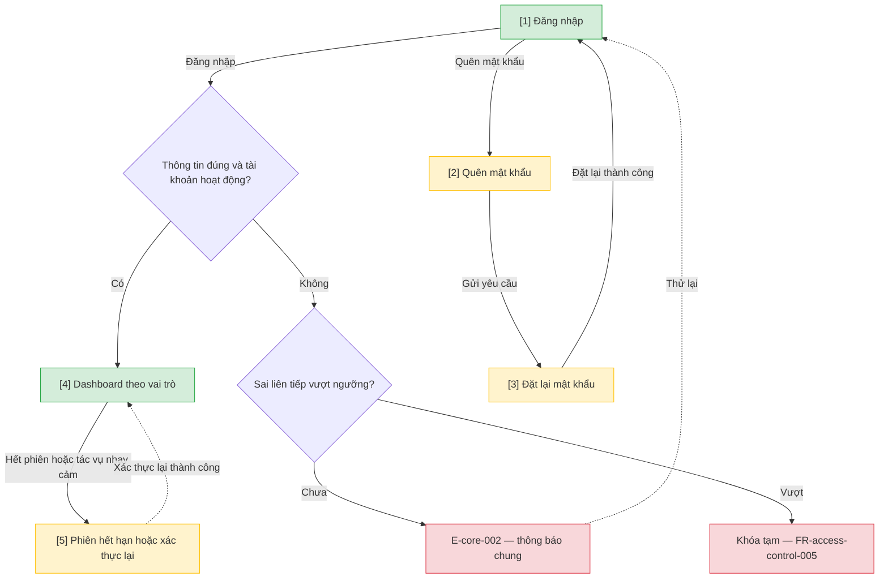

# Đăng nhập và phân quyền — User Flow

## 1. User Flow

### Flow: auth-flow — R0

## 2. Danh sách màn hình

| [#] | Slug | Màn hình | Mục đích | Thuộc flow |
|-----|------|----------|----------|------------|
| 1 | access-login | Đăng nhập | Xác thực bằng email hoặc mã thẻ và mật khẩu. | auth-flow |
| 2 | forgot-password | Quên mật khẩu | Yêu cầu link đặt lại mật khẩu; thông báo như nhau dù email có tồn tại hay không. | auth-flow |
| 3 | reset-password | Đặt lại mật khẩu | Đặt mật khẩu mới bằng link còn hiệu lực. | auth-flow |
| 4 | dashboard-home | Dashboard theo vai trò | Điểm vào sau đăng nhập, chỉ hiện chức năng có quyền. | auth-flow |
| 5 | session-expired | Phiên hết hạn / xác thực lại | Xác thực lại rồi quay về màn đang làm. | auth-flow |

## 3. Danh sách flow

| Flow-slug | Tên flow | Màn hình gồm |
|-----------|----------|--------------|
| auth-flow | Xác thực và điều hướng | access-login → forgot-password → reset-password → dashboard-home → session-expired |

## 3.5. Chuyển màn (transitions)

Chuyển màn sang feature khác xem `docs/_shared/navigation-map.md`.

| Từ màn [#] | Đến màn [#] | Trigger | Điều kiện |
|-----------|------------|---------|-----------|
| Đăng nhập [1] | Dashboard [4] | Đăng nhập | Thông tin đúng, tài khoản hoạt động. |
| Đăng nhập [1] | (giữ nguyên) [1] | Đăng nhập | E-core-002; vượt ngưỡng thì khóa tạm. |
| Đăng nhập [1] | Quên mật khẩu [2] | Chọn Quên mật khẩu | Luôn. |
| Quên mật khẩu [2] | Đặt lại mật khẩu [3] | Mở link trong email | Link còn hiệu lực. |
| Đặt lại mật khẩu [3] | Đăng nhập [1] | Đặt lại thành công | Mật khẩu mới hợp lệ. |
| Dashboard [4] | Phiên hết hạn [5] | Hết phiên hoặc tác vụ nhạy cảm | E-access-control-001. |
| Phiên hết hạn [5] | Dashboard [4] | Xác thực lại | Thành công; quay về màn an toàn. |

## 4. Open Questions

- [ ] OQ-access-control-001 — Mô hình danh tính (có SSO thì thêm nhánh chuyển sang dịch vụ danh tính).
