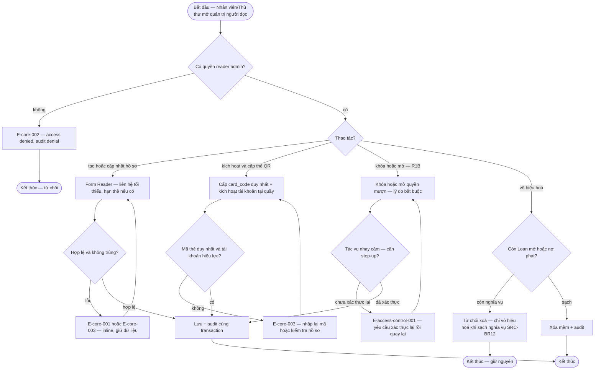

# account-admin — Flows

## Flow: Quản trị người đọc

**Trigger:** Nhân viên/Thủ thư quản lý hồ sơ người đọc; Nhân viên kích hoạt thẻ tại quầy. · **UC:** uc-account-admin · **Release:** R0 (tạo/cập nhật/kích hoạt) + R1B (khóa/mở giới hạn — FR-account-admin-002, SRC-FR-S10)

**Nhãn:** CRUD người đọc, chặn xoá khi còn phiếu mở/nợ phạt là FACT (SRC-FR-L05). Kích hoạt tại quầy sau đăng ký là FACT (default OQ-03). Khóa/mở có lý do bắt buộc + audit là PROPOSAL (FR-account-admin-002, SRC-FR-S10). PII masking theo quyền field là FACT về yêu cầu, policy retention/masking là Open (OQ-core-003). Identity model là Open (OQ-access-control-001).

### Bảng bước F2

| Bước | Actor | Quyết định / điều kiện | Phản hồi hệ thống | Error path |
|------|-------|------------------------|--------------------|------------|
| 1 | Nhân viên/Thủ thư | Kiểm quyền; field PII áp `actor × resource × action × field × purpose` | Màn hình list/form; PII mask khi thiếu quyền field | E-core-002, E-core-009 — deny + audit access attempt |
| 2 | Nhân viên/Thủ thư | Tạo/cập nhật hồ sơ | Validate + lưu | E-core-001/E-core-003 — giữ dữ liệu cho sửa |
| 3 | Nhân viên/Thủ thư | Kích hoạt + cấp `card_code` (QR locator) | Reader `active`, mượn được theo BR-core-001 | E-core-003 — mã trùng/không tồn tại |
| 4 | Nhân viên/Thủ thư | Khóa/mở quyền mượn — lý do bắt buộc (R1B; quyền theo ma trận nguồn §2 — FACT) | Reader trạng thái block; chặn ở D1 checkout; notify "tài khoản bị khóa/mở" | E-core-008 — thao tác không hợp lệ từ trạng thái hiện tại; E-access-control-001 step-up nếu phiên yếu |
| 5 | Thủ thư | Vô hiệu hoá (xóa mềm) | Chỉ khi không còn Loan mở và nợ phạt (SRC-BR12, SRC-FR-L05) | Còn nghĩa vụ → từ chối, giải thích lý do |
| 6 | Hệ thống | Mọi ghi: audit cùng TX (INV-01) | AuditEvent có actor/thời điểm/trước-sau/lý do | E-core-007 — audit fail → rollback |

**Liên kết:** FR-reader-onboarding-001, FR-account-admin-002, FR-access-control-001, FR-access-control-002, FR-notification-core-001 (notify khóa/mở), FR-ops-foundation-001 · BR-core-003, BR-core-004 · OQ-core-003 (retention/masking), OQ-access-control-001 (identity model).
