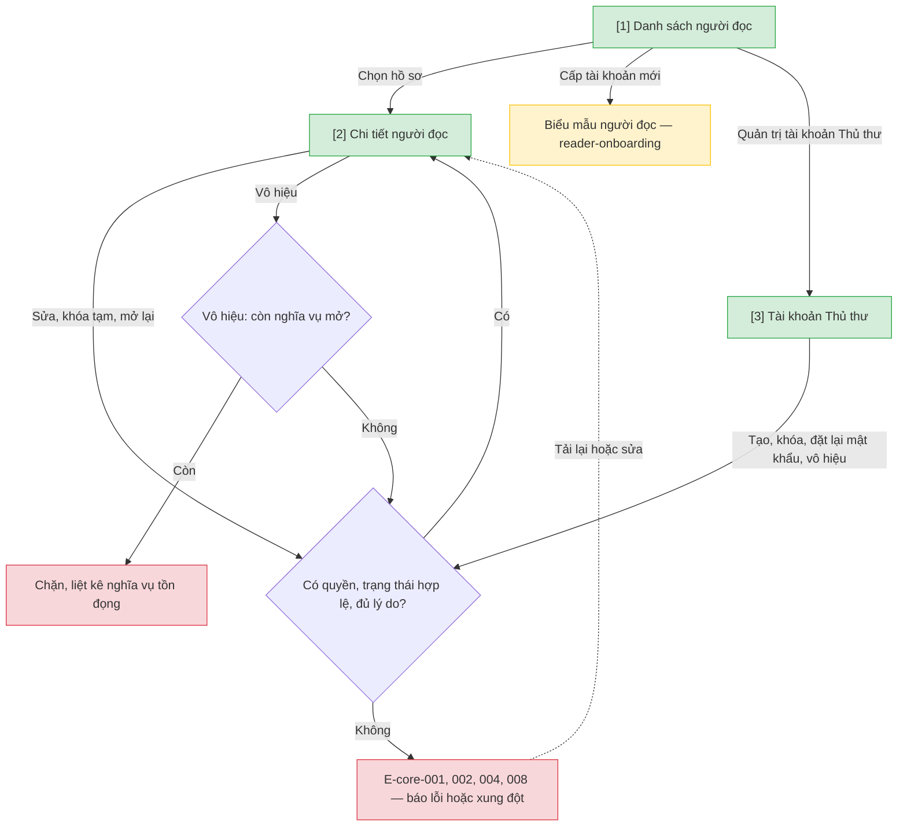

# Quản trị tài khoản — User Flow

## 1. User Flow

### Flow: account-admin-flow — R0/R1B

## 2. Danh sách màn hình

| [#] | Slug | Màn hình | Mục đích | Thuộc flow |
|-----|------|----------|----------|------------|
| 1 | reader-list | Danh sách người đọc | Tra cứu tài khoản người đọc, dữ liệu cá nhân che theo quyền. | account-admin-flow |
| 2 | reader-detail | Chi tiết người đọc | Hồ sơ, khoản đang mượn, đặt trước, công nợ; sửa, khóa tạm, mở lại, vô hiệu. | account-admin-flow |
| 3 | staff-accounts | Tài khoản Thủ thư | Quản trị viên tạo, khóa, đặt lại mật khẩu, vô hiệu tài khoản Thủ thư (mới). | account-admin-flow |

## 3. Danh sách flow

| Flow-slug | Tên flow | Màn hình gồm |
|-----------|----------|--------------|
| account-admin-flow | Quản trị tài khoản người đọc và Thủ thư | reader-list → reader-detail → staff-accounts |

## 3.5. Chuyển màn (transitions)

Chuyển màn sang feature khác xem `docs/_shared/navigation-map.md`.

| Từ màn [#] | Đến màn [#] | Trigger | Điều kiện |
|-----------|------------|---------|-----------|
| Danh sách người đọc [1] | Chi tiết người đọc [2] | Chọn hồ sơ | Hồ sơ tồn tại. |
| Danh sách người đọc [1] | Biểu mẫu người đọc (`reader-onboarding`) | Cấp tài khoản mới | Có quyền cấp. |
| Chi tiết người đọc [2] | (giữ nguyên) [2] | Sửa, khóa tạm, mở lại, vô hiệu | Lý do bắt buộc; E-core-004/008 hiển thị tại chỗ. |
| Danh sách người đọc [1] | Tài khoản Thủ thư [3] | Quản trị tài khoản Thủ thư | Chỉ Quản trị viên. |

## 4. Open Questions

- [ ] OQ-account-admin-001 — Quản lý tài khoản Quản trị viên.
