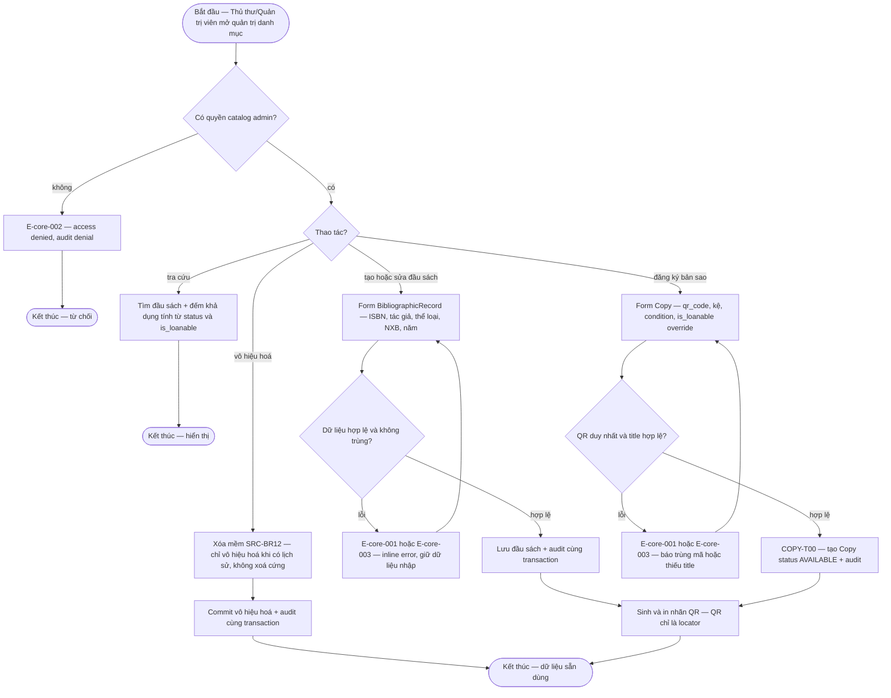

# catalog-admin — Flows

## Flow: Quản trị danh mục và bản sao

**Trigger:** Thủ thư/Quản trị viên mở chức năng quản trị danh mục hoặc kho bản sao. · **UC:** uc-catalog-admin · **Release:** R0 (tra cứu khả dụng vận hành từ R1A — FR-catalog-admin-002)

**Nhãn:** CRUD đầu sách/bản sao/danh mục + in QR là FACT (SRC-FR-L02/L03/L04, FR-catalog-admin-001/FR-copy-inventory-001). `is_loanable` là thuộc tính Title/Copy là PROPOSAL (DEC-D3-09, theo default OQ-10). Số khả dụng là giá trị tính toán từ `Copy.status` + `is_loanable`, không lưu counter — FACT (SRC-BR11). Copy `∅→AVAILABLE` khi đăng ký/import là PROPOSAL (COPY-T00 — DEC-D3-01).

### Bảng bước F1

| Bước | Actor | Quyết định / điều kiện | Phản hồi hệ thống | Error path |
|------|-------|------------------------|--------------------|------------|
| 1 | Thủ thư/Quản trị viên | Kiểm quyền `actor × resource × action` | Cho vào màn hình quản trị | E-core-002 — deny + audit denial (BR-core-004) |
| 2 | Thủ thư | Chọn tra cứu / tạo-sửa đầu sách / đăng ký bản sao / vô hiệu hoá | Render form hoặc kết quả tương ứng | E-core-009 — field PII/tài chính bị mask nếu thiếu quyền field |
| 3 | Hệ thống | Validate form: trường bắt buộc, định dạng ISBN, unique business key | Inline error hoặc cho lưu | E-core-001 (validation), E-core-003 (trùng/không tồn tại) — giữ dữ liệu, cho sửa lại |
| 4 | Hệ thống | Commit: lưu record (+ Copy `∅→AVAILABLE` nếu đăng ký bản sao) + AuditEvent — một transaction (INV-01) | Record sẵn dùng; số khả dụng tính lại | Audit fail → rollback + E-core-007 |
| 5 | Thủ thư | Sinh/in nhãn QR cho bản sao mới | File in nhãn; QR gắn locator, không phải credential (BR-copy-inventory-001) | QR sai/mờ/trùng (edge case §6.5) → nhập mã thủ công hoặc in lại |
| 6 | Thủ thư | Sửa/xoá record đã có lịch sử | Chỉ cho vô hiệu hoá (xóa mềm SRC-BR12); Copy `DISPOSED` là terminal | E-core-008 — action không hợp lệ từ trạng thái hiện tại |

**Liên kết:** FR-catalog-admin-001, FR-copy-inventory-001, FR-catalog-admin-002, FR-ops-foundation-001, FR-copy-inventory-002 · BR-copy-inventory-001, BR-core-003, BR-core-004 · NFR-catalog-admin-001 (tra cứu ≤2s @50.000 bản sao — ngưỡng PROPOSAL) · transitions: COPY-T00, COPY-T17.
