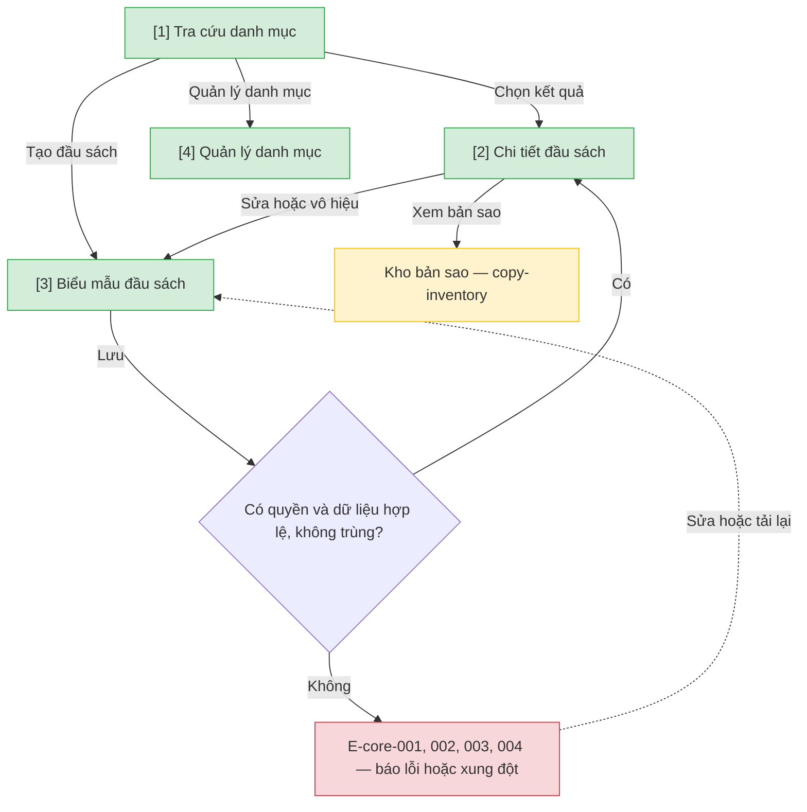

# Danh mục và đầu sách — User Flow

## 1. User Flow

### Flow: catalog-admin-flow — R0

## 2. Danh sách màn hình

| [#] | Slug | Màn hình | Mục đích | Thuộc flow |
|-----|------|----------|----------|------------|
| 1 | catalog-search | Tra cứu danh mục | Tìm đầu sách, xem số bản theo trạng thái. | catalog-admin-flow |
| 2 | bibliographic-detail | Chi tiết đầu sách | Thông tin đầu sách, số bản khả dụng, vị trí kệ. | catalog-admin-flow |
| 3 | bibliographic-form | Biểu mẫu đầu sách | Tạo, sửa, vô hiệu đầu sách. | catalog-admin-flow |
| 4 | category-admin | Quản lý danh mục | Thể loại, tác giả, nhà xuất bản, vị trí kệ (mới). | catalog-admin-flow |

## 3. Danh sách flow

| Flow-slug | Tên flow | Màn hình gồm |
|-----------|----------|--------------|
| catalog-admin-flow | Đầu sách và danh mục | catalog-search → bibliographic-detail → bibliographic-form → category-admin |

## 3.5. Chuyển màn (transitions)

Chuyển màn sang feature khác xem `docs/_shared/navigation-map.md`.

| Từ màn [#] | Đến màn [#] | Trigger | Điều kiện |
|-----------|------------|---------|-----------|
| Tra cứu danh mục [1] | Chi tiết đầu sách [2] | Chọn kết quả | Bản ghi tồn tại. |
| Tra cứu danh mục [1] | Biểu mẫu đầu sách [3] | Tạo mới | Có quyền. |
| Chi tiết đầu sách [2] | Biểu mẫu đầu sách [3] | Sửa/vô hiệu | Có quyền; BR-core-006. |
| Biểu mẫu đầu sách [3] | Chi tiết đầu sách [2] | Lưu | Hợp lệ, không trùng. |
| Chi tiết đầu sách [2] | Kho bản sao (`copy-inventory`) | Xem bản sao | Luôn. |
| Tra cứu danh mục [1] | Quản lý danh mục [4] | Quản lý danh mục | Chỉ Quản trị viên. |

## 4. Open Questions

- [ ] OQ-catalog-admin-001 — Bộ trường bắt buộc và quy tắc ISBN.
