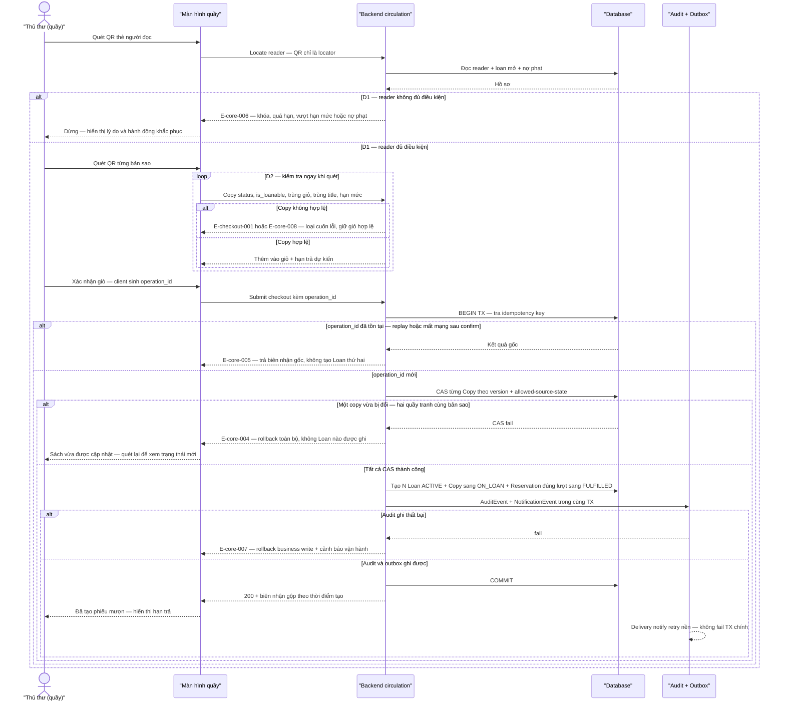

# checkout — Flows

## Flow: Mượn tại quầy nguyên tử, xử lý trùng và tranh chấp

**Trigger:** Thủ thư/Quản trị viên tạo phiếu mượn tại quầy. · **UC:** uc-checkout · **Release:** R1A

**Nhãn:** Quét thẻ → kiểm tra điều kiện (D1) → quét sách kiểm tra từng cuốn (D2) → xác nhận ghi trong một transaction là FACT (§6.1 nguồn, SRC-BR01/02/03/13, SRC-NFR03). Cơ chế `operation_id` + query-by-operation recovery là PROPOSAL (AT-CHK-02). All-or-nothing cho cả giỏ là FACT (BR-checkout-001); "loại cuốn lỗi, giữ giỏ hợp lệ" chỉ áp dụng ở bước quét-review, **không** phải partial commit — FACT (§6.5 edge case). Checkout copy `ON_HOLD` chỉ cho reservation đúng lượt — FACT (COPY-T02); tới R2 mới có dữ liệu thực tế.

### Bảng bước F3

| Bước | Actor | Quyết định / điều kiện | Phản hồi hệ thống | Error path |
|------|-------|------------------------|--------------------|------------|
| 1 | Thủ thư | Quét QR thẻ (locator — INV-05) | Locate reader, load hồ sơ | E-core-003 — mã không tồn tại → nhập lại/tra cứu tay; QR mờ → nhập mã thủ công |
| 2 | Hệ thống | **D1**: reader `active`, không block, không vượt loan limit, nợ phạt trong ngưỡng (BR-core-001; ngưỡng OQ-policy-config-001) | Cho quét sách | E-core-006 — dừng, hiển thị lý do + hành động khắc phục |
| 3 | Thủ thư | Quét từng bản sao | — | — |
| 4 | Hệ thống | **D2**: Copy `AVAILABLE` (hoặc `ON_HOLD` đúng chủ — R2), `is_loanable`, không trùng giỏ, không trùng title đang mượn, còn hạn mức (BR-checkout-002/BR-core-001) | Thêm vào giỏ + hạn trả dự kiến | E-checkout-001 — loại cuốn lỗi, giữ các cuốn hợp lệ (§6.5); E-core-008 — trạng thái không cho mượn |
| 5 | Thủ thư | Xác nhận → client phát sinh `operation_id` | Submit một lần cho cả giỏ | Mất kết nối **trước** xác nhận → không có giao dịch, giỏ cục bộ khôi phục nếu còn (§6.4) |
| 6 | Hệ thống | Idempotency: `operation_id` unique | Mới → xử lý; trùng → trả kết quả gốc | E-core-005 — duplicate replay (INV-03); mất kết nối **sau** xác nhận → query-by-operation trả trạng thái đã ghi, không tạo lần hai (§6.4) |
| 7 | Hệ thống | CAS `Copy.version` + allowed-source-state trên **từng** copy | Toàn bộ CAS pass → tiếp tục | E-core-004 — một copy fail → **rollback cả giỏ**, không Loan nào (BR-checkout-001 all-or-nothing, AT-CHK-01/03); hai quầy tranh cùng bản sao → chỉ giao dịch ghi trước thắng (§6.4) |
| 8 | Hệ thống | Commit set: N Loan `ACTIVE` + Copy→`ON_LOAN` (COPY-T01/T02) + Reservation đúng lượt→`FULFILLED` + audit + outbox — **một transaction** (INV-01) | Phiếu mượn + hạn trả `borrowed + policy` | E-core-007 — audit fail → rollback, cảnh báo vận hành |
| 9 | Hệ thống | Sau commit: notify qua outbox, biên nhận gộp theo thời điểm tạo (default OQ-06) | "Đã tạo phiếu mượn. Hạn trả hiển thị trong danh sách đang mượn." | Notify lỗi → outbox retry/dead-letter, TX vẫn commit (INV-04) |

**Liên kết:** FR-catalog-admin-002, FR-checkout-001, FR-checkout-002, FR-notification-core-001, FR-ops-foundation-001, FR-copy-inventory-002 · BR-checkout-001/BR-checkout-002/BR-core-001/BR-copy-inventory-001/BR-core-003/BR-core-005 · NFR-core-002 · transitions: COPY-T01, COPY-T02, LOAN-T01, RES-T03 · AT-CHK-01..05.
