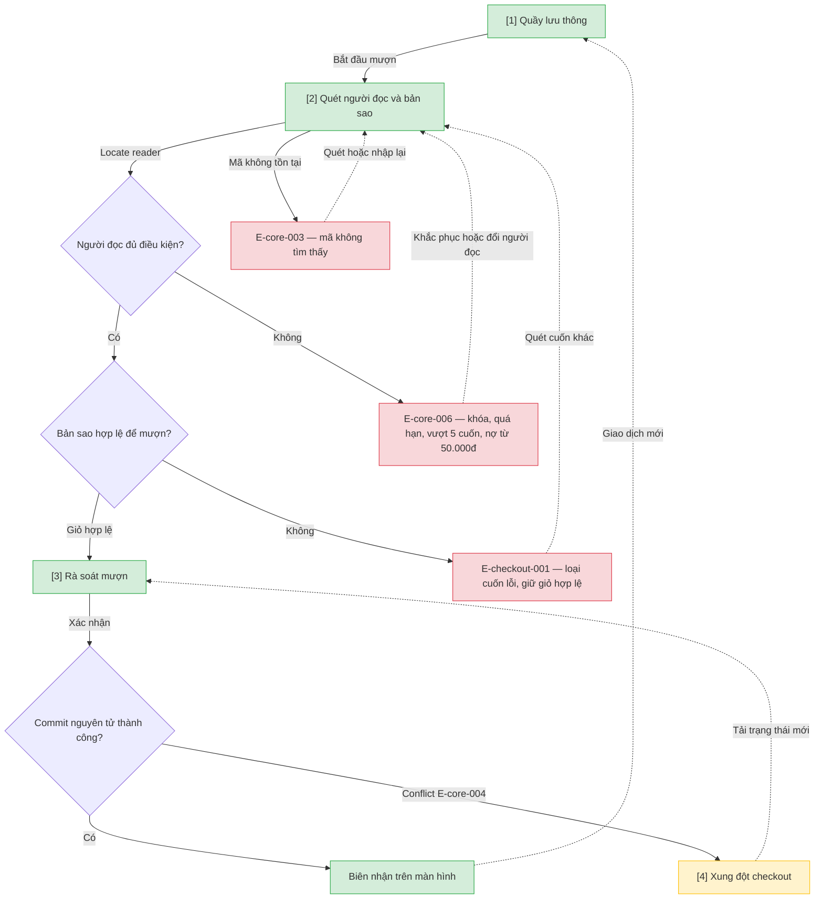

# Mượn tại quầy — User Flow

## 1. User Flow

### Flow: checkout-flow — R1A

## 2. Danh sách màn hình

| [#] | Slug | Màn hình | Mục đích | Thuộc flow |
|-----|------|----------|----------|------------|
| 1 | circulation-desk | Quầy lưu thông | Điểm vào mượn tại quầy. | checkout-flow |
| 2 | checkout-scan | Quét checkout | Quét thẻ và từng bản sao, kiểm tra D1/D2 ngay. | checkout-flow |
| 3 | checkout-review | Rà soát mượn | Xác nhận giỏ, commit nguyên tử, hiện biên nhận. | checkout-flow |
| 4 | checkout-conflict | Xung đột checkout | Hai quầy tranh bản sao — tải lại an toàn. | checkout-flow |

## 3. Danh sách flow

| Flow-slug | Tên flow | Màn hình gồm |
|-----------|----------|--------------|
| checkout-flow | Mượn tại quầy | circulation-desk → checkout-scan → checkout-review → checkout-conflict |

## 3.5. Chuyển màn (transitions)

Chuyển màn sang feature khác ghi bằng chữ khi đích chưa có wireframe; feature R0 dùng `../../{slug}/html-wireframe/`.

| Từ màn [#] | Đến màn [#] | Trigger | Điều kiện |
|-----------|------------|---------|-----------|
| Quầy [1] | Quét [2] | Bắt đầu mượn | Luôn |
| Quét [2] | (giữ) [2] | Locate reader | E-core-006 hoặc E-core-003 |
| Quét [2] | Rà soát [3] | Giỏ hợp lệ | D1 và D2 đạt |
| Rà soát [3] | Xung đột [4] | Xác nhận | E-core-004 |
| Xung đột [4] | Rà soát [3] | Tải lại | Luôn |
| Rà soát [3] | Quầy [1] | Commit thành công | Hiện biên nhận trên màn; in — OQ-checkout-001 |

## 4. Open Questions

- [ ] OQ-checkout-001 — Khổ giấy và loại máy in biên nhận tại quầy? Owner: vận hành.
