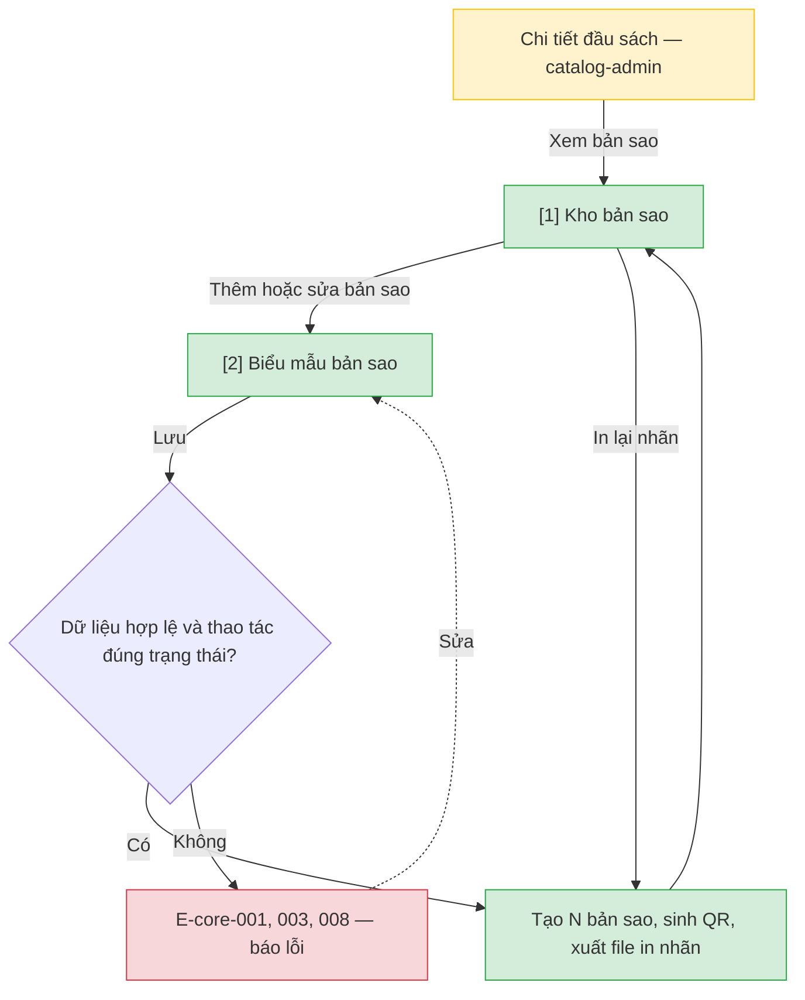

# Bản sao và nhãn QR — User Flow

## 1. User Flow

### Flow: copy-inventory-flow — R0

## 2. Danh sách màn hình

| [#] | Slug | Màn hình | Mục đích | Thuộc flow |
|-----|------|----------|----------|------------|
| 1 | copy-inventory | Kho bản sao | Danh sách bản sao của một đầu sách theo trạng thái; in lại nhãn. | copy-inventory-flow |
| 2 | copy-form | Biểu mẫu bản sao | Nhập N bản, vị trí kệ, tình trạng, cờ chỉ đọc tại chỗ. | copy-inventory-flow |

## 3. Danh sách flow

| Flow-slug | Tên flow | Màn hình gồm |
|-----------|----------|--------------|
| copy-inventory-flow | Kho bản sao và in nhãn | copy-inventory → copy-form |

## 3.5. Chuyển màn (transitions)

Chuyển màn sang feature khác xem `docs/_shared/navigation-map.md`.

| Từ màn [#] | Đến màn [#] | Trigger | Điều kiện |
|-----------|------------|---------|-----------|
| Chi tiết đầu sách (`catalog-admin`) | Kho bản sao [1] | Xem bản sao | Luôn. |
| Kho bản sao [1] | Biểu mẫu bản sao [2] | Thêm hoặc sửa | Có quyền. |
| Biểu mẫu bản sao [2] | Kho bản sao [1] | Lưu | Hợp lệ; bản sao mới có QR. |

## 4. Open Questions

- [ ] OQ-copy-inventory-002 — Mẫu nhãn in.
