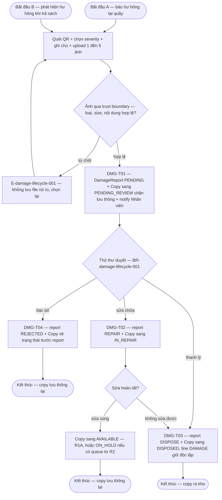

# damage-lifecycle — Flows

## Flow: Báo cáo hư hỏng và duyệt

**Trigger:** Nhân viên báo hư hỏng tại quầy hoặc phát hiện khi trả (F4); ghi nhận mất; tìm lại bản sao `LOST`. · **UC:** uc-damage-report · **Release:** R1A (report + disposition tối thiểu + lost — DEC-P2-03/07), R1B (found reconcile — DEC-D3-05)

**Nhãn:** Quy trình quét–ảnh–severity–Chờ duyệt ngay + 3 disposition là FACT (§6.4 nguồn, SRC-FR-S05, SRC-FR-L08, default OQ-11). Một Copy chỉ một DamageReport `PENDING`, khôi phục trạng thái trước report khi `REJECTED`, `IN_REPAIR→DISPOSED`, thanh lý trực tiếp là PROPOSAL (DEC-D3-07 + quy tắc bổ sung §6). Lost→found compensation là PROPOSAL (DEC-D3-05). Trust boundary upload là FACT (BR-damage-lifecycle-002).

### Bảng bước F7a — damage report

| Bước | Actor | Quyết định / điều kiện | Phản hồi hệ thống | Error path |
|------|-------|------------------------|--------------------|------------|
| 1 | Nhân viên/Thủ thư | Quét copy + severity (Nhẹ/Vừa/Nặng) + note + 1–5 ảnh (≤500KB/ảnh sau nén) | Validate form | E-core-001 — thiếu ảnh/severity; E-damage-lifecycle-001 — upload bị từ chối, không lưu file rủi ro (BR-damage-lifecycle-002) |
| 2 | Hệ thống | Một Copy chỉ một report `PENDING` (PROPOSAL) | DMG-T01: report `PENDING` + Copy→`PENDING_REVIEW` (COPY-T07; qua trả thì COPY-T05 gắn `loan_id` + phạt SRC-BR07) + notify Nhân viên + audit — một TX | Report lặp trên cùng copy → gộp vào report đang mở hoặc idempotent reject (PROPOSAL); Copy `ON_HOLD` bị báo hư hỏng → reservation re-queue `WAITING` giữ vị trí (PROPOSAL DEC-D3-06) |
| 3 | Nhân viên | Disposition (BR-damage-lifecycle-001: chỉ đóng khi có quyết định + audit) | `REJECTED` → Copy về trạng thái trước report (DMG-T04); `REPAIR` → `IN_REPAIR` (T02+COPY-T10); `DISPOSE` → `DISPOSED` (T03+COPY-T11), fine DAMAGE giữ độc lập | E-core-008 — disposition không hợp lệ; audit fail → E-core-007 rollback |
| 4 | Nhân viên/Thủ thư | Hoàn tất sửa + cập nhật condition | `IN_REPAIR→AVAILABLE` (COPY-T12); từ R2 có queue → `ON_HOLD` (COPY-T13) | Sửa không thành → `IN_REPAIR→DISPOSED` (COPY-T14, PROPOSAL DEC-D3-07) |
