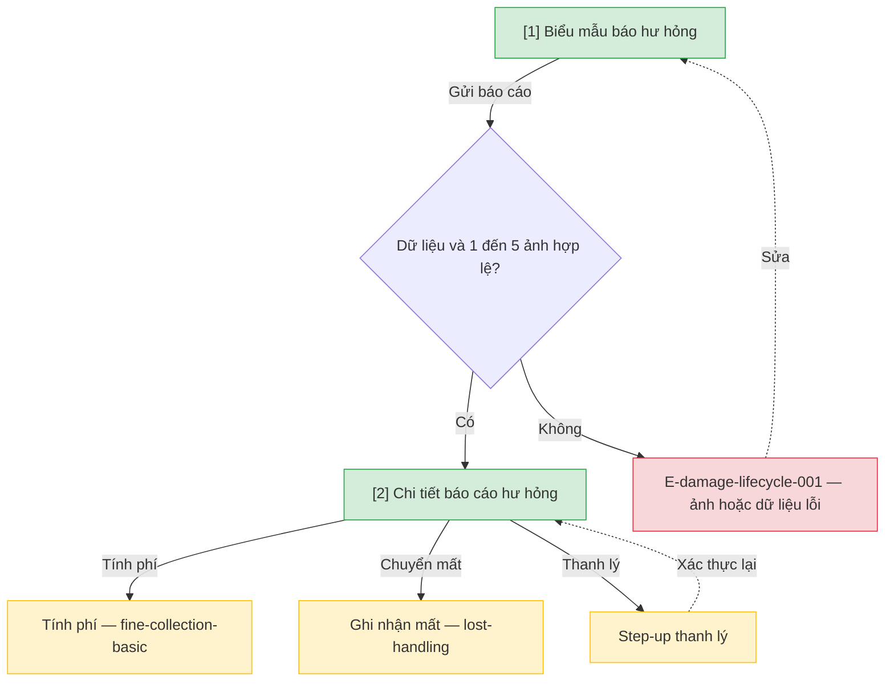

# Báo cáo hư hỏng — User Flow

## 1. User Flow

### Flow: damage-lifecycle-flow — R1A

## 2. Danh sách màn hình

| [#] | Slug | Màn hình | Mục đích | Thuộc flow |
|-----|------|----------|----------|------------|
| 1 | damage-report-form | Biểu mẫu hư hỏng | Gửi báo cáo và 1–5 ảnh, cách ly bản sao. | damage-lifecycle-flow |
| 2 | damage-report-detail | Chi tiết hư hỏng | Duyệt disposition: sửa, tính phí, thanh lý, chuyển mất. | damage-lifecycle-flow |

## 3. Danh sách flow

| Flow-slug | Tên flow | Màn hình gồm |
|-----------|----------|--------------|
| damage-lifecycle-flow | Báo hư và duyệt | damage-report-form → damage-report-detail |

## 3.5. Chuyển màn (transitions)

Chuyển màn sang feature khác ghi bằng chữ khi đích chưa có wireframe; feature R0 dùng `../../{slug}/html-wireframe/`.

| Từ màn [#] | Đến màn [#] | Trigger | Điều kiện |
|-----------|------------|---------|-----------|
| Form [1] | Chi tiết [2] | Gửi hợp lệ | 1–5 ảnh, dữ liệu đủ |
| Form [1] | (giữ) [1] | Gửi | E-damage-lifecycle-001 |
| Chi tiết [2] | fine-collection-basic (chữ) | Tính phí | Sau duyệt |
| Chi tiết [2] | lost-handling (chữ) | Chuyển mất | Khi không sửa được |

## 4. Open Questions

- [ ] OQ-damage-lifecycle-001 — Ảnh lưu theo báo cáo hay quản lý như tệp đính kèm riêng, lưu giữ bao lâu? Owner: domain/tech.
- [ ] OQ-damage-lifecycle-002 — Mức phạt hư hỏng chính thức (mặc định nguồn 0%/30%/100%)? Owner: Thủ thư trưởng.
