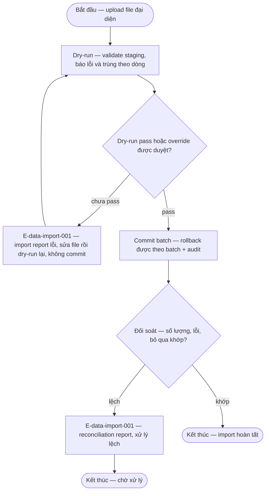

# data-import — Flows

## Flow: Import và đối soát

### Bảng bước

| Bước | Actor | Quyết định / điều kiện | Phản hồi hệ thống | Error path |
|------|-------|------------------------|--------------------|------------|
| I1 | Thủ thư | Upload file import đại diện (schema Open OQ-data-import-001) | Staging + validate: mã nhận diện, trạng thái hợp lệ, lỗi/trùng theo dòng | E-data-import-001 — file sai format/dòng lỗi → báo theo dòng, không commit |
| I2 | Hệ thống | Dry-run | Pass hoặc override được duyệt (BR-data-import-001) mới cho commit | Chưa pass → chỉ báo cáo, rollback toàn batch nếu lỗi giữa chừng — không để dữ liệu nhập dở (§6.4) |
| I3 | Hệ thống | Commit batch + reconciliation | Đối chiếu số lượng, bản ghi lỗi, bản ghi bỏ qua | E-data-import-001 — reconcile lệch → report, xử lý trước GATE-MIG |
