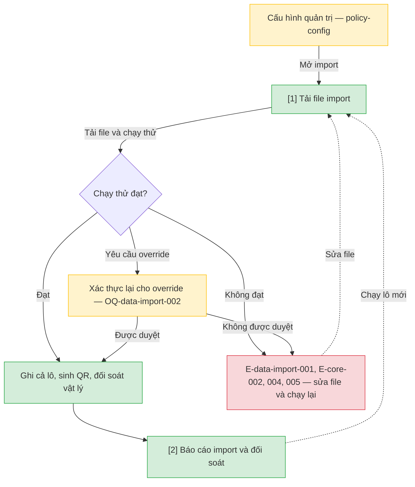

# Import Excel và đối soát — User Flow

## 1. User Flow

### Flow: data-import-flow — R0

## 2. Danh sách màn hình

| [#] | Slug | Màn hình | Mục đích | Thuộc flow |
|-----|------|----------|----------|------------|
| 1 | import-upload | Tải file import | Tải file, chạy thử, xin override. | data-import-flow |
| 2 | import-report | Báo cáo import | Lỗi theo dòng, kết quả ghi lô, đối soát. | data-import-flow |

## 3. Danh sách flow

| Flow-slug | Tên flow | Màn hình gồm |
|-----------|----------|--------------|
| data-import-flow | Import và đối soát | import-upload → import-report |

## 3.5. Chuyển màn (transitions)

Chuyển màn sang feature khác xem `docs/_shared/navigation-map.md`.

| Từ màn [#] | Đến màn [#] | Trigger | Điều kiện |
|-----------|------------|---------|-----------|
| Cấu hình quản trị (`policy-config`) | Tải file import [1] | Mở import | Có quyền. |
| Tải file import [1] | Báo cáo import [2] | Chạy thử/ghi lô | Chạy thử đạt hoặc override được duyệt. |
| Tải file import [1] | (giữ nguyên) [1] | Chạy thử | E-data-import-001; sửa file chạy lại. |
| Tải file import [1] | Phiên hết hạn (`access-control`) | Yêu cầu override | Xác thực lại. |
| Báo cáo import [2] | Tải file import [1] | Chạy lô mới | Lô trước đã kết thúc. |

## 4. Open Questions

- [ ] OQ-data-import-001 — File Excel đại diện.
- [ ] OQ-data-import-002 — Người duyệt override.
