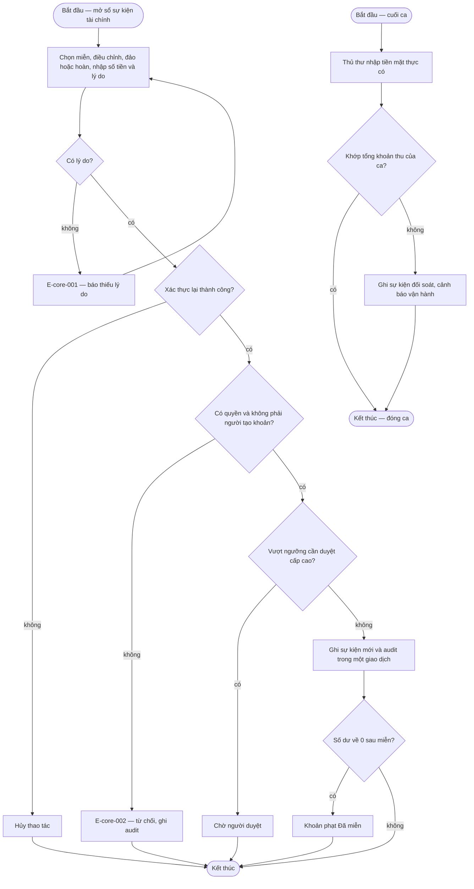

# fine-collection-adv — Flows

## Flow: Miễn, điều chỉnh, đảo, hoàn và đối soát cuối ca

**Trigger:** Quản trị viên xử lý ngoại lệ tài chính; kết thúc ca. · **UC:** uc-fine-adjustment · **Release:** R1B

