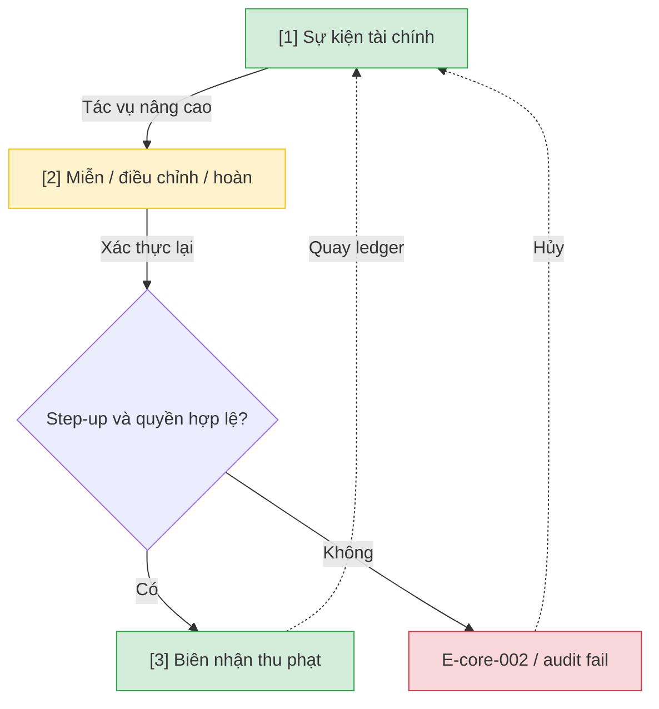

# Thu phạt nâng cao — User Flow

## 1. User Flow

### Flow: fine-adv-flow — R1B

## 2. Danh sách màn hình

| [#] | Slug | Màn hình | Mục đích | Thuộc flow |
|-----|------|----------|----------|------------|
| 1 | financial-events | Sự kiện tài chính | Ledger khoản phạt và sự kiện thu/miễn/điều chỉnh. | fine-adv-flow |
| 2 | fine-adjust | Miễn điều chỉnh hoàn | Step-up re-auth cho waiver/adjustment/refund. | fine-adv-flow |
| 3 | fine-receipt | Biên nhận thu phạt | R1B loại biên nhận thu phạt. | fine-adv-flow |

## 3. Danh sách flow

| Flow-slug | Tên flow | Màn hình gồm |
|-----------|----------|--------------|
| fine-adv-flow | Tài chính nâng cao | financial-events → fine-adjust → fine-receipt |

## 3.5. Chuyển màn (transitions)

Chuyển màn sang feature khác ghi bằng chữ khi đích chưa có wireframe; feature R0 dùng `../../{slug}/html-wireframe/`.

| Từ màn [#] | Đến màn [#] | Trigger | Điều kiện |
|-----------|------------|---------|-----------|
| Ledger [1] | Điều chỉnh [2] | Tác vụ R1B | Cần step-up |
| Điều chỉnh [2] | Biên nhận [3] | Duyệt thành công | Quyền và re-auth |
| Điều chỉnh [2] | Ledger [1] | Thất bại | E-core-002 |

## 4. Open Questions

- [ ] OQ-fine-collection-adv-001 — Thu một phần, miễn, điều chỉnh, đảo, hoàn: chính sách và quyền? Owner: finance.
- [ ] OQ-fine-collection-adv-002 — Ai duyệt khi đối soát lệch và ngưỡng duyệt cấp cao? Owner: finance.
- [ ] OQ-fine-collection-adv-003 — Mẫu biên nhận thu phạt? Owner: vận hành.
