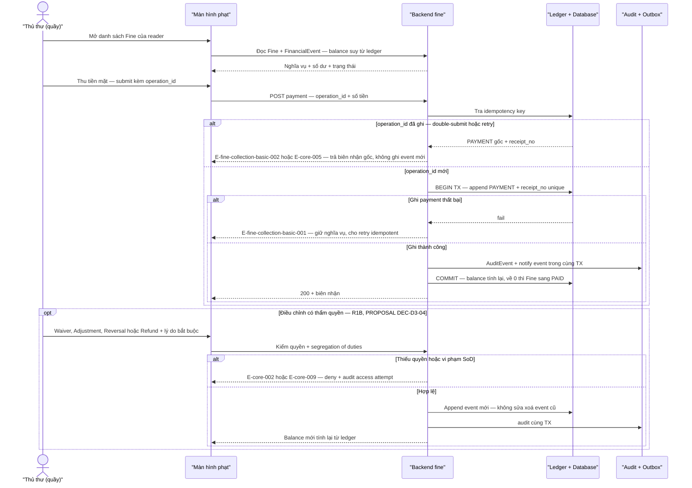

# fine-collection-basic — Flows

## Flow: Thu tiền phạt và sự kiện tài chính

**Trigger:** Thu tiền mặt tại quầy; assess tự động khi đóng Loan; điều chỉnh có thẩm quyền. · **UC:** uc-fine-cash-payment · **Release:** R1A (assessment + thu tiền mặt tối thiểu — DEC-P2-04), R1B (biên nhận đầy đủ, waiver/adjustment/reversal/refund — DEC-D3-04)

**Nhãn:** Ledger append-only, PAYMENT do Thủ thư/Quản trị viên ghi, không sửa/xoá bút toán là FACT (BR-core-002, §7 nguồn). `receipt_no` unique, `RECONCILIATION` cuối ca, SoD waiver-vs-assessment, partial payment là PROPOSAL (DEC-D3-04/08, OQ-fine-collection-adv-001/OQ-fine-collection-adv-002). Ngưỡng nợ chặn mượn là Open (OQ-policy-config-001).

### Bảng bước F6

| Bước | Actor | Quyết định / điều kiện | Phản hồi hệ thống | Error path |
|------|-------|------------------------|--------------------|------------|
| 1 | Thủ thư/Quản trị viên | Mở fine list/detail của reader | `balance` suy từ Σ events (INV-06); hiển thị ledger | E-core-009 — field tài chính mask khi thiếu quyền |
| 2 | Thủ thư/Quản trị viên | Thu tiền mặt + `operation_id` | Append `PAYMENT` + `receipt_no` unique (AT-FIN-02) | E-fine-collection-basic-001 — ghi payment fail → giữ nghĩa vụ, retry idempotent; mất kết nối sau confirm → query-by-operation trả biên nhận gốc (§6.4) |
| 3 | Hệ thống | Replay `operation_id` | Trả PAYMENT gốc — không event thứ hai | E-fine-collection-basic-002/E-core-005 (INV-03) |
| 4 | Hệ thống | Sau commit | Balance tính lại; `=0` → Fine `PAID` (không có trạng thái `PARTIALLY_PAID` — partial là PAYMENT < balance, PROPOSAL DEC-D3-04) | Audit fail → E-core-007 rollback |
| 5 | Thủ thư (R1B) | Waiver/Adjustment/Reversal/Refund — lý do + thẩm quyền + SoD | Append event; sai sót sửa bằng `REVERSAL` trỏ event gốc; Fine đã đóng **không reopen** — dư âm xử lý bằng `REFUND` + reconcile | E-core-002/E-core-009 — deny + audit attempt |
| 6 | Thủ thư/Hệ thống | Đối soát thu ngân cuối ca (PROPOSAL DEC-D3-08) | `RECONCILIATION` event; job đối chiếu `balance` vs Σ events → lệch thì cảnh báo | Lệch → cảnh báo vận hành, không tự sửa ledger |

**Liên kết:** FR-overdue-fines-001, FR-fine-collection-basic-001, FR-fine-collection-adv-002, FR-ops-foundation-001 · BR-core-002, BR-fine-collection-basic-001, BR-core-003 · transitions: Fine `UNPAID→PAID/WAIVED` (suy từ event) · AT-FIN-01..04 · DEC-P2-04, DEC-D3-04/05/08 · OQ-fine-collection-adv-001/OQ-fine-collection-adv-002/OQ-policy-config-001.
