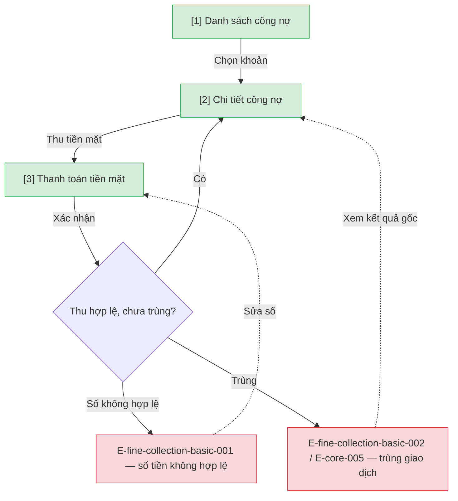

# Thu phạt tiền mặt — User Flow

## 1. User Flow

### Flow: fine-collection-basic-flow — R1A

## 2. Danh sách màn hình

| [#] | Slug | Màn hình | Mục đích | Thuộc flow |
|-----|------|----------|----------|------------|
| 1 | fine-list | Danh sách công nợ | Tra cứu khoản phạt của người đọc. | fine-collection-basic-flow |
| 2 | fine-detail | Chi tiết công nợ | Số dư và hành động thu được phép. | fine-collection-basic-flow |
| 3 | fine-payment | Thanh toán tiền mặt | Ghi nhận thu tiền mặt idempotent. | fine-collection-basic-flow |

## 3. Danh sách flow

| Flow-slug | Tên flow | Màn hình gồm |
|-----------|----------|--------------|
| fine-collection-basic-flow | Thu tiền mặt | fine-list → fine-detail → fine-payment |

## 3.5. Chuyển màn (transitions)

Chuyển màn sang feature khác ghi bằng chữ khi đích chưa có wireframe; feature R0 dùng `../../{slug}/html-wireframe/`.

| Từ màn [#] | Đến màn [#] | Trigger | Điều kiện |
|-----------|------------|---------|-----------|
| Danh sách [1] | Chi tiết [2] | Chọn khoản | Luôn |
| Chi tiết [2] | Thu [3] | Thu tiền mặt | R1A |
| Thu [3] | Chi tiết [2] | Xác nhận | Idempotent thành công |
| Thu [3] | (giữ) [3] | Xác nhận | E-fine-collection-basic-001 |

## 4. Open Questions

- [ ] OQ-fine-collection-basic-001 — Có cho thu một phần không, giới hạn số lần (gắn OQ-fine-collection-adv-001)? Owner: finance.
