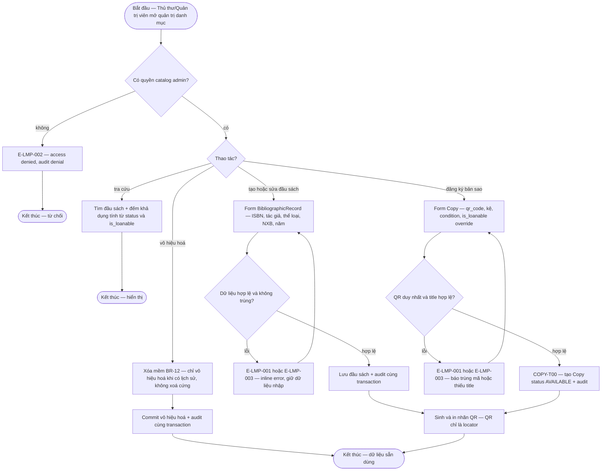
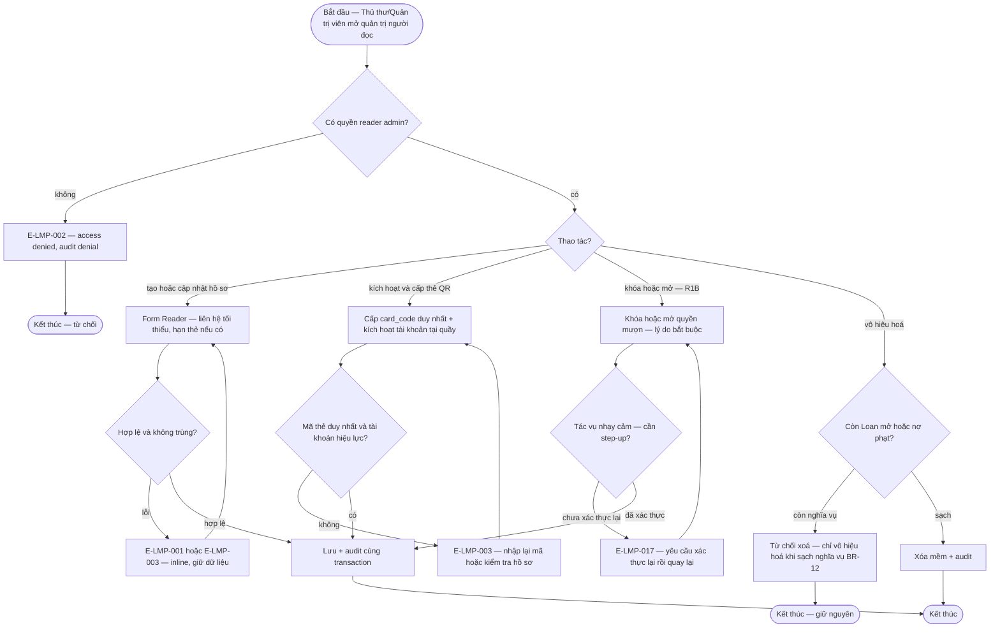
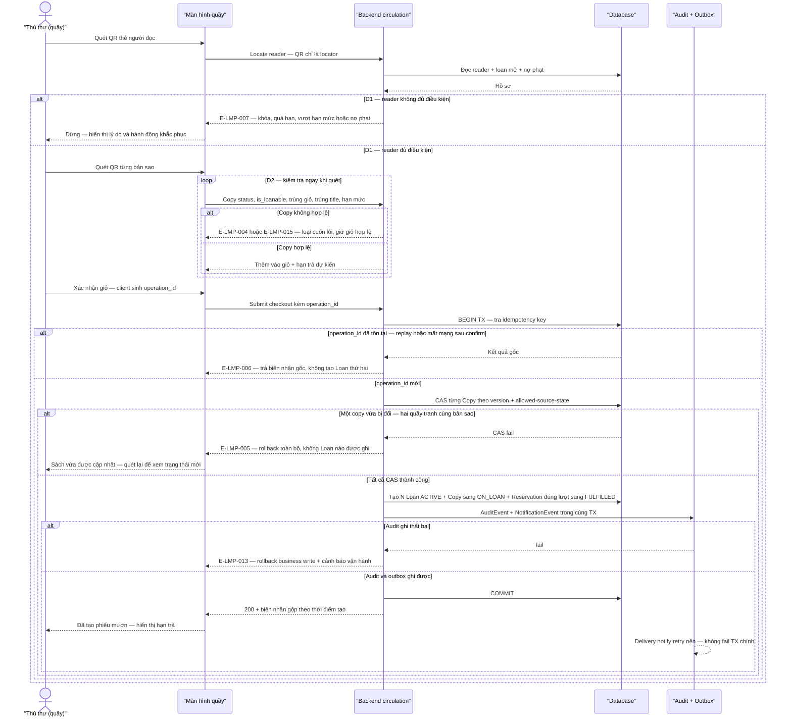
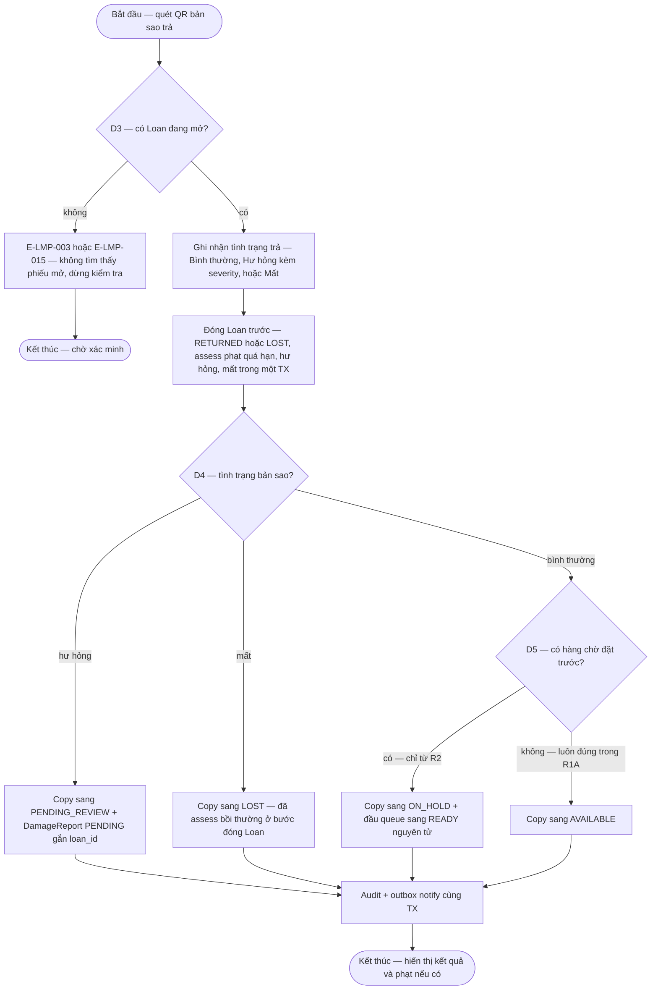
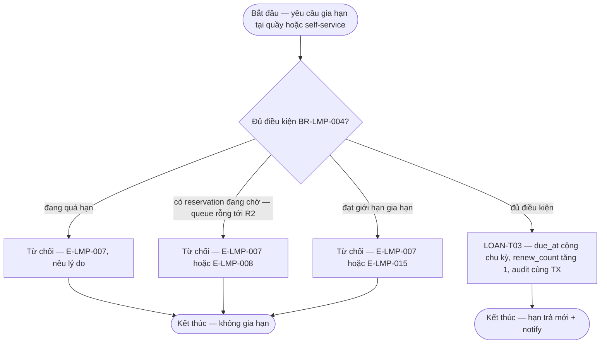
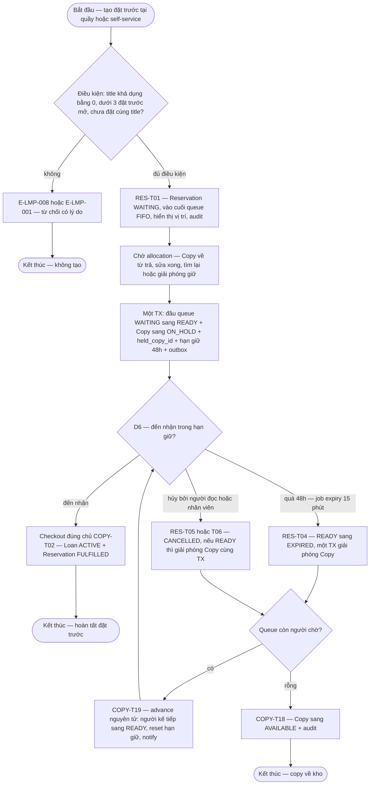
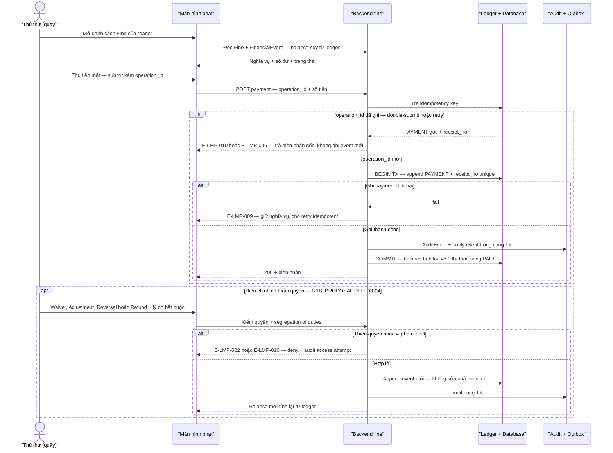
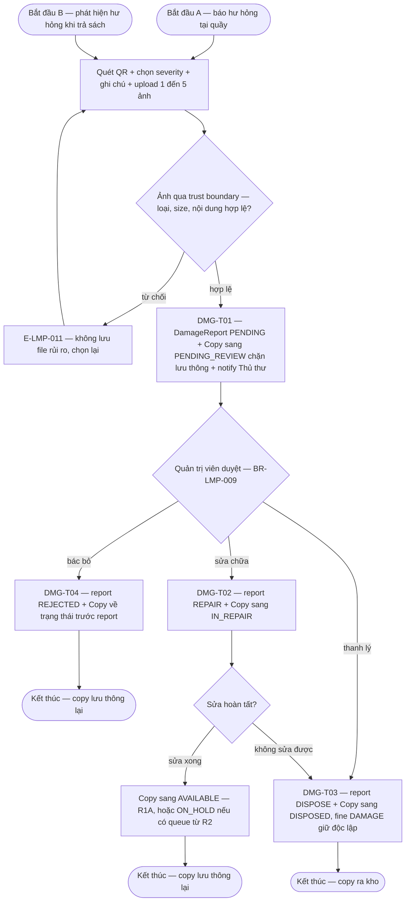
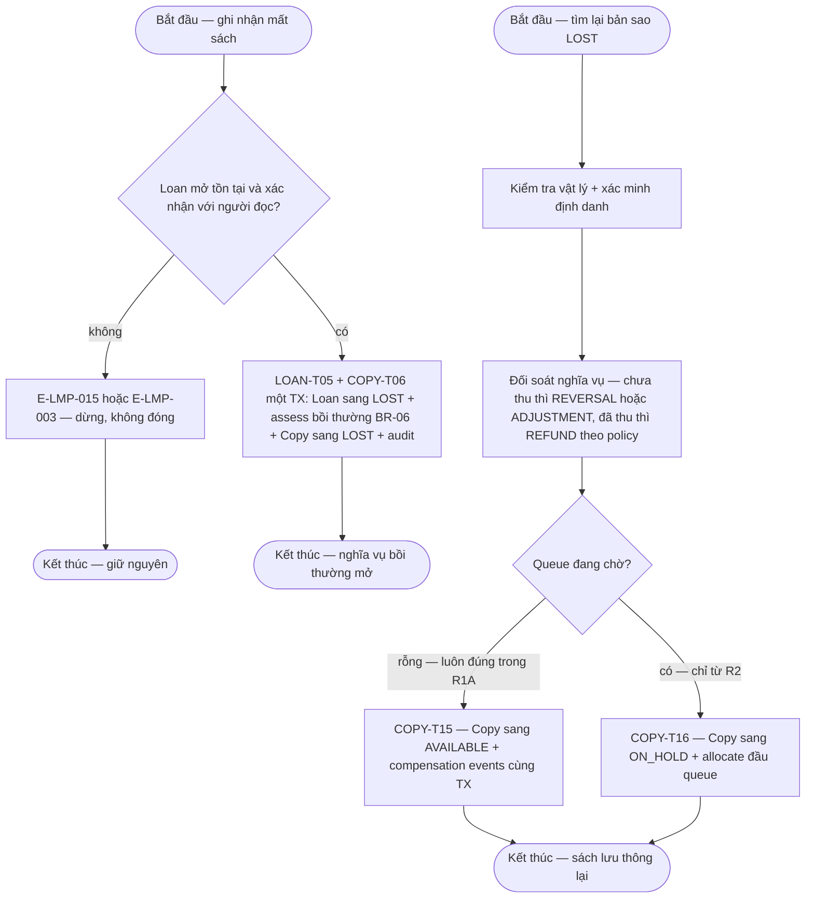

# library-management-platform — Flow Models (SRS Tier 2)

> Draft Phase 4 — SRS Tier 2 flow models. File đích cuối: `docs/features/library-management-platform/srs/library-management-platform-flows.md`. Nội dung được dựng từ các nguồn: spec.md (FR/BR/Error Matrix), `domain/lifecycle-inventory.md` (state transitions — nhãn PROPOSAL chờ DEC-D3-01/02), `brainstorms/product-roadmap-baseline.md` (§5 core flows, §6.1 D1–D6, §6.4 interrupted transactions, §6.5 edge cases), `docs/_product/roadmap.md` (release boundary R0–R3) và `decision-register.md`.

## 0. Quy ước và invariant dùng chung

**Nhãn nguồn** (theo `library-management-platform-spec.md` §0 và `lifecycle-inventory.md` §0):

- `FACT` — có căn cứ trong `docs/he_thong_quan_ly_thu_vien.md`, roadmap baseline hoặc business rule nguồn.
- `PROPOSAL` — suy diễn/reconstruction hợp lý; chờ domain approval qua decision register (DEC-D3-*, DEC-P2-*).
- `Open` — chưa đủ quyết định; không được xem là approved (OQ-LMP-*, OQ-* nguồn).

**Release tag** theo `docs/_product/roadmap.md` (chuẩn DEC-P2-08): `R0` nền tảng · `R1A` lưu thông lõi tại quầy · `R1B` hoàn thiện + pilot · `R2` đặt trước trọn vòng + báo cáo xu hướng · `R3` candidate.

**Lưu ý release boundary quan trọng (DEC-P2-05):** trong R1A luồng trả **không** phân bổ hàng chờ — điểm quyết định D5 luôn đi nhánh "không có hàng chờ". Reservation trọn vòng có một release owner duy nhất là R2. Mọi nhánh gắn `(R2)` trong diagram F4/F5/F7 chỉ hiệu lực từ R2.

### 0.1 Invariant giao dịch dùng chung

Áp dụng cho mọi luồng có ghi dữ liệu; các flow section chỉ ghi chú thêm khi có ngoại lệ.

| ID | Invariant | Nhãn | Source |
|----|-----------|------|--------|
| INV-01 | Business write + `AuditEvent` + `NotificationEvent` (outbox) ghi trong **một** transaction; audit fail → rollback toàn bộ (E-LMP-013) | FACT (BR-LMP-013, BR-LMP-016, NFR-LMP-006) | spec §5/§6 |
| INV-02 | Concurrency bằng CAS trên `version` + allowed-source-state; giao dịch sau nhận conflict và phải reload (E-LMP-005) | FACT (BR-13 nguồn, NFR-LMP-003) | spec §4, lifecycle §3 |
| INV-03 | Mọi submit ghi (checkout, payment, pickup) mang `operation_id`/idempotency key; replay trả kết quả gốc, không nhân đôi side effect (E-LMP-006, E-LMP-010) | PROPOSAL (AT-CHK-02, AT-FIN-02, BR-LMP-008) | lifecycle §7 |
| INV-04 | Notification không bao giờ làm fail business transaction; delivery retry có kiểm soát + dead-letter + cảnh báo vận hành (E-LMP-012, E-LMP-018) | FACT (BR-LMP-016, NFR-LMP-007); ngưỡng retry PROPOSAL | spec §5, lifecycle §4 |
| INV-05 | QR/barcode chỉ là **locator**; sau khi locate vẫn phải kiểm tra actor × resource × action (BR-LMP-011, BR-LMP-015) | FACT | spec §5 |
| INV-06 | FinancialEvent append-only; không UPDATE/DELETE; `Fine.balance` suy từ ledger (BR-LMP-007) | FACT | spec §5, lifecycle §5 |

### 0.2 Bản đồ luồng ↔ use case ↔ release ↔ lỗi

| # | Luồng | UC | Màn hình chính | FR chính | Release | Errors phủ |
|---|-------|----|----------------|----------|---------|------------|
| F1 | Catalog/copy administration | uc-catalog-admin | catalog-search, bibliographic-detail/form, copy-inventory, copy-form | FR-LMP-001/002/003/026/020 | R0 (+R1A tra cứu) | E-LMP-001/002/003/015/016 |
| F2 | Reader administration | uc-reader-admin | reader-list, reader-form, reader-detail | FR-LMP-004/005/006/007 | R0 (+R1B khóa/mở) | E-LMP-001/002/003/015/016/017 |
| F3 | Checkout nguyên tử + conflict/idempotency | uc-checkout | circulation-desk, checkout-scan/review/conflict | FR-LMP-008/009/026/003 | R1A | E-LMP-004/005/006/007/013/015 |
| F4 | Return/renewal + fine/damage follow-up | uc-return-renewal | return-scan, return-result, renewal-result | FR-LMP-010/011/014 | R1A (return), R1B (renewal) | E-LMP-003/004/005/007/013/015 |
| F5 | Reservation queue/hold/expiry/pickup | uc-reservation | reservation-search/form/queue/pickup | FR-LMP-012/013/024 | R2 | E-LMP-005/008/012/015/018 |
| F6 | Fine payment + financial events | uc-fine-payment | fine-list, fine-detail, fine-payment, financial-events | FR-LMP-014/015/016 | R1A (payment), R1B (waiver/adjust/biên nhận) | E-LMP-002/006/009/010/013/015/016 |
| F7 | Damage report/lost/found | uc-damage-lost-found | damage-report-form/detail, lost-found | FR-LMP-017/018/025 | R1A (+R1B found reconcile) | E-LMP-001/003/005/011/013/015 |
| F8 | Notification outbox + audit + admin import/reconcile | uc-notification-audit, uc-admin-import | notification-status, audit-log, admin-config, import-upload/report | FR-LMP-019/020/021/022/027 | R0 (audit capture, import, policy), R1A (notify tối thiểu), R1B (trung tâm + audit viewer) | E-LMP-002/012/013/014/016/018 |

---

## 1. F1 — Luồng quản trị danh mục & bản sao (catalog/copy administration)

**Trigger:** Thủ thư/Quản trị viên mở chức năng quản trị danh mục hoặc kho bản sao. · **UC:** uc-catalog-admin · **Release:** R0 (tra cứu khả dụng vận hành từ R1A — FR-LMP-003)

**Nhãn:** CRUD đầu sách/bản sao/danh mục + in QR là FACT (FR-L02/L03/L04, FR-LMP-001/002). `is_loanable` là thuộc tính Title/Copy là PROPOSAL (DEC-D3-09, theo default OQ-10). Số khả dụng là giá trị tính toán từ `Copy.status` + `is_loanable`, không lưu counter — FACT (BR-11). Copy `∅→AVAILABLE` khi đăng ký/import là PROPOSAL (COPY-T00 — DEC-D3-01).

### Bảng bước F1

| Bước | Actor | Quyết định / điều kiện | Phản hồi hệ thống | Error path |
|------|-------|------------------------|--------------------|------------|
| 1 | Thủ thư/Quản trị viên | Kiểm quyền `actor × resource × action` | Cho vào màn hình quản trị | E-LMP-002 — deny + audit denial (BR-LMP-015) |
| 2 | Thủ thư | Chọn tra cứu / tạo-sửa đầu sách / đăng ký bản sao / vô hiệu hoá | Render form hoặc kết quả tương ứng | E-LMP-016 — field PII/tài chính bị mask nếu thiếu quyền field |
| 3 | Hệ thống | Validate form: trường bắt buộc, định dạng ISBN, unique business key | Inline error hoặc cho lưu | E-LMP-001 (validation), E-LMP-003 (trùng/không tồn tại) — giữ dữ liệu, cho sửa lại |
| 4 | Hệ thống | Commit: lưu record (+ Copy `∅→AVAILABLE` nếu đăng ký bản sao) + AuditEvent — một transaction (INV-01) | Record sẵn dùng; số khả dụng tính lại | Audit fail → rollback + E-LMP-013 |
| 5 | Thủ thư | Sinh/in nhãn QR cho bản sao mới | File in nhãn; QR gắn locator, không phải credential (BR-LMP-011) | QR sai/mờ/trùng (edge case §6.5) → nhập mã thủ công hoặc in lại |
| 6 | Thủ thư | Sửa/xoá record đã có lịch sử | Chỉ cho vô hiệu hoá (xóa mềm BR-12); Copy `DISPOSED` là terminal | E-LMP-015 — action không hợp lệ từ trạng thái hiện tại |

**Liên kết:** FR-LMP-001, FR-LMP-002, FR-LMP-003, FR-LMP-020, FR-LMP-026 · BR-LMP-011, BR-LMP-013, BR-LMP-015 · NFR-LMP-002 (tra cứu ≤2s @50.000 bản sao — ngưỡng PROPOSAL) · transitions: COPY-T00, COPY-T17.

---

## 2. F2 — Luồng quản trị người đọc (reader administration)

**Trigger:** Thủ thư/Quản trị viên quản lý hồ sơ người đọc; Thủ thư kích hoạt thẻ tại quầy. · **UC:** uc-reader-admin · **Release:** R0 (tạo/cập nhật/kích hoạt) + R1B (khóa/mở giới hạn — FR-LMP-005, FR-S10)

**Nhãn:** CRUD người đọc, chặn xoá khi còn phiếu mở/nợ phạt là FACT (FR-L05). Kích hoạt tại quầy sau đăng ký là FACT (default OQ-03). Khóa/mở có lý do bắt buộc + audit là PROPOSAL (FR-LMP-005, FR-S10). PII masking theo quyền field là FACT về yêu cầu, policy retention/masking là Open (OQ-LMP-006). Identity model là Open (OQ-LMP-007).

### Bảng bước F2

| Bước | Actor | Quyết định / điều kiện | Phản hồi hệ thống | Error path |
|------|-------|------------------------|--------------------|------------|
| 1 | Thủ thư/Quản trị viên | Kiểm quyền; field PII áp `actor × resource × action × field × purpose` | Màn hình list/form; PII mask khi thiếu quyền field | E-LMP-002, E-LMP-016 — deny + audit access attempt |
| 2 | Thủ thư/Quản trị viên | Tạo/cập nhật hồ sơ | Validate + lưu | E-LMP-001/003 — giữ dữ liệu cho sửa |
| 3 | Thủ thư/Quản trị viên | Kích hoạt + cấp `card_code` (QR locator) | Reader `active`, mượn được theo BR-LMP-003 | E-LMP-003 — mã trùng/không tồn tại |
| 4 | Thủ thư/Quản trị viên | Khóa/mở quyền mượn — lý do bắt buộc (R1B; quyền theo ma trận nguồn §2 — FACT) | Reader trạng thái block; chặn ở D1 checkout; notify "tài khoản bị khóa/mở" | E-LMP-015 — thao tác không hợp lệ từ trạng thái hiện tại; E-LMP-017 step-up nếu phiên yếu |
| 5 | Quản trị viên | Vô hiệu hoá (xóa mềm) | Chỉ khi không còn Loan mở và nợ phạt (BR-12, FR-L05) | Còn nghĩa vụ → từ chối, giải thích lý do |
| 6 | Hệ thống | Mọi ghi: audit cùng TX (INV-01) | AuditEvent có actor/thời điểm/trước-sau/lý do | E-LMP-013 — audit fail → rollback |

**Liên kết:** FR-LMP-004, FR-LMP-005, FR-LMP-006, FR-LMP-007, FR-LMP-019 (notify khóa/mở), FR-LMP-020 · BR-LMP-013, BR-LMP-015 · OQ-LMP-006 (retention/masking), OQ-LMP-007 (identity model).

---

## 3. F3 — Luồng checkout nguyên tử và xử lý conflict/idempotency

**Trigger:** Thủ thư/Quản trị viên tạo phiếu mượn tại quầy. · **UC:** uc-checkout · **Release:** R1A

**Nhãn:** Quét thẻ → kiểm tra điều kiện (D1) → quét sách kiểm tra từng cuốn (D2) → xác nhận ghi trong một transaction là FACT (§6.1 nguồn, BR-01/02/03/13, NFR-03). Cơ chế `operation_id` + query-by-operation recovery là PROPOSAL (AT-CHK-02). All-or-nothing cho cả giỏ là FACT (BR-LMP-001); "loại cuốn lỗi, giữ giỏ hợp lệ" chỉ áp dụng ở bước quét-review, **không** phải partial commit — FACT (§6.5 edge case). Checkout copy `ON_HOLD` chỉ cho reservation đúng lượt — FACT (COPY-T02); tới R2 mới có dữ liệu thực tế.

### Bảng bước F3

| Bước | Actor | Quyết định / điều kiện | Phản hồi hệ thống | Error path |
|------|-------|------------------------|--------------------|------------|
| 1 | Thủ thư | Quét QR thẻ (locator — INV-05) | Locate reader, load hồ sơ | E-LMP-003 — mã không tồn tại → nhập lại/tra cứu tay; QR mờ → nhập mã thủ công |
| 2 | Hệ thống | **D1**: reader `active`, không block, không vượt loan limit, nợ phạt trong ngưỡng (BR-LMP-003; ngưỡng OQ-LMP-010) | Cho quét sách | E-LMP-007 — dừng, hiển thị lý do + hành động khắc phục |
| 3 | Thủ thư | Quét từng bản sao | — | — |
| 4 | Hệ thống | **D2**: Copy `AVAILABLE` (hoặc `ON_HOLD` đúng chủ — R2), `is_loanable`, không trùng giỏ, không trùng title đang mượn, còn hạn mức (BR-LMP-002/003) | Thêm vào giỏ + hạn trả dự kiến | E-LMP-004 — loại cuốn lỗi, giữ các cuốn hợp lệ (§6.5); E-LMP-015 — trạng thái không cho mượn |
| 5 | Thủ thư | Xác nhận → client phát sinh `operation_id` | Submit một lần cho cả giỏ | Mất kết nối **trước** xác nhận → không có giao dịch, giỏ cục bộ khôi phục nếu còn (§6.4) |
| 6 | Hệ thống | Idempotency: `operation_id` unique | Mới → xử lý; trùng → trả kết quả gốc | E-LMP-006 — duplicate replay (INV-03); mất kết nối **sau** xác nhận → query-by-operation trả trạng thái đã ghi, không tạo lần hai (§6.4) |
| 7 | Hệ thống | CAS `Copy.version` + allowed-source-state trên **từng** copy | Toàn bộ CAS pass → tiếp tục | E-LMP-005 — một copy fail → **rollback cả giỏ**, không Loan nào (BR-LMP-001 all-or-nothing, AT-CHK-01/03); hai quầy tranh cùng bản sao → chỉ giao dịch ghi trước thắng (§6.4) |
| 8 | Hệ thống | Commit set: N Loan `ACTIVE` + Copy→`ON_LOAN` (COPY-T01/T02) + Reservation đúng lượt→`FULFILLED` + audit + outbox — **một transaction** (INV-01) | Phiếu mượn + hạn trả `borrowed + policy` | E-LMP-013 — audit fail → rollback, cảnh báo vận hành |
| 9 | Hệ thống | Sau commit: notify qua outbox, biên nhận gộp theo thời điểm tạo (default OQ-06) | "Đã tạo phiếu mượn. Hạn trả hiển thị trong danh sách đang mượn." | Notify lỗi → outbox retry/dead-letter, TX vẫn commit (INV-04) |

**Liên kết:** FR-LMP-003, FR-LMP-008, FR-LMP-009, FR-LMP-019, FR-LMP-020, FR-LMP-026 · BR-LMP-001/002/003/011/013/016 · NFR-LMP-003 · transitions: COPY-T01, COPY-T02, LOAN-T01, RES-T03 · AT-CHK-01..05.

---

## 4. F4 — Luồng trả sách, gia hạn và follow-up phạt/hư hỏng

**Trigger:** Thủ thư nhận trả bản sao tại quầy; yêu cầu gia hạn tại quầy hoặc self-service. · **UC:** uc-return-renewal · **Release:** R1A (trả + fine follow-up), R1B (gia hạn — FR-LMP-011, CAP-RENEW)

**Nhãn:** Thứ tự bắt buộc "đóng Loan + tính phạt trước, quyết định trạng thái Copy sau" là FACT (§6.2 nguồn). Chi tiết flow trả (D3/D4/D5) là PROPOSAL reconstruction (DEC-D3-02). **D5 trong R1A luôn = "không có hàng chờ"** (DEC-P2-05) — nhánh `ON_HOLD` chỉ từ R2. Gia hạn: điều kiện từ chối là FACT (BR-04); ngưỡng là Open (OQ-LMP-010); check "có người đặt trước" chạy trên queue rỗng tới R2.

### Bảng bước F4a — trả sách

| Bước | Actor | Quyết định / điều kiện | Phản hồi hệ thống | Error path |
|------|-------|------------------------|--------------------|------------|
| 1 | Thủ thư | Quét QR bản sao (locator) | Locate copy + tra Loan mở | QR sai/mờ/trùng → nhập mã thủ công (§6.5) |
| 2 | Hệ thống | **D3**: Loan mở tồn tại cho đúng copy | Tiếp tục | E-LMP-003 — "Không tìm thấy phiếu mượn đang mở cho cuốn sách này" → dừng, yêu cầu kiểm tra; double-return → Loan đã `RETURNED` thì idempotent reject, trả kết quả gốc (lifecycle §3) |
| 3 | Thủ thư | Ghi nhận tình trạng: Bình thường / Hư hỏng (severity + ảnh nếu cần → F7) / Mất | Chuẩn bị payload đóng phiếu | E-LMP-001 — thiếu severity/bằng chứng bắt buộc |
| 4 | Hệ thống | Đóng Loan **trước**: `ACTIVE/OVERDUE → RETURNED` (LOAN-T04) hoặc `→ LOST` (LOAN-T05) + assess phạt: quá hạn BR-05, hư hỏng BR-07, mất BR-06 → FinancialEvent `ASSESSMENT` + Fine `UNPAID` | Nghĩa vụ phạt ghi nhận trong cùng TX | Audit fail → E-LMP-013 rollback; CAS conflict trạng thái copy/loan → E-LMP-005 |
| 5 | Hệ thống | **D4**: tình trạng copy | Hư hỏng → `PENDING_REVIEW` + DamageReport `PENDING` gắn `loan_id` (COPY-T05); Mất → `LOST` (COPY-T06); Bình thường → D5 | — |
| 6 | Hệ thống | **D5**: có hàng chờ? — **R1A luôn "không"** (DEC-P2-05) | R1A: `ON_LOAN → AVAILABLE` (COPY-T03); từ R2: có queue → `ON_HOLD` + đầu queue `WAITING→READY` nguyên tử (COPY-T04, AT-RSV-01) | — |
| 7 | Hệ thống | Audit + outbox trong cùng TX (INV-01); hiển thị kết quả | "Đã nhận trả sách và cập nhật trạng thái bản sao." + phạt nếu có | Notify lỗi → outbox retry (INV-04) |

### F4b — gia hạn (R1B)

### Bảng bước F4b — gia hạn

| Bước | Actor | Quyết định / điều kiện | Phản hồi hệ thống | Error path |
|------|-------|------------------------|--------------------|------------|
| 1 | Thủ thư/Quản trị viên/Người đọc | Yêu cầu gia hạn trên Loan `ACTIVE` | Load loan + policy tại thời điểm mượn | E-LMP-002/016 — self-service chỉ trên loan của chính mình |
| 2 | Hệ thống | BR-LMP-004: chưa quá hạn · `renew_count < limit` · title không có reservation đang chờ (queue rỗng tới R2 — DEC-P2-05) | Đủ điều kiện → LOAN-T03: `due_at += 7 ngày` (baseline), `renew_count++`, audit | E-LMP-007 — hiển thị lý do từ chối; E-LMP-015 — loan terminal không gia hạn |
| 3 | Hệ thống | Race với trả/mất | Transition commit trước thắng; transition sau nhận invalid-state | E-LMP-005 — reload trạng thái mới (lifecycle §3) |
| 4 | Hệ thống | Sau commit | Notify hạn mới qua outbox | INV-04 |

**Liên kết:** FR-LMP-010, FR-LMP-011, FR-LMP-014, FR-LMP-017 (gắn damage), FR-LMP-018 (gắn lost), FR-LMP-019, FR-LMP-020 · BR-LMP-004/005/007/016 · transitions: LOAN-T02/T03/T04/T05, COPY-T03/T04/T05/T06 · OQ-LMP-010 (ngưỡng).

---

## 5. F5 — Luồng reservation queue / hold / expiry / pickup

**Trigger:** Người đọc hoặc nhân viên tạo/hủy đặt trước; copy về kho kích hoạt allocation; job expiry mỗi 15 phút. · **UC:** uc-reservation · **Release:** R2 — release owner duy nhất (DEC-P2-05)

**Nhãn:** FIFO queue, giữ 48h, allocation khi có copy, expiry chuyển người kế tiếp là FACT (§6.3, BR-08/09/10, §5.4). Atomic allocation + unique active hold + dedup cùng title là PROPOSAL (AT-RSV-01/02, RES-T01). `skip`/`suspend` **không** có trong baseline (DEC-D3-03 — Open). Re-queue khi copy `ON_HOLD` bị báo hư hỏng là PROPOSAL (DEC-D3-06). Notify fail không hủy `READY` — FACT về yêu cầu, escalation PROPOSAL (DEC-D3-08).

### Bảng bước F5

| Bước | Actor | Quyết định / điều kiện | Phản hồi hệ thống | Error path |
|------|-------|------------------------|--------------------|------------|
| 1 | Người đọc/Thủ thư | Tạo đặt trước trên title | Kiểm BR-LMP-012: khả dụng = 0 (BR-08), < 3 reservation mở, không trùng title đang mở (AT-RSV-02) | E-LMP-008 — không đủ điều kiện → cho hủy, đổi edition/copy hoặc quay lại |
| 2 | Hệ thống | Enqueue | `WAITING` cuối queue FIFO theo `created_at` (AT-RSV-05), hiển thị vị trí, audit | — |
| 3 | Hệ thống | Allocation trigger: COPY-T04/T13/T16/T19 | Một TX: đầu queue `WAITING→READY` + `Copy→ON_HOLD` + `held_copy_id` + `hold_expires_at=+48h` + outbox notify "đến nhận trong 48h" (AT-RSV-01) | Notify fail → retry/dead-letter; `READY` **không** tự hủy, `hold_expires_at` vẫn chạy (E-LMP-012/018, INV-04) |
| 4 | Người đọc + Thủ thư | **D6**: pickup trong hạn | Checkout đúng chủ (COPY-T02): kiểm `hold_expires_at` chưa qua + reader đủ điều kiện → Loan `ACTIVE` + `FULFILLED` | E-LMP-015 — sai chủ/qua hạn → từ chối; E-LMP-005 — reservation vừa expire → reload |
| 5 | Hệ thống (cron 15 phút) | `now > hold_expires_at` | `READY→EXPIRED` nguyên tử + giải phóng copy + advance queue (AT-RSV-03/04) — không có trạng thái trung gian lộ ra ngoài | Job chạy lại → idempotent, không nhân đôi advance/notify (§6.4) |
| 6 | Người đọc/Thủ thư | Hủy khi `WAITING` (T05) hoặc `READY` (T06) | `CANCELLED`; nếu đang giữ → giải phóng + advance trong cùng TX | Race hủy-vs-allocate → CAS trên `Reservation.status`; bên thua nhận trạng thái mới (E-LMP-005, lifecycle §4) |
| 7 | Hệ thống | Queue advance | Còn người → COPY-T19 re-hold người kế tiếp + notify; rỗng → COPY-T18 `AVAILABLE` | — |

**Liên kết:** FR-LMP-012, FR-LMP-013, FR-LMP-024, FR-LMP-019, FR-LMP-020, FR-LMP-008 (pickup) · BR-LMP-005, BR-LMP-006, BR-LMP-016 · transitions: RES-T01..T06, COPY-T02/T04/T13/T16/T18/T19 · AT-RSV-01..05 · DEC-P2-05, DEC-D3-03/06/08.

---

## 6. F6 — Luồng thanh toán tiền phạt và financial events

**Trigger:** Thu tiền mặt tại quầy; assess tự động khi đóng Loan; điều chỉnh có thẩm quyền. · **UC:** uc-fine-payment · **Release:** R1A (assessment + thu tiền mặt tối thiểu — DEC-P2-04), R1B (biên nhận đầy đủ, waiver/adjustment/reversal/refund — DEC-D3-04)

**Nhãn:** Ledger append-only, PAYMENT do Thủ thư/Quản trị viên ghi, không sửa/xoá bút toán là FACT (BR-LMP-007, §7 nguồn). `receipt_no` unique, `RECONCILIATION` cuối ca, SoD waiver-vs-assessment, partial payment là PROPOSAL (DEC-D3-04/08, OQ-LMP-005/009). Ngưỡng nợ chặn mượn là Open (OQ-LMP-010).

### Bảng bước F6

| Bước | Actor | Quyết định / điều kiện | Phản hồi hệ thống | Error path |
|------|-------|------------------------|--------------------|------------|
| 1 | Thủ thư/Quản trị viên | Mở fine list/detail của reader | `balance` suy từ Σ events (INV-06); hiển thị ledger | E-LMP-016 — field tài chính mask khi thiếu quyền |
| 2 | Thủ thư/Quản trị viên | Thu tiền mặt + `operation_id` | Append `PAYMENT` + `receipt_no` unique (AT-FIN-02) | E-LMP-009 — ghi payment fail → giữ nghĩa vụ, retry idempotent; mất kết nối sau confirm → query-by-operation trả biên nhận gốc (§6.4) |
| 3 | Hệ thống | Replay `operation_id` | Trả PAYMENT gốc — không event thứ hai | E-LMP-010/E-LMP-006 (INV-03) |
| 4 | Hệ thống | Sau commit | Balance tính lại; `=0` → Fine `PAID` (không có trạng thái `PARTIALLY_PAID` — partial là PAYMENT < balance, PROPOSAL DEC-D3-04) | Audit fail → E-LMP-013 rollback |
| 5 | Thủ thư (R1B) | Waiver/Adjustment/Reversal/Refund — lý do + thẩm quyền + SoD | Append event; sai sót sửa bằng `REVERSAL` trỏ event gốc; Fine đã đóng **không reopen** — dư âm xử lý bằng `REFUND` + reconcile | E-LMP-002/016 — deny + audit attempt |
| 6 | Thủ thư/Hệ thống | Đối soát thu ngân cuối ca (PROPOSAL DEC-D3-08) | `RECONCILIATION` event; job đối chiếu `balance` vs Σ events → lệch thì cảnh báo | Lệch → cảnh báo vận hành, không tự sửa ledger |

**Liên kết:** FR-LMP-014, FR-LMP-015, FR-LMP-016, FR-LMP-020 · BR-LMP-007, BR-LMP-008, BR-LMP-013 · transitions: Fine `UNPAID→PAID/WAIVED` (suy từ event) · AT-FIN-01..04 · DEC-P2-04, DEC-D3-04/05/08 · OQ-LMP-005/009/010.

---

## 7. F7 — Luồng báo cáo hư hỏng / mất / tìm lại

**Trigger:** Thủ thư báo hư hỏng tại quầy hoặc phát hiện khi trả (F4); ghi nhận mất; tìm lại bản sao `LOST`. · **UC:** uc-damage-lost-found · **Release:** R1A (report + disposition tối thiểu + lost — DEC-P2-03/07), R1B (found reconcile — DEC-D3-05)

**Nhãn:** Quy trình quét–ảnh–severity–Chờ duyệt ngay + 3 disposition là FACT (§6.4 nguồn, FR-S05, FR-L08, default OQ-11). Một Copy chỉ một DamageReport `PENDING`, khôi phục trạng thái trước report khi `REJECTED`, `IN_REPAIR→DISPOSED`, thanh lý trực tiếp là PROPOSAL (DEC-D3-07 + quy tắc bổ sung §6). Lost→found compensation là PROPOSAL (DEC-D3-05). Trust boundary upload là FACT (BR-LMP-012).

### Bảng bước F7a — damage report

| Bước | Actor | Quyết định / điều kiện | Phản hồi hệ thống | Error path |
|------|-------|------------------------|--------------------|------------|
| 1 | Thủ thư/Quản trị viên | Quét copy + severity (Nhẹ/Vừa/Nặng) + note + 1–5 ảnh (≤500KB/ảnh sau nén) | Validate form | E-LMP-001 — thiếu ảnh/severity; E-LMP-011 — upload bị từ chối, không lưu file rủi ro (BR-LMP-012) |
| 2 | Hệ thống | Một Copy chỉ một report `PENDING` (PROPOSAL) | DMG-T01: report `PENDING` + Copy→`PENDING_REVIEW` (COPY-T07; qua trả thì COPY-T05 gắn `loan_id` + phạt BR-07) + notify Thủ thư + audit — một TX | Report lặp trên cùng copy → gộp vào report đang mở hoặc idempotent reject (PROPOSAL); Copy `ON_HOLD` bị báo hư hỏng → reservation re-queue `WAITING` giữ vị trí (PROPOSAL DEC-D3-06) |
| 3 | Thủ thư | Disposition (BR-LMP-009: chỉ đóng khi có quyết định + audit) | `REJECTED` → Copy về trạng thái trước report (DMG-T04); `REPAIR` → `IN_REPAIR` (T02+COPY-T10); `DISPOSE` → `DISPOSED` (T03+COPY-T11), fine DAMAGE giữ độc lập | E-LMP-015 — disposition không hợp lệ; audit fail → E-LMP-013 rollback |
| 4 | Thủ thư/Quản trị viên | Hoàn tất sửa + cập nhật condition | `IN_REPAIR→AVAILABLE` (COPY-T12); từ R2 có queue → `ON_HOLD` (COPY-T13) | Sửa không thành → `IN_REPAIR→DISPOSED` (COPY-T14, PROPOSAL DEC-D3-07) |

### F7b — mất và tìm lại

### Bảng bước F7b — lost / found

| Bước | Actor | Quyết định / điều kiện | Phản hồi hệ thống | Error path |
|------|-------|------------------------|--------------------|------------|
| 1 | Thủ thư/Quản trị viên | Ghi nhận mất trên Loan mở, xác nhận với người đọc | Một TX: Loan→`LOST` (không reopen) + `ASSESSMENT` bồi thường BR-06 + Copy→`LOST` + audit + notify | E-LMP-015 — loan không mở; báo mất lặp → idempotent (§6.5); CAS conflict → E-LMP-005 |
| 2 | Thủ thư | Found-after-lost: kiểm tra vật lý + reconcile tài chính **trước** khi copy lưu thông lại (BR-LMP-010) | Nghĩa vụ LOST đã ghi **không tự xóa**: chưa thu → `REVERSAL`/`ADJUSTMENT` về 0; đã thu → `REFUND` theo policy; có thể giữ phí xử lý — Open (OQ-LMP-005, DEC-D3-05) | Chưa reconcile → không cho Copy→`AVAILABLE` (E-LMP-015) |
| 3 | Hệ thống | Compensation + Copy transition một TX (AT-FIN-04) | `LOST→AVAILABLE` (COPY-T15); từ R2 có queue → `ON_HOLD` (COPY-T16) + audit bắt buộc | Audit fail → rollback cả compensation (INV-01) |

**Liên kết:** FR-LMP-017, FR-LMP-018, FR-LMP-025, FR-LMP-014, FR-LMP-019, FR-LMP-020 · BR-LMP-009, BR-LMP-010, BR-LMP-012 · transitions: DMG-T01..T04, COPY-T05..T17, LOAN-T05 · DEC-P2-03/07, DEC-D3-05/06/07 · OQ-LMP-005.

---

## 8. F8 — Luồng notification outbox + audit + admin import/reconcile

**Trigger:** Business event phát notification; sensitive action ghi audit; Quản trị viên chạy import. · **UC:** uc-notification-audit, uc-admin-import · **Release:** R0 (audit capture — DEC-P2-06; import — DEC-P2-09; policy config FR-LMP-021), R1A (outbox notify tối thiểu — DEC-P2-01), R1B (trung tâm thông báo + audit viewer FR-LMP-027)

**Nhãn:** Outbox bền + retry + dead-letter, audit cùng transaction fail-closed, dry-run–lỗi-theo-dòng–đối soát–không-commit-khi-chưa-pass là FACT (NFR-LMP-006/007/011, BR-LMP-013/014/016, §5.1 baseline). Kênh notify = in-app + email sự kiện quan trọng là PROPOSAL (DEC-P2-01); escalation khi notify fail, `RECONCILIATION` event là PROPOSAL (DEC-D3-08). File Excel đại diện + mapping schema là Open (OQ-LMP-002 — external blocker GATE-MIG). Ngưỡng retry/dead-letter là Open.

```mermaid
flowchart TD
    subgraph SG_OUT["Outbox notification — BR-LMP-016, NFR-LMP-007"]
        OStart(["Bắt đầu — business commit ghi NotificationEvent"]) --> OPend["Outbox PENDING — delivery tách khỏi TX chính"]
        OPend --> OTry{"Kênh ngoài gửi được?"}
        OTry -->|"thành công"| OSent["Đánh dấu SENT + trạng thái hiển thị"]
        OSent --> ODone(["Kết thúc — đã gửi"])
        OTry -->|"lỗi hoặc timeout"| ORetry["Retry theo policy có backoff"]
        ORetry --> OLimit{"Vượt ngưỡng retry?"}
        OLimit -->|"chưa"| OPend
        OLimit -->|"vượt"| ODead["DEAD-LETTER — E-LMP-012 hoặc E-LMP-018 + cảnh báo vận hành"]
        ODead --> OEnd(["Kết thúc — xử lý thủ công"])
    end
    subgraph SG_AUD["Audit trong transaction — BR-LMP-013, NFR-LMP-006"]
        AStart(["Bắt đầu — sensitive action"]) --> AWrite["Ghi AuditEvent cùng TX: actor, thời điểm, resource, trước sau, lý do"]
        AWrite --> AOk{"Audit ghi được?"}
        AOk -->|"có"| ACommit["Commit cả business write và audit"]
        ACommit --> ADone(["Kết thúc — đã ghi"])
        AOk -->|"không"| ARoll["Rollback business write — E-LMP-013 blocking + alert vận hành"]
        ARoll --> AEnd(["Kết thúc — hành động thất bại"])
    end
    subgraph SG_IMP["Import và đối soát — FR-LMP-022, BR-LMP-014"]
        IStart(["Bắt đầu — upload file đại diện"]) --> IDry["Dry-run — validate staging, báo lỗi và trùng theo dòng"]
        IDry --> IPass{"Dry-run pass hoặc override được duyệt?"}
        IPass -->|"chưa pass"| IErr["E-LMP-014 — import report lỗi, sửa file rồi dry-run lại, không commit"]
        IErr --> IDry
        IPass -->|"pass"| ICommit["Commit batch — rollback được theo batch + audit"]
        ICommit --> IRecon{"Đối soát — số lượng, lỗi, bỏ qua khớp?"}
        IRecon -->|"lệch"| IMis["E-LMP-014 — reconciliation report, xử lý lệch"]
        IMis --> IEndX(["Kết thúc — chờ xử lý"])
        IRecon -->|"khớp"| IDone(["Kết thúc — import hoàn tất"])
    end
```

### Bảng bước F8

| Bước | Actor | Quyết định / điều kiện | Phản hồi hệ thống | Error path |
|------|-------|------------------------|--------------------|------------|
| O1 | Hệ thống | Business commit có notify | Ghi `NotificationEvent` PENDING trong cùng TX (INV-01); business TX commit độc lập delivery | — |
| O2 | Hệ thống | Deliver qua kênh cấu hình (in-app + email sự kiện quan trọng R1A — PROPOSAL DEC-P2-01; kênh cụ thể Open OQ-LMP-008) | SENT → trạng thái trên notification-status | E-LMP-012 — kênh timeout/reject → retry backoff; E-LMP-018 — channel down → degraded status |
| O3 | Hệ thống | Retry vượt ngưỡng (ngưỡng Open) | DEAD-LETTER + cảnh báo vận hành (escalation PROPOSAL DEC-D3-08); business event đã commit không rollback | Tác vụ nền chạy lại → idempotent, không gửi trùng (§6.4) |
| A1 | Hệ thống | Sensitive action (checkout, payment, disposition, lock, config, import) | AuditEvent trong cùng TX — fail thì business write fail (fail-closed) | E-LMP-013 — rollback + alert; không để sensitive action không audit |
| A2 | Quản trị viên | Audit viewer / truy vết lịch sử (R1B — FR-LMP-027) | Chỉ đọc; PII redacted theo quyền | E-LMP-016 — field nhạy cảm mask + audit access attempt |
| I1 | Quản trị viên | Upload file import đại diện (schema Open OQ-LMP-002) | Staging + validate: mã nhận diện, trạng thái hợp lệ, lỗi/trùng theo dòng | E-LMP-014 — file sai format/dòng lỗi → báo theo dòng, không commit |
| I2 | Hệ thống | Dry-run | Pass hoặc override được duyệt (BR-LMP-014) mới cho commit | Chưa pass → chỉ báo cáo, rollback toàn batch nếu lỗi giữa chừng — không để dữ liệu nhập dở (§6.4) |
| I3 | Hệ thống | Commit batch + reconciliation | Đối chiếu số lượng, bản ghi lỗi, bản ghi bỏ qua | E-LMP-014 — reconcile lệch → report, xử lý trước GATE-MIG |
| I4 | Quản trị viên | Policy config (FR-LMP-021): hạn mượn, gia hạn, hạn giữ, kênh notify | Giá trị mới chỉ áp cho giao dịch bắt đầu sau thời điểm hiệu lực; Loan đã tạo giữ quy định lúc mượn (§6.5) | Giá trị mặc định Open (OQ-LMP-010); E-LMP-002 nếu thiếu quyền |

**Liên kết:** FR-LMP-019, FR-LMP-020, FR-LMP-021, FR-LMP-022, FR-LMP-027 · BR-LMP-013, BR-LMP-014, BR-LMP-016 · NFR-LMP-006/007/010/011 · DEC-P2-01/06/09, DEC-D3-08 · OQ-LMP-002/008.

---

## 9. Phủ Interrupted Transactions (baseline §6.4)

| Tình huống | Luồng xử lý | Cơ chế |
|------------|-------------|--------|
| Mất kết nối **trước** xác nhận | F3 bước 5, F6 bước 2 | Không tạo giao dịch; giỏ cục bộ khôi phục nếu còn; không có dữ liệu nghiệp vụ cần xóa |
| Mất kết nối **sau** xác nhận | F3 bước 6, F6 bước 3 | Query-by-operation: trả trạng thái/biên nhận đã ghi, không tạo lần thứ hai (INV-03, E-LMP-006/010) |
| Import bị lỗi | F8 I1–I3 | Chỉ báo cáo dry-run hoặc rollback toàn batch; sửa file chạy lại; không để dữ liệu nhập dở (E-LMP-014) |
| Tác vụ nền chạy lại | F5 bước 5, F8 O3 | Cron expiry/outbox/overdue idempotent — bản ghi đã xử lý không nhân đôi side effect (AT-RSV-03) |
| Hai quầy xử lý cùng một bản sao | F3 bước 7, F4, F7 | CAS `version` + allowed-source-state; chỉ thao tác ghi trước thành công; quầy sau nhận E-LMP-005 và reload (BR-13) |
| Double-submit / trả lặp / báo mất lặp / thu phạt lặp (§6.5) | F3, F4, F6, F7 | Idempotency key + terminal-state reject trả kết quả gốc (E-LMP-006/010, lifecycle §3/§6) |
| Hủy đặt trước đúng lúc allocation/hết hạn (§6.5) | F5 bước 6 | CAS trên `Reservation.status`; cả hai hướng idempotent (lifecycle §4) |
| Policy đổi giữa chừng (§6.5) | F8 I4 | Chỉ áp cho giao dịch bắt đầu sau thời điểm hiệu lực |

## 10. Phủ Error Matrix E-LMP-001..018

| Error | Flow phủ | Error | Flow phủ |
|-------|----------|-------|----------|
| E-LMP-001 validation | F1, F2, F4, F5, F7, F8 | E-LMP-010 payment duplicate | F6 |
| E-LMP-002 permission denied | F1, F2, F6, F8 | E-LMP-011 upload rejected | F7 |
| E-LMP-003 not found/duplicate | F1, F2, F3, F4, F7 | E-LMP-012 notification delivery failed | F5, F8 |
| E-LMP-004 copy unavailable | F3, F4 | E-LMP-013 audit write failed | F3, F4, F6, F7, F8 (INV-01) |
| E-LMP-005 concurrency conflict | F3, F4, F5, F7 | E-LMP-014 import invalid/mismatch | F8 |
| E-LMP-006 duplicate replay | F3, F6 | E-LMP-015 invalid state transition | F1, F2, F3, F4, F5, F6, F7 |
| E-LMP-007 reader ineligible | F3, F4 | E-LMP-016 field-level denied | F1, F2, F6, F8 |
| E-LMP-008 reservation unavailable | F4, F5 | E-LMP-017 session/step-up | F2 (và mọi tác vụ nhạy cảm — FR-LMP-007) |
| E-LMP-009 payment failed | F6 | E-LMP-018 channel unavailable | F5, F8 |

## 11. Gap / PROPOSAL / Open cần theo dõi

| Mục | Trạng thái | Ảnh hưởng flow |
|-----|-----------|----------------|
| DEC-D3-01/02 — Copy state machine + return flow là reconstruction (sơ đồ gốc mất) | Open — chờ Thủ thư trưởng | F3, F4, F5, F7 dùng transition COPY-T* |
| DEC-P2-05 — R1A return không phân bổ queue; Reservation owner = R2 | Open — chờ approve | F4 D5, F5 toàn bộ, F7 T16 |
| DEC-D3-04 — partial payment, SoD, thẩm quyền waiver/adjustment | Open — finance hard-stop | F6 |
| DEC-D3-05 — lost→found compensation, giữ phí xử lý | Open — finance | F7b |
| DEC-D3-06 — copy ON_HOLD báo hư hỏng → reservation re-queue | Open | F7a, F5 |
| DEC-D3-07 — thanh lý trực tiếp / sửa-không-thành | Open | F7a |
| DEC-D3-08 — receipt_no, cashier reconcile, notify escalation | Open | F6, F8 |
| DEC-D3-09 — `is_loanable` Title/Copy | Open | F1, F3 |
| DEC-P2-04 — fine split R1A/R1B | Open | F6 |
| OQ-LMP-002 — file Excel đại diện + schema | Open — external blocker | F8 I1–I3 |
| OQ-LMP-005/009 — financial policy, reconcile, override approver | Open — hard-stop | F6, F7b, F8 |
| OQ-LMP-006/007 — retention/masking, identity model | Open — hard-stop | F2 |
| OQ-LMP-008 — kênh notification bắt buộc | Open | F8 O2 |
| OQ-LMP-010 — ngưỡng loan/renewal/hold/fine/SLA | Open | F3 D1, F4b, F5, F6 |
| Reservation `skip`/`suspend` | Open — KHÔNG trong baseline (DEC-D3-03) | F5 — không model hoá |

<!-- Phase 4 draft — flows.md; file đích: docs/features/library-management-platform/srs/library-management-platform-flows.md -->

