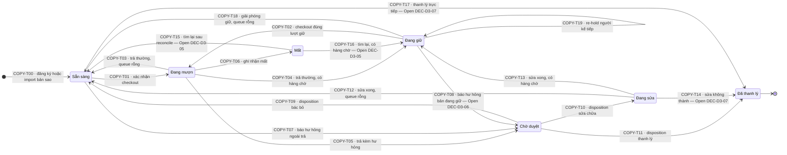
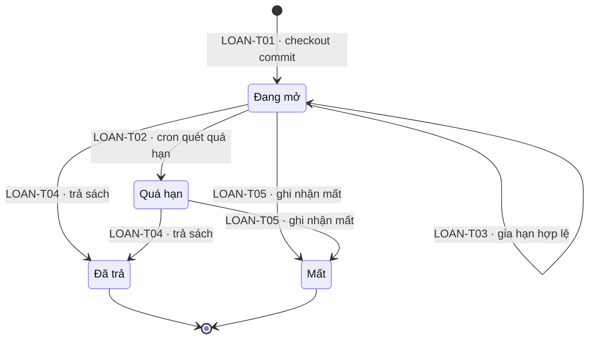
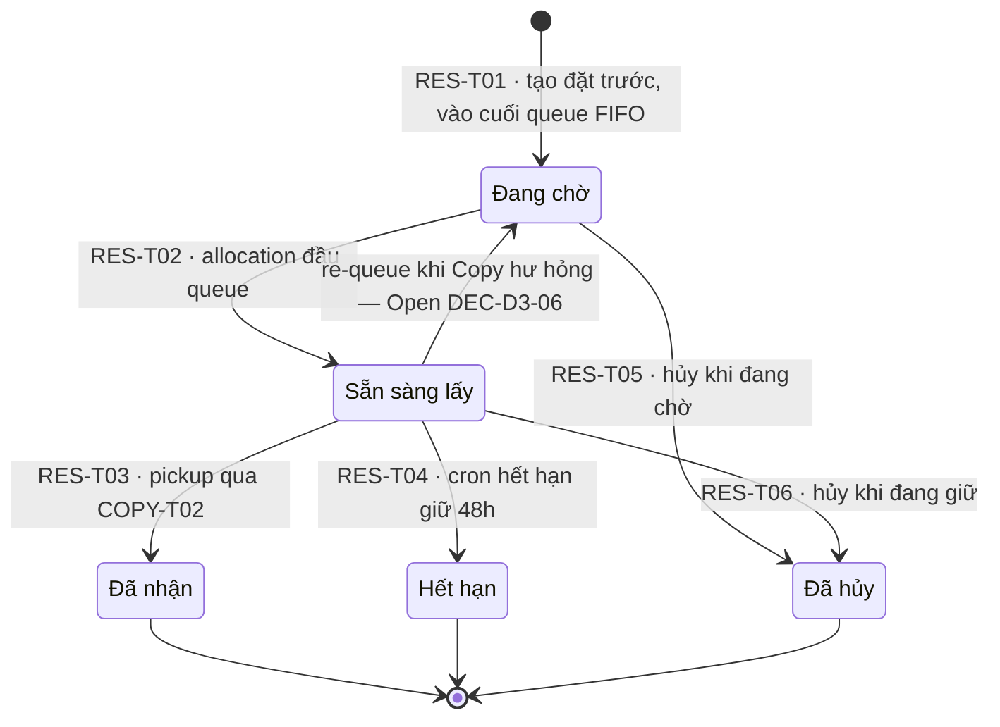
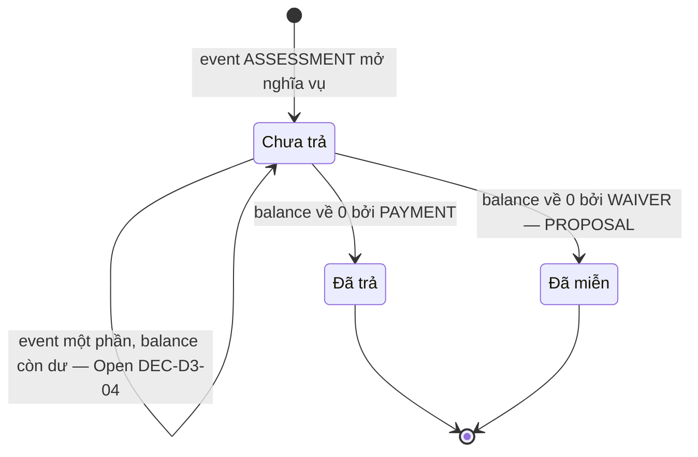
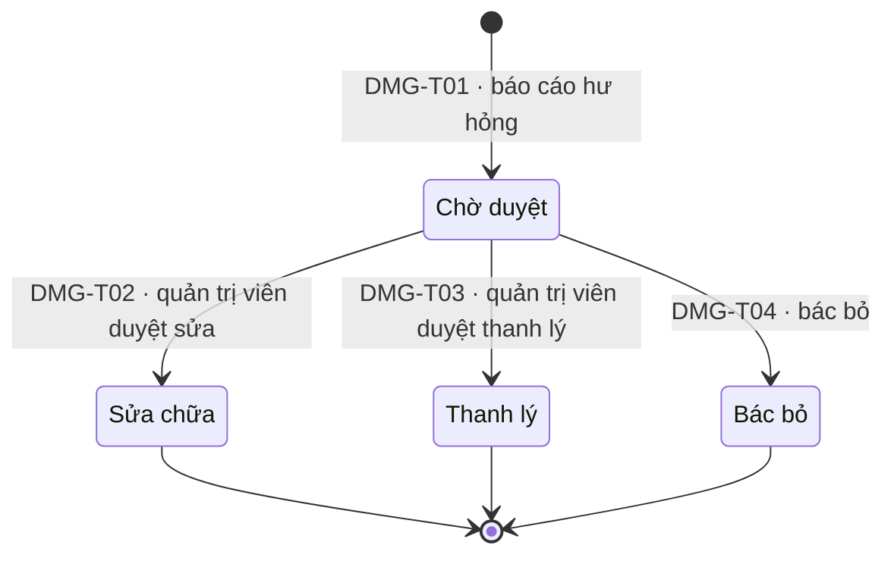

# library-management-platform — State Diagrams (SRS Tier 2)

> Draft cho file đích `docs/features/library-management-platform/srs/library-management-platform-states.md`. Nguồn transition chuẩn là `domain/lifecycle-inventory.md` — mọi transition ID trong inventory (`COPY-T00..T19`, `LOAN-T01..T05`, `RES-T01..T06`, `DMG-T01..T04`) xuất hiện đúng một lần trong đúng một diagram của file này, kèm bảng đối chiếu nhãn nguồn. File này không bịa transition mới; phần nào là reconstruction đều ghi nhãn `PROPOSAL`/`Open` kèm decision gate.

## 0. Quy ước chung

### 0.1 Nhãn nguồn

| Nhãn | Nghĩa |
|------|-------|
| `FACT` | Có căn cứ trực tiếp trong `docs/he_thong_quan_ly_thu_vien.md`, `project-profile.md` hoặc roadmap baseline (`product-roadmap-baseline.md` §5–§6). |
| `PROPOSAL` | Suy diễn/dựng lại để khép kín lifecycle; **chờ domain approval** qua `decision-register.md`. Không được xem là requirement. |
| `Open` | Transition/cơ chế gắn decision `Open` trong decision register — diagram chỉ vẽ ở dạng chờ duyệt, không khoá baseline. |

### 0.2 Cảnh báo reconstruction (hard-stop)

Sơ đồ "vòng đời bản sao · 7 trạng thái" và "luồng trả sách · 3 bước, 2 quyết định" trong tài liệu nguồn chỉ còn placeholder `[embedded content]` — **nội dung gốc đã mất** (OQ-LMP-004). Toàn bộ state machine Copy (Mục 1) và flow trả chi tiết là **PROPOSAL do BA dựng lại**; các transition mang nhãn `FACT` trong bảng đối chiếu là FACT **về trigger/quy tắc**, còn ma trận tổng thể vẫn chờ duyệt qua **DEC-D3-01 / DEC-D3-02** trước khi Phase 4 khoá state diagram.

### 0.3 Quy ước ký hiệu

- Tên node trong diagram = code trạng thái lưu (`AVAILABLE`, `ON_LOAN`, ...). Tên hiển thị tiếng Việt khai qua `state "..." as`.
- `[*] --> X` = transition tạo aggregate (∅ → trạng thái đầu). `X --> [*]` = kết thúc vòng đời hợp lệ của aggregate (terminal state).
- Label cạnh = `<ID transition> · <trigger ngắn>`; cạnh chờ duyệt ghi thêm `— Open <DEC-ID>`.
- Self-loop (`A --> A`) là transition thay đổi thuộc tính/chủ thể mà **không đổi trạng thái lưu** (ví dụ `COPY-T19` re-hold, `LOAN-T03` renew).
- Giá trị tính toán ("khả dụng", `Fine.balance`, vị trí queue) **không phải trạng thái** — không xuất hiện như node (inventory §1.1, §2.3, §5.1).

### 0.4 Quyền sở hữu trạng thái (single-writer)

| Trường trạng thái | Aggregate sở hữu | Ghi chú |
|-------------------|------------------|---------|
| `Copy.status` | Copy | Reservation/Loan không tự đổi; chỉ use case ghi trong cùng transaction |
| `Loan.status` | Loan | Return chỉ đọc Loan, đóng qua transition của Loan |
| `Reservation.status`, `held_copy_id` | Reservation | Gắn bản sao giữ là quyết định của Reservation |
| `Fine.status`, `Fine.balance` | Fine (suy từ `FinancialEvent`) | Không sửa balance trực tiếp; chỉ append event |
| `DamageReport.status` | DamageReport | Disposition là quyết định của report, không phải của Copy |

Nguồn: inventory §1.1 (FACT).

---

## 1. State: Copy (Bản sao)

**Related UC**: `uc-catalog-admin`, `uc-checkout`, `uc-return-renewal`, `uc-reservation`, `uc-damage-lost-found`
**Related BR**: BR-LMP-001/002/005/006/010, BR-01..BR-13 (nguồn), BR-11 khả dụng tính toán
**Nhãn tổng**: `PROPOSAL` — chờ **DEC-D3-01** (hard-stop, OQ-LMP-004). Tên 7 trạng thái là FACT (còn trong văn bản nguồn); ma trận transition là reconstruction.

### 1.1 Diagram

### 1.2 Legend trạng thái

| State | Tên | Nghĩa | Tính vào "khả dụng"? | Terminal? | Nhãn |
|-------|-----|-------|----------------------|-----------|------|
| `AVAILABLE` | Sẵn sàng | Trên kệ, cho mượn được nếu `is_loanable` | Có (nếu loanable) | Không | FACT (tên) |
| `ON_LOAN` | Đang mượn | Gắn với một Loan đang mở | Không | Không | FACT (tên) |
| `ON_HOLD` | Đang giữ | Gắn với một Reservation `READY`, chờ người đặt đến lấy trong hạn BR-10 | Không | Không | FACT (tên) |
| `PENDING_REVIEW` | Chờ duyệt | Bị báo cáo hư hỏng, chặn lưu thông chờ thủ thư (OQ-11 default) | Không | Không | FACT (tên) |
| `IN_REPAIR` | Đang sửa | Quản trị viên đã duyệt sửa chữa | Không | Không | FACT (tên) |
| `LOST` | Mất | Đã ghi nhận mất; có thể quay lại qua found-after-lost | Không | Không | FACT (tên) |
| `DISPOSED` | Đã thanh lý | Ra khỏi kho vĩnh viễn | Không | **Có** | FACT (tên) |

### 1.3 Bảng đối chiếu transition

| ID | Từ → Sang | Trigger | Actor | Nhãn | Source ref / Gate |
|----|-----------|---------|-------|------|--------------------|
| COPY-T00 | ∅ → AVAILABLE | Đăng ký/import bản sao | Thủ thư / Hệ thống import | PROPOSAL | FR-L03; OQ-15 — gộp DEC-D3-01 |
| COPY-T01 | AVAILABLE → ON_LOAN | Xác nhận checkout | Thủ thư / Quản trị viên | FACT | baseline §6.1; BR-13 |
| COPY-T02 | ON_HOLD → ON_LOAN | Checkout nhận sách đặt trước | Thủ thư / Quản trị viên | FACT | baseline §6.3 bước 4 |
| COPY-T03 | ON_LOAN → AVAILABLE | Trả bình thường, không hàng chờ | Thủ thư / Quản trị viên | FACT | baseline §5, §6.2, D5 |
| COPY-T04 | ON_LOAN → ON_HOLD | Trả bình thường, có hàng chờ | Thủ thư / Quản trị viên | FACT | baseline §6.3 bước 3, D5 |
| COPY-T05 | ON_LOAN → PENDING_REVIEW | Trả với hư hỏng | Thủ thư / Quản trị viên | FACT | baseline §6.2, §6.4 bước 4 |
| COPY-T06 | ON_LOAN → LOST | Ghi nhận mất sách | Thủ thư / Quản trị viên | FACT | FR-S07; baseline §5 |
| COPY-T07 | AVAILABLE → PENDING_REVIEW | Báo hư hỏng ngoài luồng trả | Thủ thư / Quản trị viên | FACT | baseline §6.4 bước 1–2 |
| COPY-T08 | ON_HOLD → PENDING_REVIEW | Báo hư hỏng trên bản đang giữ | Thủ thư / Quản trị viên | **PROPOSAL — Open DEC-D3-06** | Suy diễn; Reservation `READY` liên quan re-queue về `WAITING` |
| COPY-T09 | PENDING_REVIEW → AVAILABLE | Quản trị viên bác bỏ báo cáo | Quản trị viên | FACT | baseline §6.4 bước 3 |
| COPY-T10 | PENDING_REVIEW → IN_REPAIR | Quản trị viên duyệt sửa | Quản trị viên | FACT | baseline §6.4 bước 3 |
| COPY-T11 | PENDING_REVIEW → DISPOSED | Quản trị viên duyệt thanh lý | Quản trị viên | FACT | baseline §6.4 bước 3 |
| COPY-T12 | IN_REPAIR → AVAILABLE | Sửa xong, không hàng chờ | Thủ thư / Quản trị viên | FACT | baseline §5 ghi chú |
| COPY-T13 | IN_REPAIR → ON_HOLD | Sửa xong, có hàng chờ | Thủ thư / Quản trị viên | FACT | baseline §5 ghi chú (explicit) |
| COPY-T14 | IN_REPAIR → DISPOSED | Sửa không thành, thanh lý | Quản trị viên | **PROPOSAL — Open DEC-D3-07** | Suy diễn |
| COPY-T15 | LOST → AVAILABLE | Found-after-lost, reconcile xong, không hàng chờ | Thủ thư / Quản trị viên | **PROPOSAL — Open DEC-D3-05** | Baseline "Có điều kiện nếu tìm lại"; tiền đề: financial reconciliation xong |
| COPY-T16 | LOST → ON_HOLD | Found-after-lost, reconcile xong, có hàng chờ | Thủ thư / Quản trị viên | **PROPOSAL — Open DEC-D3-05** | Suy diễn |
| COPY-T17 | AVAILABLE → DISPOSED | Thanh lý trực tiếp không qua hư hỏng | Quản trị viên | **PROPOSAL — Open DEC-D3-07** | Suy diễn (BR-12 vô hiệu hoá) |
| COPY-T18 | ON_HOLD → AVAILABLE | Giải phóng giữ chỗ (hết hạn/hủy), queue rỗng | Hệ thống (cron) / Thủ thư | FACT | baseline §6.3 bước 4; §8 cron |
| COPY-T19 | ON_HOLD → ON_HOLD | Giải phóng giữ chỗ, queue còn người (re-hold) | Hệ thống | FACT | baseline §6.3 bước 4; BR-09 — self-loop nguyên tử |

### 1.4 Invariants — Copy

| # | Invariant | Nhãn / nguồn |
|---|-----------|--------------|
| CP-INV-01 | `Copy.status` chỉ aggregate Copy sở hữu; mọi cập nhật chéo (Reservation/Loan/DamageReport) đi qua use case trong **cùng một transaction**. | FACT — inventory §1.1 |
| CP-INV-02 | Checkout chỉ hợp lệ từ `AVAILABLE` (COPY-T01) hoặc `ON_HOLD` đúng chủ (COPY-T02); chống tranh bằng CAS trên `Copy.version` + allowed-source-state. | FACT — BR-13, NFR-03, AT-CHK-03 |
| CP-INV-03 | "Khả dụng" = đếm Copy `AVAILABLE` **và** `is_loanable = true` — giá trị **tính toán** (BR-11), không lưu counter, không phải trạng thái. | FACT (BR-11) + PROPOSAL (is_loanable, DEC-D3-09) |
| CP-INV-04 | `is_loanable` là **thuộc tính** trên Title (mặc định) và override trên Copy — đổi `is_loanable` không phải state transition nhưng vẫn ghi audit. | PROPOSAL — DEC-D3-09 |
| CP-INV-05 | `DISPOSED` là terminal duy nhất: không transition ra; API từ chối `DISPOSED → *` (E-LMP-015). | FACT |
| CP-INV-06 | Trong flow trả: **đóng Loan và tính phạt trước, quyết trạng thái Copy sau**; bước đóng Loan → quyết Copy → audit/outbox trong một transaction. | FACT (thứ tự) + PROPOSAL chi tiết — DEC-D3-02 |
| CP-INV-07 | Một Copy tối đa một Reservation `READY` giữ (`held_copy_id` unique khi đang giữ) và tối đa một DamageReport `PENDING`. | PROPOSAL — AT-RSV-02, inventory §6 |
| CP-INV-08 | Mọi transition ghi audit cùng transaction; notification qua durable outbox, không làm fail business write. | FACT — NFR-04, BR-LMP-013/016 |

### 1.5 Invalid transitions — Copy

| Từ → Sang | Vì sao invalid | Hành vi |
|-----------|----------------|---------|
| `DISPOSED → *` | Terminal; ra kho vĩnh viễn | API từ chối (E-LMP-015) |
| `* → ON_LOAN` ngoài T01/T02 | Chỉ mượn từ `AVAILABLE` hoặc `ON_HOLD` đúng chủ | Từ chối + gợi ý trạng thái hiện tại |
| `ON_LOAN → ON_LOAN` | Gia hạn là thuộc tính Loan, không đổi Copy | Không áp dụng |
| `AVAILABLE → ON_HOLD` trực tiếp | Giữ chỗ chỉ qua allocation của Reservation (T04/T13/T19) | Từ chối |
| `PENDING_REVIEW → ON_LOAN/ON_HOLD` | Chưa có disposition | Từ chối |
| `LOST → ON_LOAN` | Loan đã đóng `LOST`; found đi qua T15/T16 + reconcile | Từ chối |
| `IN_REPAIR → ON_LOAN` | Phải về AVAILABLE/ON_HOLD trước | Từ chối |
| `ON_HOLD → PENDING_REVIEW` do người đặt hủy | Hủy reservation giải phóng qua T18/T19, không tạo DamageReport | Từ chối nghiệp vụ sai |

---

## 2. State: Loan (Phiếu mượn)

**Related UC**: `uc-checkout`, `uc-return-renewal`
**Related BR**: BR-LMP-001/003/004, BR-01..BR-05 (nguồn)
**Nhãn**: trạng thái và transition lõi là `FACT` (baseline §5, §6.3); phần "không reopen" của LOAN-T05 là `PROPOSAL`.

### 2.1 Diagram

### 2.2 Legend trạng thái

| State | Tên | Nghĩa | Terminal? | Nhãn |
|-------|-----|-------|-----------|------|
| `ACTIVE` | Đang mở | Loan đang hiệu lực, `due_at = borrowed + kỳ hạn BR-04` | Không | FACT |
| `OVERDUE` | Quá hạn | `now > due_at`, chưa trả; BR-03 chặn mượn mới | Không | FACT |
| `RETURNED` | Đã trả | Đóng bởi trả sách; ghi `returned_at`, `return_condition`, `closed_by` | **Có** | FACT |
| `LOST` | Mất | Đóng bởi ghi nhận mất; bồi thường BR-06 đã assess | **Có** | FACT |

### 2.3 Bảng đối chiếu transition

| ID | Từ → Sang | Trigger | Actor | Nhãn | Source ref / Gate |
|----|-----------|---------|-------|------|--------------------|
| LOAN-T01 | ∅ → ACTIVE | Checkout commit | Thủ thư / Quản trị viên | FACT | baseline §6.1 |
| LOAN-T02 | ACTIVE → OVERDUE | Cron quét quá hạn 00:05 | Hệ thống | FACT | baseline §5; §8 cron |
| LOAN-T03 | ACTIVE → ACTIVE | Gia hạn (self-loop: `due_at += 7 ngày`, `renew_count++`) | Người đọc / Thủ thư / Quản trị viên | FACT | FR-R06/S06; BR-04 — ngưỡng OQ-LMP-010 |
| LOAN-T04 | ACTIVE/OVERDUE → RETURNED | Trả sách | Thủ thư / Quản trị viên | FACT | baseline §5, §6.2 |
| LOAN-T05 | ACTIVE/OVERDUE → LOST | Ghi nhận mất | Thủ thư / Quản trị viên | FACT + PROPOSAL (không reopen) | baseline §5; FR-S07 — phần reopen theo DEC-D3-05 |

### 2.4 Invariants — Loan

| # | Invariant | Nhãn / nguồn |
|---|-----------|--------------|
| LN-INV-01 | `RETURNED` và `LOST` là terminal: **không reopen**. Sai sót sửa qua quy trình điều chỉnh + audit; found-after-lost xử lý ở Copy (COPY-T15/T16) + Fine compensation — không mở lại Loan. | FACT (terminal) + PROPOSAL (DEC-D3-05) |
| LN-INV-02 | Renew (LOAN-T03) chỉ đổi thuộc tính Loan (`due_at`, `renew_count`); **không** đổi `Copy.status`; bị từ chối khi quá hạn, có reservation chờ hoặc đạt limit. | FACT — BR-LMP-004 |
| LN-INV-03 | Loan chỉ được tạo qua checkout (∅ → ACTIVE); cấm ∅ → OVERDUE/RETURNED/LOST. | FACT |
| LN-INV-04 | Checkout nguyên tử all-or-nothing theo commit set; idempotent theo `operation_id`; tranh chấp CAS — transition commit trước thắng, giao dịch sau nhận E-LMP-005. | FACT — BR-LMP-001, AT-CHK-01/02/03 |
| LN-INV-05 | Double-return trên Loan đã `RETURNED` → idempotent reject, trả kết quả gốc. | PROPOSAL — khớp AT-RSV-03 pattern |
| LN-INV-06 | Đóng Loan (T04/T05) luôn kèm assess phạt (quá hạn BR-05, hư hỏng BR-07, mất BR-06) và Copy transition tương ứng trong cùng transaction. | FACT — inventory §2.4 |

### 2.5 Invalid transitions — Loan

| Từ → Sang | Vì sao invalid | Hành vi |
|-----------|----------------|---------|
| `RETURNED/LOST → *` | Terminal | API từ chối (E-LMP-015) |
| `OVERDUE → ACTIVE` không qua renew hợp lệ | Renew bị cấm khi quá hạn (BR-LMP-004) | Từ chối |
| `∅ → OVERDUE/RETURNED/LOST` | Phải qua ACTIVE | Từ chối |
| `RETURNED → RETURNED` (double-return) | Idempotent | Trả kết quả gốc (E-LMP-006) |

---

## 3. State: Reservation (Đặt trước)

**Related UC**: `uc-reservation` (release owner: **R2** — DEC-P2-05; luồng trả R1A không phân bổ hàng chờ)
**Related BR**: BR-LMP-005/006, BR-08/09/10 (nguồn)
**Nhãn**: trạng thái và transition `FACT` (baseline §5, §6.3, FR-R08); nhánh re-queue `READY → WAITING` là `PROPOSAL — Open DEC-D3-06`; `skip`/`suspend` **không nằm trong baseline** — `Open DEC-D3-03`.

### 3.1 Diagram

### 3.2 Legend trạng thái

| State | Tên | Nghĩa | Terminal? | Nhãn |
|-------|-----|-------|-----------|------|
| `WAITING` | Đang chờ | Trong hàng chờ FIFO của title, chưa được gán Copy | Không | FACT |
| `READY` | Sẵn sàng lấy | Đã giữ `held_copy_id`, `hold_expires_at = +48h` (BR-10) | Không | FACT |
| `FULFILLED` | Đã nhận | Người đặt đã checkout qua COPY-T02 | **Có** | FACT |
| `EXPIRED` | Hết hạn | Quá `hold_expires_at`, cron đóng và advance queue | **Có** | FACT |
| `CANCELLED` | Đã hủy | Bị hủy bởi người đọc/nhân viên | **Có** | FACT |

### 3.3 Bảng đối chiếu transition

| ID | Từ → Sang | Trigger | Actor | Nhãn | Source ref / Gate |
|----|-----------|---------|-------|------|--------------------|
| RES-T01 | ∅ → WAITING | Tạo đặt trước khi title `khả dụng = 0` (BR-08) | Người đọc / Thủ thư / Quản trị viên | FACT + PROPOSAL (dedup cùng title) | baseline §6.3; BR-08/09 |
| RES-T02 | WAITING → READY | Allocation khi Copy về (COPY-T04/T13/T15/T16/T19) | Hệ thống | FACT | baseline §6.3 bước 3 — nguyên tử AT-RSV-01 |
| RES-T03 | READY → FULFILLED | Người đặt đến nhận, checkout | Thủ thư / Quản trị viên | FACT | baseline §5; §6.3 bước 4 |
| RES-T04 | READY → EXPIRED | Cron hết hạn giữ (mỗi 15 phút) | Hệ thống | FACT | baseline §5; §8 cron; BR-10 |
| RES-T05 | WAITING → CANCELLED | Hủy khi đang chờ | Người đọc / Thủ thư / Quản trị viên | FACT | baseline §5; ma trận quyền |
| RES-T06 | READY → CANCELLED | Hủy khi đang giữ | Người đọc / Thủ thư / Quản trị viên | FACT | baseline §5 — nguyên tử với COPY-T18/T19 |
| *(COPY-T08 side effect)* | READY → WAITING | Copy đang giữ bị báo hư hỏng → re-queue giữ vị trí | Hệ thống (cùng transaction COPY-T08) | **PROPOSAL — Open DEC-D3-06** | inventory COPY-T08; chưa có nguồn |

### 3.4 Invariants — Reservation

| # | Invariant | Nhãn / nguồn |
|---|-----------|--------------|
| RSV-INV-01 | `WAITING → READY` nguyên tử cùng `Copy → ON_HOLD` + `held_copy_id` + `hold_expires_at` + outbox notify — một transaction, CAS trên cả hai aggregate. | PROPOSAL — AT-RSV-01 (khớp BR-LMP-005) |
| RSV-INV-02 | Một Copy tối đa một Reservation `READY`; một reader tối đa một Reservation mở cho cùng title (constraint DB). | PROPOSAL — AT-RSV-02 |
| RSV-INV-03 | `READY → EXPIRED/CANCELLED` nguyên tử với giải phóng Copy + queue advance: gán người kế (COPY-T19) hoặc về `AVAILABLE` (COPY-T18) — không lộ trạng thái trung gian. | PROPOSAL — AT-RSV-04; FACT về yêu cầu BR-LMP-006 |
| RSV-INV-04 | Thứ tự FIFO = `created_at` hợp lệ; allocation luôn chọn đầu queue tại thời điểm commit. | FACT — BR-09, AT-RSV-05 |
| RSV-INV-05 | Notify fail **không** rollback business transition: `READY` không tự hủy vì lỗi notify, `hold_expires_at` vẫn chạy; outbox retry + dead-letter, escalation cảnh báo vận hành sau ngưỡng retry. | FACT (outbox bền) + PROPOSAL kênh escalation — DEC-D3-08 |
| RSV-INV-06 | Race hủy-vs-allocate phân giải bằng CAS trên `Reservation.status`: ai commit trước thắng, nhánh sau đi đường tương ứng (RES-T06 hoặc bỏ qua + advance); cả hai idempotent. | PROPOSAL — cơ chế; FACT yêu cầu BR-13 |
| RSV-INV-07 | `skip`/`suspend` **không có trong baseline** — chỉ thêm khi `DEC-D3-03` approved. | Open — DEC-D3-03 |
| RSV-INV-08 | Release boundary: Reservation trọn vòng một release owner = R2; ở R1A D5 luôn nhánh "không có hàng chờ" nên COPY-T04/T13/T19 và RES-T02/T04/T06 chưa phát sinh trong R1A. | PROPOSAL — DEC-P2-05 (hard-stop release boundary) |

### 3.5 Invalid transitions — Reservation

| Từ → Sang | Vì sao invalid | Hành vi |
|-----------|----------------|---------|
| `WAITING → FULFILLED` | Phải qua READY + pickup | Từ chối (E-LMP-015) |
| `FULFILLED/EXPIRED/CANCELLED → *` | Terminal | Từ chối |
| `READY → WAITING` ngoài nhánh COPY-T08 | Re-queue chỉ qua cơ chế DEC-D3-06 (Open) | Từ chối |
| Tạo RES khi title còn bản khả dụng | Vi phạm BR-08 | Từ chối nghiệp vụ |

---

## 4. State: Fine (Khoản phạt) — ledger-derived

**Related UC**: `uc-fine-payment`, `uc-return-renewal` (assessment), `uc-damage-lost-found` (compensation)
**Related BR**: BR-LMP-007/008, BR-05/06/07 (nguồn)
**Nhãn**: 3 trạng thái `FACT` (data model §7); transition **suy ra từ `FinancialEvent`** — công thức balance, partial payment, SoD là `PROPOSAL`/`Open` (DEC-D3-04/05/08, OQ-LMP-005/009).

### 4.1 Diagram

> Fine **không có transition do actor gọi trực tiếp**: mọi thay đổi trạng thái là hệ quả của việc append `FinancialEvent` vào ledger; `balance` tính lại được từ ledger, `status` đóng khi `balance = 0`.

### 4.2 Legend trạng thái

| State | Tên | Nghĩa | Terminal? | Nhãn |
|-------|-----|-------|-----------|------|
| `UNPAID` | Chưa trả | `balance > 0` suy từ ledger | Không | FACT |
| `PAID` | Đã trả | `balance = 0`, event chốt cuối là PAYMENT (hoặc hỗn hợp) | **Có** | FACT + PROPOSAL (quy tắc nhãn event cuối) |
| `WAIVED` | Đã miễn | `balance = 0` do WAIVER | **Có** | FACT + PROPOSAL |

### 4.3 Bảng đối chiếu transition (event-derived — không có ID `FINE-Tnn` trong id-registry)

| Đường đi | Điều kiện | Event quyết định | Nhãn | Source ref / Gate |
|----------|-----------|------------------|------|--------------------|
| ∅ → UNPAID | Nghĩa vụ phát sinh (đóng Loan assess, manual assessment) | `ASSESSMENT` | FACT (BR-05/06/07) + PROPOSAL (manual) | inventory §5.1–5.2 |
| UNPAID → UNPAID | Event làm giảm/tăng nhưng `balance > 0` | `PAYMENT`/`WAIVER`/`ADJUSTMENT`/`REVERSAL` một phần | **PROPOSAL — Open DEC-D3-04** (partial payment) | OQ-LMP-005 |
| UNPAID → PAID | `balance = 0`, event chốt mang tính thu tiền | `PAYMENT` (đủ) | FACT | FR-S08; inventory §5.1 |
| UNPAID → WAIVED | `balance = 0`, event chốt mang tính miễn | `WAIVER` (hoặc hỗn hợp — event cuối quyết nhãn) | **PROPOSAL** | DEC-D3-04; OQ-LMP-005 |
| PAID/WAIVED → (nghĩa vụ mới) | Reversal/refund sau đóng tạo dư âm hoặc nghĩa vụ mới | `REVERSAL`/`ADJUSTMENT`/`REFUND` → mở **Fine mới**, không reopen | **PROPOSAL — Open DEC-D3-04/05** | OQ-LMP-005/009 |

**`FinancialEvent` types (append-only)** — nguồn: inventory §5.2.

| Event | Chiều tiền | Actor được phép | Nhãn |
|-------|-----------|-----------------|------|
| `ASSESSMENT` | + nghĩa vụ | Hệ thống (đóng Loan) / Thủ thư (manual) | FACT + PROPOSAL (manual) |
| `PAYMENT` | − thu tiền mặt | Thủ thư / Quản trị viên (FR-S08) | FACT |
| `WAIVER` | − miễn | Thủ thư trở lên + lý do bắt buộc | PROPOSAL — DEC-D3-04 |
| `ADJUSTMENT` | ± điều chỉnh | Thủ thư + lý do; ngưỡng duyệt cao hơn là OQ | PROPOSAL — OQ-LMP-005 |
| `REVERSAL` | đảo một event sai | Thủ thư + tham chiếu event gốc | PROPOSAL — OQ-LMP-009 |
| `REFUND` | − tiền ra (đã thu thừa) | Thủ thư; theo policy finance | PROPOSAL — OQ-LMP-005 |
| `RECONCILIATION` | 0 (đối soát ca/kỳ) | Thủ thư | PROPOSAL — DEC-D3-08 |

### 4.4 Invariants — Fine

| # | Invariant | Nhãn / nguồn |
|---|-----------|--------------|
| FIN-INV-01 | `FinancialEvent` **append-only**: không UPDATE/DELETE; sửa sai bằng `REVERSAL` trỏ event gốc. `balance` = Σ events tính lại được; có thể cache nhưng phải đối soát được. | FACT (nguyên tắc) + PROPOSAL (công thức) — AT-FIN-01, BR-LMP-007 |
| FIN-INV-02 | **Không có trạng thái `PARTIALLY_PAID`**: trả một phần là PAYMENT < balance, Fine vẫn `UNPAID`. Partial payment chờ finance approval. | PROPOSAL — Open DEC-D3-04 / OQ-LMP-005 |
| FIN-INV-03 | `PAID`/`WAIVED` terminal — **không reopen**; nghĩa vụ mới sau đóng → mở Fine mới. | PROPOSAL — inventory §5.1 |
| FIN-INV-04 | SoD: người duyệt `WAIVER`/`ADJUSTMENT` không được là người đã tạo `ASSESSMENT` thủ công cho cùng khoản; Thủ thư (quầy) chỉ `PAYMENT`. | PROPOSAL — DEC-D3-04 (hard-stop finance) |
| FIN-INV-05 | Payment idempotent theo operation key (BR-LMP-008); `receipt_no` unique; reconcile job lệch → `RECONCILIATION` + alert. | FACT (idempotent) + PROPOSAL — DEC-D3-08, AT-FIN-02/03 |
| FIN-INV-06 | Lost→found: nghĩa vụ LOST đã assess **không tự xóa** — chưa thu → `REVERSAL`/`ADJUSTMENT` về 0; đã thu → `REFUND`; có thể giữ phí xử lý BR-06. Compensation + Copy transition trong một transaction (AT-FIN-04). | PROPOSAL — Open DEC-D3-05; OQ-LMP-005 |
| FIN-INV-07 | Mọi event nhạy cảm yêu cầu `reason` + audit cùng transaction; audit fail → rollback. | FACT — NFR-04, AT-CHK-04 |

### 4.5 Invalid transitions — Fine

| Từ → Sang | Vì sao invalid | Hành vi |
|-----------|----------------|---------|
| `PAID/WAIVED → UNPAID` | Không reopen; dùng event + Fine mới | Từ chối |
| `∅ → PAID/WAIVED` | Phải qua `ASSESSMENT` mở `UNPAID` | Từ chối |
| Sửa `balance` trực tiếp | Chỉ append event | Từ chối ghi trực tiếp |
| `PAYMENT` bởi Thủ thư cho khoản cần duyệt | SoD/quyền hạn | E-LMP-002/016 |

---

## 5. State: DamageReport (Báo cáo hư hỏng)

**Related UC**: `uc-damage-lost-found`, `uc-return-renewal` (phát hiện lúc trả)
**Related BR**: BR-LMP-009/012, BR-07 (nguồn)
**Nhãn**: `FACT` (data model §7, baseline §6.4); phần khôi phục trạng thái trước report của DMG-T04 là `PROPOSAL`.

### 5.1 Diagram

### 5.2 Legend trạng thái

| State | Tên | Nghĩa | Terminal? | Nhãn |
|-------|-----|-------|-----------|------|
| `PENDING` | Chờ duyệt | Report mở, chờ quản trị viên disposition; Copy bị chặn ở `PENDING_REVIEW` (OQ-11 default) | Không | FACT |
| `REPAIR` | Sửa chữa | Disposition sửa; Copy → `IN_REPAIR`, theo dõi đến khi sửa xong | **Có** (với report) | FACT |
| `DISPOSE` | Thanh lý | Disposition thanh lý; Copy → `DISPOSED` | **Có** | FACT |
| `REJECTED` | Bác bỏ | Xác định không hư hỏng; Copy quay trạng thái trước report nếu còn hợp lệ | **Có** | FACT + PROPOSAL (phần khôi phục) |

### 5.3 Bảng đối chiếu transition

| ID | Từ → Sang | Trigger | Actor | Nhãn | Source ref / Gate |
|----|-----------|---------|-------|------|--------------------|
| DMG-T01 | ∅ → PENDING | Báo cáo hư hỏng (quầy hoặc khi trả); 1–5 ảnh, severity, note | Thủ thư / Quản trị viên | FACT | baseline §6.4; FR-S05 — side effect Copy → PENDING_REVIEW |
| DMG-T02 | PENDING → REPAIR | Quản trị viên duyệt sửa | Quản trị viên | FACT | baseline §6.4 bước 3; FR-L08 — side effect Copy → IN_REPAIR (COPY-T10) |
| DMG-T03 | PENDING → DISPOSE | Quản trị viên duyệt thanh lý | Quản trị viên | FACT | baseline §6.4 bước 3 — side effect Copy → DISPOSED (COPY-T11); fine DAMAGE gắn loan giữ độc lập |
| DMG-T04 | PENDING → REJECTED | Quản trị viên bác bỏ | Quản trị viên | FACT + PROPOSAL (khôi phục trạng thái trước) | baseline §6.4 bước 3 — side effect Copy → AVAILABLE hoặc trạng thái lưu trước report (COPY-T09) |

### 5.4 Invariants — DamageReport

| # | Invariant | Nhãn / nguồn |
|---|-----------|--------------|
| DMG-INV-01 | Một Copy tối đa **một** DamageReport `PENDING` tại một thời điểm; báo cáo lặp trên cùng Copy gộp vào report đang mở hoặc từ chối idempotent. | PROPOSAL — inventory §6 |
| DMG-INV-02 | Report không tự đóng — chỉ đóng khi có disposition (`REPAIR`/`DISPOSE`/`REJECTED`) + audit đầy đủ. | FACT — BR-LMP-009 |
| DMG-INV-03 | DMG-T01 chặn lưu thông ngay: Copy → `PENDING_REVIEW` trong cùng transaction (OQ-11 default). | FACT — inventory DMG-T01 |
| DMG-INV-04 | `loan_id` nullable liên kết return phát hiện hư hỏng → phạt BR-07 gắn Loan đó; fine DAMAGE giữ **độc lập** với disposition thanh lý. | FACT — baseline §6.4 bước 4 |
| DMG-INV-05 | Disposition là quyết định của DamageReport (aggregate sở hữu), không phải Copy tự duyệt; Copy chỉ nhận side-effect transition tương ứng (COPY-T09/T10/T11). | FACT — inventory §1.1 |

### 5.5 Invalid transitions — DamageReport

| Từ → Sang | Vì sao invalid | Hành vi |
|-----------|----------------|---------|
| `REPAIR/DISPOSE/REJECTED → *` | Terminal cho report | Từ chối (E-LMP-015) |
| `PENDING → PENDING` (báo lặp) | Một report mở/Copy | Gộp vào report đang mở hoặc idempotent reject |
| `∅ → REPAIR/DISPOSE/REJECTED` | Phải qua review PENDING | Từ chối |

---

## 6. Invariants chéo aggregate (đọc cùng mọi diagram)

| # | Invariant | Nhãn / nguồn |
|---|-----------|--------------|
| X-INV-01 | **Atomic boundary cross-aggregate**: cặp transition liên kết (RES-T02 + Copy→ON_HOLD; RES-T04/T06 + COPY-T18/T19; LOAN-T04/T05 + COPY-T03..T06; DMG-T02/T03/T04 + COPY-T09/T10/T11) commit trong **một transaction** — không có trạng thái trung gian lộ ra ngoài. | FACT — NFR-03, BR-LMP-005/006 + PROPOSAL chi tiết (AT-RSV-01/04) |
| X-INV-02 | **Concurrency**: mọi transition nhạy cảm dùng CAS trên `version` + allowed-source-state; giao dịch thua nhận E-LMP-005 "Sách vừa được cập nhật". | FACT — BR-13, AT-CHK-03 |
| X-INV-03 | **Idempotency**: checkout/payment/cron expire/cancel đều replay-safe qua operation key hoặc CAS trạng thái; chạy lặp trả kết quả gốc, không nhân đôi side effect. | FACT + PROPOSAL — AT-CHK-02, AT-RSV-03, AT-FIN-02 |
| X-INV-04 | **Audit**: mọi transition ghi `AuditEvent` cùng transaction; audit fail → rollback business write. | FACT — NFR-04, BR-LMP-013 |
| X-INV-05 | **Notification**: outbox event ghi trong transaction business; delivery retry sau, không làm fail transition; dead-letter sau ngưỡng + escalation (Open DEC-D3-08). | FACT — BR-LMP-016, NFR-07 |
| X-INV-06 | Không aggregate nào sở hữu quyết định của aggregate khác (bảng §0.4); cập nhật chéo chỉ qua use case trong cùng transaction. | FACT — inventory §1.1, §8 |

## 7. Phủ transition — kiểm chứng đối chiếu inventory

| Aggregate | Dải ID trong inventory | Xuất hiện trong file | Thiếu? |
|-----------|------------------------|----------------------|--------|
| Copy | COPY-T00..T19 (20) | Mục 1.1 diagram + 1.3 bảng (20 dòng) | Không |
| Loan | LOAN-T01..T05 (5) | Mục 2.1 diagram + 2.3 bảng (T04/T05 khai trên 2 nhánh ACTIVE/OVERDUE) | Không |
| Reservation | RES-T01..T06 (6) + nhánh re-queue của COPY-T08 | Mục 3.1 diagram + 3.3 bảng | Không |
| Fine | Không có series `FINE-Tnn` — transition suy từ `FinancialEvent` | Mục 4.1 diagram + 4.3 bảng đối chiếu event | Không |
| DamageReport | DMG-T01..T04 (4) | Mục 5.1 diagram + 5.3 bảng | Không |

Terminal hợp lệ (không phải dead-end): `DISPOSED` (Copy); `RETURNED`, `LOST` (Loan); `FULFILLED`, `EXPIRED`, `CANCELLED` (Reservation); `PAID`, `WAIVED` (Fine); `REPAIR`, `DISPOSE`, `REJECTED` (DamageReport) — tất cả nối `--> [*]` trong diagram.

## 8. Điểm PROPOSAL / Open cần domain approver duyệt

| Decision | Ảnh hưởng trong file này | Approver | Hard-stop? | Gate |
|----------|--------------------------|----------|------------|------|
| DEC-D3-01 | **Toàn bộ** state machine Copy (Mục 1) là reconstruction do sơ đồ gốc mất | Thủ thư trưởng | Có — OQ-LMP-004 | Trước khi Phase 4 khoá state diagram |
| DEC-D3-02 | Thứ tự flow trả → semantics COPY-T03/T04/T05/T06 (Mục 1.3, CP-INV-06) | Thủ thư trưởng | Có — OQ-LMP-004 | Cùng DEC-D3-01 |
| DEC-D3-03 | `skip`/`suspend` Reservation **không** có trong diagram Mục 3 — chỉ thêm khi approved | Product owner | Không | Trước Phase 4 |
| DEC-D3-04 | Self-loop `UNPAID → UNPAID` (partial payment), nhãn `WAIVED`, SoD (Mục 4) | Finance owner + Thủ thư trưởng | Có — OQ-LMP-005/009 | Trước release có thu phạt |
| DEC-D3-05 | COPY-T15/T16 lost→found + compensation events (Mục 1, 4.4 FIN-INV-06) | Finance owner | Có — OQ-LMP-005 | Trước SRS financial model |
| DEC-D3-06 | COPY-T08 + nhánh `READY → WAITING` re-queue (Mục 1, 3.1) | Thủ thư trưởng | Không | Trước SRS states |
| DEC-D3-07 | COPY-T14/T17 thanh lý trực tiếp / sửa-không-thành (Mục 1) | Thủ thư trưởng | Không | Trước SRS states |
| DEC-D3-08 | `receipt_no` unique, `RECONCILIATION`, escalation notify (Mục 4.4, RSV-INV-05) | Finance + product owner | Không | Trước release có thu phạt |
| DEC-D3-09 | `is_loanable` là attribute không phải state (CP-INV-03/04) | Thủ thư trưởng | Không — OQ-10 default | Trước ERD |
| DEC-P2-05 | Release boundary Reservation = R2; nhánh queue chưa phát sinh trong R1A (RSV-INV-08) | Thủ thư trưởng | Có — release boundary | Trước L1 roadmap |

## 9. Traceability nhanh (transition → FR/BR)

| Cụm transition | FR SRS | BR SRS | Ghi chú |
|----------------|--------|--------|---------|
| COPY-T00 | FR-LMP-002, FR-LMP-022 | BR-LMP-014 | Đăng ký + import |
| COPY-T01/T02, LOAN-T01, RES-T03 | FR-LMP-008/009/012 | BR-LMP-001/002/003 | Checkout nguyên tử |
| LOAN-T02 | FR-LMP-010 | BR-LMP-003 | Cron quá hạn + chặn mượn |
| LOAN-T03 | FR-LMP-011 | BR-LMP-004 | Renew |
| LOAN-T04/T05 + COPY-T03..T06, DMG-T01 | FR-LMP-010/014/017/018 | BR-LMP-005/007 | Return flow — DEC-D3-02 |
| RES-T01..T06 + COPY-T18/T19 | FR-LMP-012/013 | BR-LMP-005/006 | Reservation — R2 (DEC-P2-05) |
| DMG-T02/T03/T04 + COPY-T09/T10/T11 | FR-LMP-017 | BR-LMP-009 | Disposition |
| COPY-T15/T16 + compensation events | FR-LMP-018 | BR-LMP-010 | Lost→found — DEC-D3-05 |
| Fine event-derived | FR-LMP-014/015/016 | BR-LMP-007/008 | Ledger append-only — DEC-D3-04/08 |
