# Library Management Platform — User Flow

> Nguồn chia flow duy nhất cho wireframe và prototype của feature này. Bộ HTML wireframe dùng khung Mobile 375 theo quyết định ngày 2026-10-07. Phạm vi production của portal Người đọc R2 và màn reader R1B vẫn chờ OQ-LMP-015 và OQ-LMP-016.

## 1. User Flow (tổng)

> Phủ happy, error và edge case. `[n]` là số màn hình đối chiếu Mục 2. Reservation R2 là future/not in pilot.

### Flow: auth-flow — R0

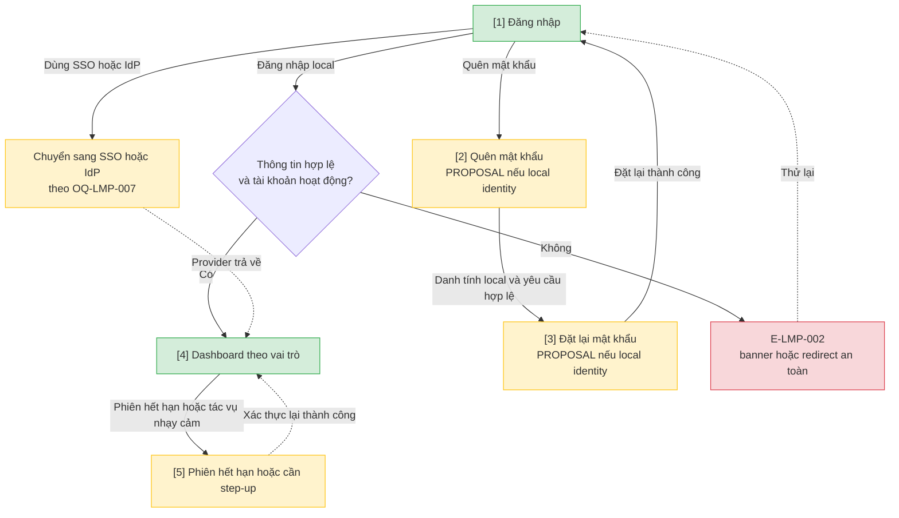

### Flow: catalog-admin-flow — R0/R1A

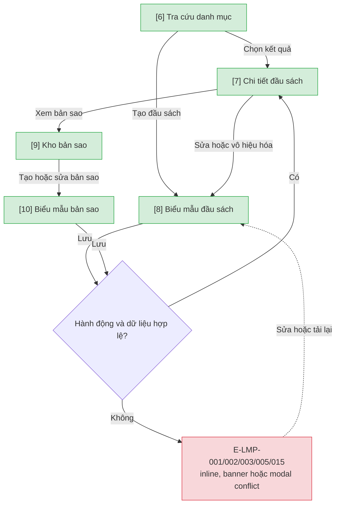

### Flow: reader-admin-flow — R0/R1B

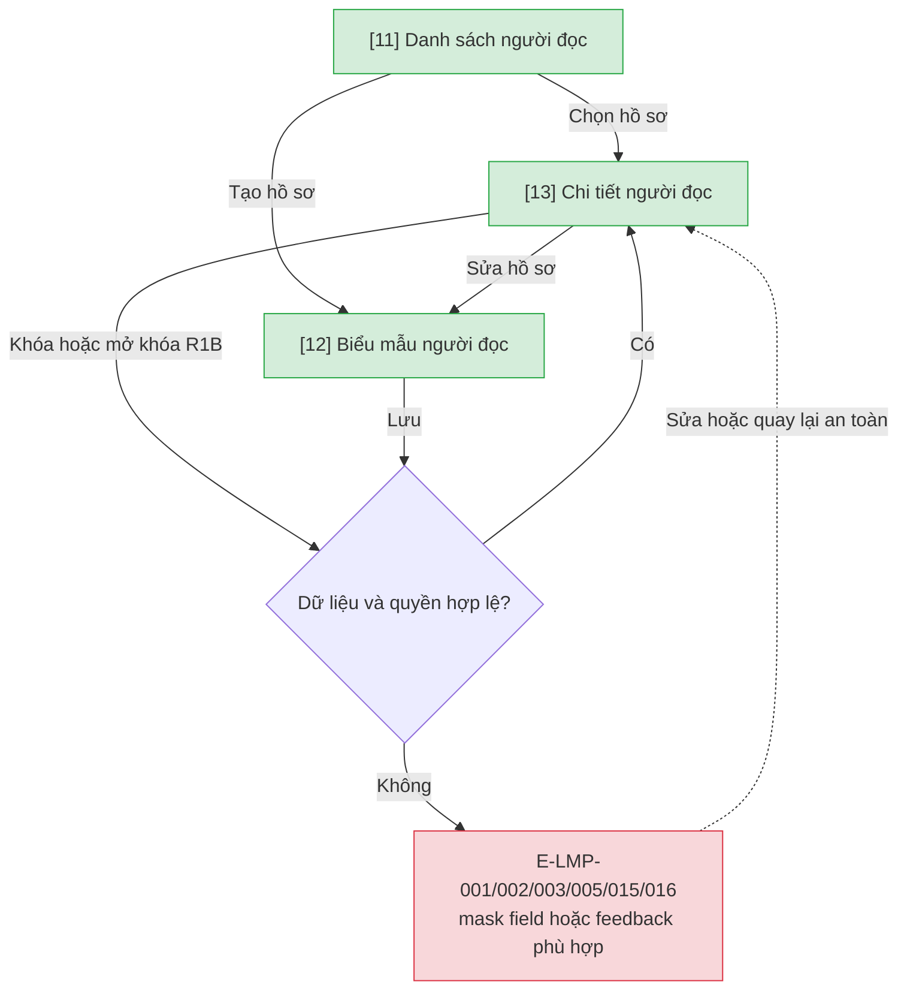

### Flow: checkout-flow — R1A

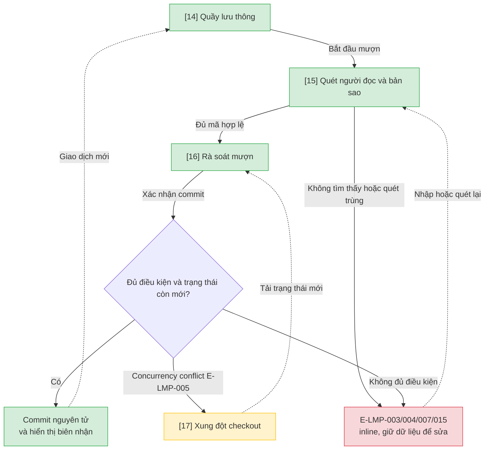

### Flow: return-renewal-flow — trả R1A, gia hạn R1B

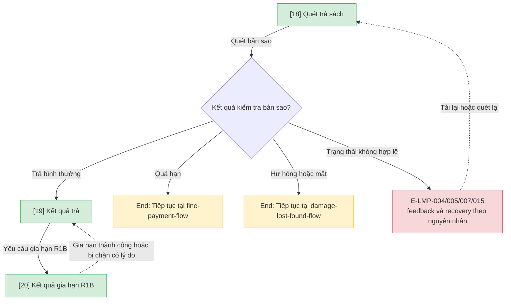

### Flow: reservation-flow — R2 future/not in pilot

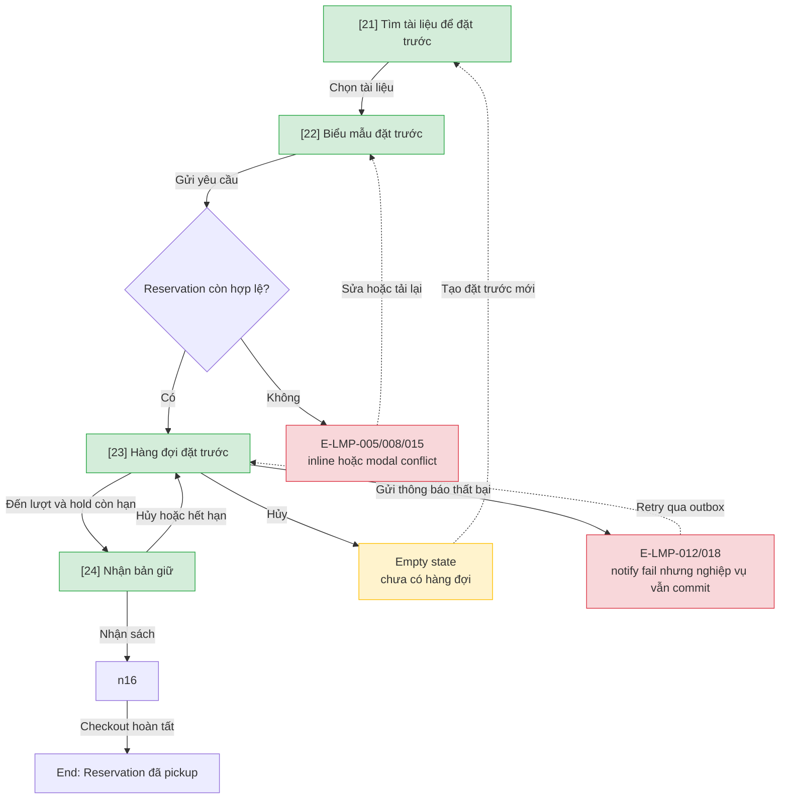

### Flow: fine-payment-flow — R1A/R1B

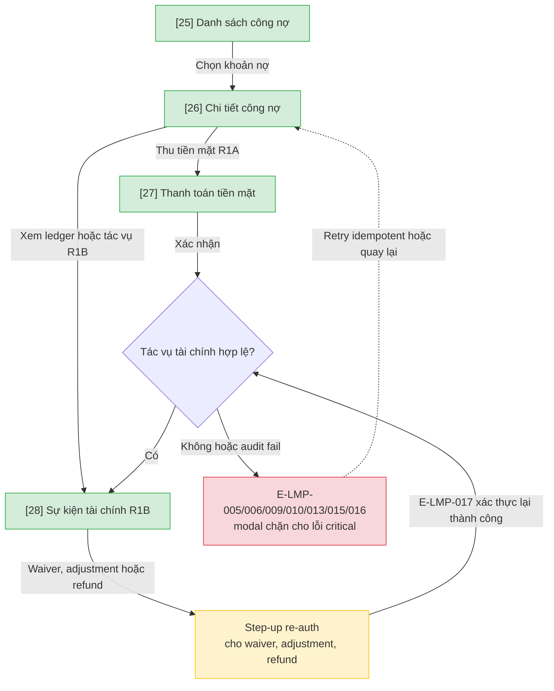

### Flow: damage-lost-found-flow — R1A/R1B

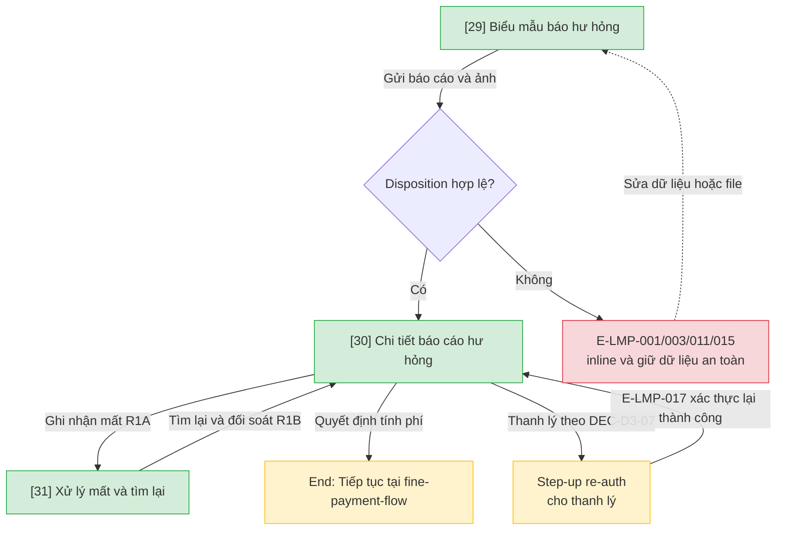

### Flow: notification-audit-flow — R0/R1A/R1B

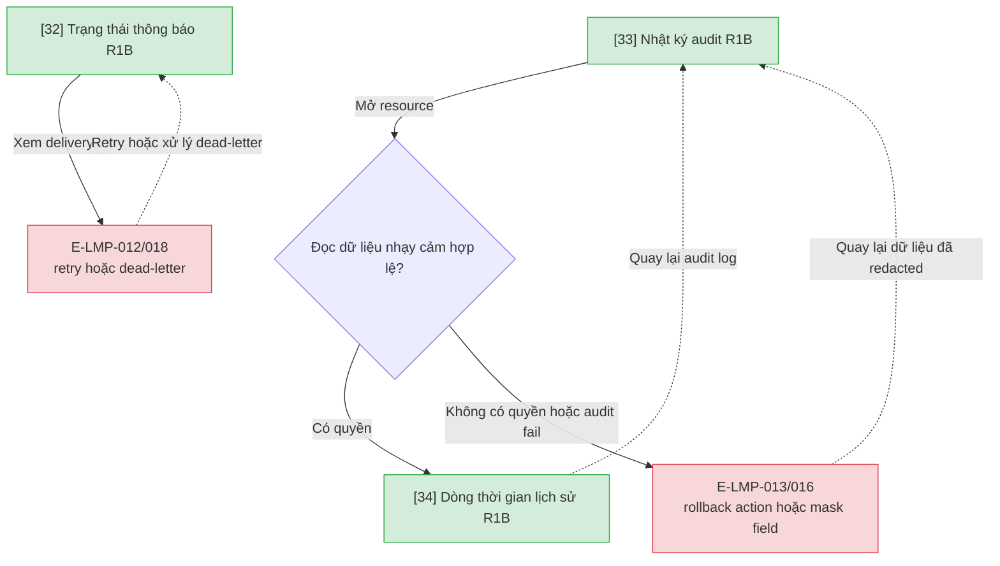

### Flow: admin-import-flow — R0

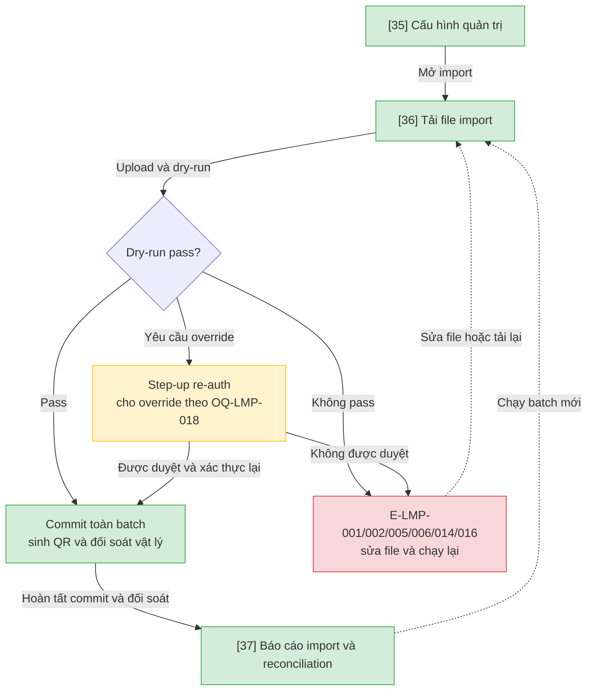

### Flow: reports-flow — R1A/R2

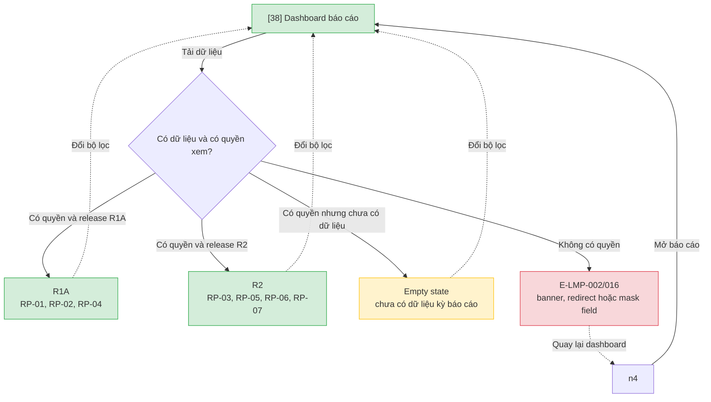

## 2. Danh sách màn hình

| [#] | Slug | Màn hình | Mục đích | Thuộc flow |
|-----|------|----------|----------|------------|
| 1 | access-login | Đăng nhập | Xác thực local hoặc chuyển sang SSO/IdP. | auth-flow |
| 2 | forgot-password | Quên mật khẩu | Khởi tạo account recovery khi identity là local. | auth-flow |
| 3 | reset-password | Đặt lại mật khẩu | Hoàn tất account recovery khi identity là local. | auth-flow |
| 4 | dashboard-home | Dashboard theo vai trò | Điều hướng theo vai trò và quick actions. | auth-flow |
| 5 | session-expired | Phiên hết hạn / step-up | Xác thực lại rồi quay về trạng thái an toàn. | auth-flow |
| 6 | catalog-search | Tra cứu danh mục | Tìm đầu sách và bản sao khả dụng. | catalog-admin-flow |
| 7 | bibliographic-detail | Chi tiết đầu sách | Xem thông tin thư mục và điều hướng tới kho bản sao. | catalog-admin-flow |
| 8 | bibliographic-form | Biểu mẫu đầu sách | Tạo, sửa hoặc vô hiệu hóa đầu sách. | catalog-admin-flow |
| 9 | copy-inventory | Kho bản sao | Xem và quản lý bản sao vật lý. | catalog-admin-flow |
| 10 | copy-form | Biểu mẫu bản sao | Tạo hoặc sửa bản sao. | catalog-admin-flow |
| 11 | reader-list | Danh sách người đọc | Tra cứu và chọn hồ sơ người đọc. | reader-admin-flow |
| 12 | reader-form | Biểu mẫu người đọc | Tạo hoặc cập nhật hồ sơ. | reader-admin-flow |
| 13 | reader-detail | Chi tiết người đọc | Xem hồ sơ và khóa/mở theo quyền. | reader-admin-flow |
| 14 | circulation-desk | Quầy lưu thông | Điểm vào cho nghiệp vụ mượn/trả tại quầy. | checkout-flow |
| 15 | checkout-scan | Quét checkout | Nhập/quét người đọc và các bản sao. | checkout-flow |
| 16 | checkout-review | Rà soát checkout | Kiểm tra và commit checkout nguyên tử. | checkout-flow |
| 17 | checkout-conflict | Xung đột checkout | Hiển thị trạng thái mới và cho tải lại an toàn. | checkout-flow |
| 18 | return-scan | Quét trả sách | Nhận diện bản sao và kiểm tra trạng thái trả. | return-renewal-flow |
| 19 | return-result | Kết quả trả | Hiển thị kết quả, fine hoặc follow-up. | return-renewal-flow |
| 20 | renewal-result | Kết quả gia hạn | Hiển thị thành công hoặc lý do bị chặn. | return-renewal-flow |
| 21 | reservation-search | Tìm tài liệu đặt trước | Chọn tài liệu cho reservation R2. | reservation-flow |
| 22 | reservation-form | Biểu mẫu đặt trước | Gửi yêu cầu reservation. | reservation-flow |
| 23 | reservation-queue | Hàng đợi đặt trước | Xem vị trí, empty state và hủy yêu cầu. | reservation-flow |
| 24 | reservation-pickup | Nhận bản giữ | Xác nhận pickup, hủy hoặc xử lý hết hạn. | reservation-flow |
| 25 | fine-list | Danh sách công nợ | Tra cứu các khoản fine. | fine-payment-flow |
| 26 | fine-detail | Chi tiết công nợ | Xem số dư và hành động được phép. | fine-payment-flow |
| 27 | fine-payment | Thanh toán fine | Ghi nhận thu tiền mặt tối thiểu R1A. | fine-payment-flow |
| 28 | financial-events | Sự kiện tài chính | Xem ledger và tác vụ nâng cao R1B. | fine-payment-flow |
| 29 | damage-report-form | Biểu mẫu hư hỏng | Gửi báo cáo và 1–5 ảnh bằng chứng. | damage-lost-found-flow |
| 30 | damage-report-detail | Chi tiết hư hỏng | Duyệt disposition và follow-up. | damage-lost-found-flow |
| 31 | lost-found | Mất / tìm lại | Ghi nhận mất và xử lý found-after-lost. | damage-lost-found-flow |
| 32 | notification-status | Trạng thái thông báo | Theo dõi outbox, retry và dead-letter. | notification-audit-flow |
| 33 | audit-log | Nhật ký audit | Tra cứu hành động nhạy cảm đã audit. | notification-audit-flow |
| 34 | history-timeline | Dòng thời gian lịch sử | Xem lịch sử resource đã redacted theo quyền. | notification-audit-flow |
| 35 | admin-config | Cấu hình quản trị | Quản lý policy và mở luồng import. | admin-import-flow |
| 36 | import-upload | Tải file import | Upload, validate và chạy dry-run. | admin-import-flow |
| 37 | import-report | Báo cáo import | Xem lỗi, commit result và reconciliation. | admin-import-flow |
| 38 | report-dashboard | Dashboard báo cáo | Xem báo cáo nghiệp vụ theo release và quyền. | reports-flow |

## 3. Danh sách flow

| Flow-slug | Tên flow | Màn hình gồm | Cases phủ |
|-----------|----------|--------------|-----------|
| auth-flow | Xác thực và điều hướng | access-login → forgot-password → reset-password → dashboard-home → session-expired | happy; credential/permission; session; local-vs-SSO edge |
| catalog-admin-flow | Danh mục và bản sao | catalog-search → bibliographic-detail → bibliographic-form → copy-inventory → copy-form | CRUD; validation; permission; conflict; soft-delete |
| reader-admin-flow | Quản lý người đọc | reader-list → reader-form → reader-detail | CRUD; khóa/mở R1B; permission; field masking |
| checkout-flow | Mượn tại quầy | circulation-desk → checkout-scan → checkout-review → checkout-conflict | atomic commit; unavailable/ineligible; duplicate; concurrency |
| return-renewal-flow | Trả và gia hạn | return-scan → return-result → renewal-result | trả R1A; gia hạn R1B; fine/damage/lost branches |
| reservation-flow | Đặt trước R2 | reservation-search → reservation-form → reservation-queue → reservation-pickup | queue; pickup; cancel; expiry; notify fail; empty state |
| fine-payment-flow | Công nợ và thanh toán | fine-list → fine-detail → fine-payment → financial-events | cash payment; ledger; duplicate; audit failure; step-up |
| damage-lost-found-flow | Hư hỏng, mất và tìm lại | damage-report-form → damage-report-detail → lost-found | upload reject; disposition; found-after-lost; step-up |
| notification-audit-flow | Thông báo và audit | notification-status → audit-log → history-timeline | retry/dead-letter; audit rollback; redaction |
| admin-import-flow | Cấu hình và import | admin-config → import-upload → import-report | dry-run; all-or-nothing commit; override; reconciliation |
| reports-flow | Báo cáo vận hành | report-dashboard | R1A/R2 datasets; permission; empty state |

## 3.5. Chuyển màn (transitions)

> Nguồn duy nhất cho chuyển màn. `(giữ nguyên)` nghĩa là hiển thị feedback tại màn hiện tại; node hệ thống/thông báo trong Mermaid được diễn đạt tại cột điều kiện.

| Từ màn [#] | Đến màn [#] | Trigger | Điều kiện |
|-----------|------------|---------|-----------|
| Đăng nhập [1] | Dashboard [4] | Submit đăng nhập | Local hợp lệ hoặc provider trả về thành công. |
| Đăng nhập [1] | (giữ nguyên) [1] | Submit đăng nhập | E-LMP-002; hiển thị banner/redirect an toàn. |
| Đăng nhập [1] | Quên mật khẩu [2] | Chọn Quên mật khẩu | Chỉ khi identity là local. |
| Quên mật khẩu [2] | Đặt lại mật khẩu [3] | Gửi yêu cầu recovery | Yêu cầu hợp lệ; cơ chế chờ OQ-LMP-007. |
| Đặt lại mật khẩu [3] | Đăng nhập [1] | Đặt lại thành công | Local identity. |
| Dashboard [4] | Phiên hết hạn [5] | Session timeout / sensitive action | E-LMP-017. |
| Phiên hết hạn [5] | Dashboard [4] | Xác thực lại | Thành công; quay về trạng thái an toàn. |
| Tra cứu danh mục [6] | Chi tiết đầu sách [7] | Chọn kết quả | Bản ghi tồn tại. |
| Tra cứu danh mục [6] | Biểu mẫu đầu sách [8] | Tạo mới | Có quyền. |
| Chi tiết đầu sách [7] | Biểu mẫu đầu sách [8] | Sửa/vô hiệu hóa | Có quyền; BR-LMP-017. |
| Chi tiết đầu sách [7] | Kho bản sao [9] | Xem bản sao | Luôn. |
| Kho bản sao [9] | Biểu mẫu bản sao [10] | Tạo/sửa | Có quyền. |
| Biểu mẫu đầu sách [8] | Chi tiết đầu sách [7] | Lưu | Validation và concurrency pass. |
| Biểu mẫu bản sao [10] | Chi tiết đầu sách [7] | Lưu | Validation và concurrency pass. |
| Danh sách người đọc [11] | Chi tiết người đọc [13] | Chọn hồ sơ | Hồ sơ tồn tại. |
| Danh sách người đọc [11] | Biểu mẫu người đọc [12] | Tạo mới | Chỉ actor được phép. |
| Chi tiết người đọc [13] | Biểu mẫu người đọc [12] | Sửa | Có quyền field. |
| Biểu mẫu người đọc [12] | Chi tiết người đọc [13] | Lưu | Validation/concurrency pass. |
| Chi tiết người đọc [13] | (giữ nguyên) [13] | Khóa/mở R1B | Có quyền; lỗi hiển thị tại chỗ. |
| Quầy lưu thông [14] | Quét checkout [15] | Bắt đầu mượn | R1A. |
| Quét checkout [15] | Rà soát checkout [16] | Hoàn tất quét | Mã tồn tại và không trùng. |
| Quét checkout [15] | (giữ nguyên) [15] | Quét/nhập | E-LMP-003/006; sửa rồi thử lại. |
| Rà soát checkout [16] | Quầy lưu thông [14] | Xác nhận commit | Mọi điều kiện pass; commit nguyên tử. |
| Rà soát checkout [16] | Xung đột checkout [17] | Xác nhận commit | E-LMP-005. |
| Xung đột checkout [17] | Rà soát checkout [16] | Tải trạng thái mới | Cho retry an toàn. |
| Quét trả [18] | Kết quả trả [19] | Quét bản sao | Trả bình thường. |
| Quét trả [18] | (giữ nguyên) [18] | Quét bản sao | E-LMP-004/005/007/015. |
| Kết quả trả [19] | Kết quả gia hạn [20] | Yêu cầu gia hạn | R1B. |
| Kết quả gia hạn [20] | Kết quả trả [19] | Đóng kết quả | Thành công hoặc bị chặn có lý do. |
| Tìm đặt trước [21] | Biểu mẫu đặt trước [22] | Chọn tài liệu | R2 future. |
| Biểu mẫu đặt trước [22] | Hàng đợi [23] | Gửi yêu cầu | Hợp lệ. |
| Biểu mẫu đặt trước [22] | (giữ nguyên) [22] | Gửi yêu cầu | E-LMP-005/008/015. |
| Hàng đợi [23] | Nhận bản giữ [24] | Đến lượt | Hold còn hạn. |
| Hàng đợi [23] | Tìm đặt trước [21] | Hủy / queue rỗng | Hiển thị empty state. |
| Nhận bản giữ [24] | Hàng đợi [23] | Hủy / hết hạn | Queue advance. |
| Nhận bản giữ [24] | Rà soát checkout [16] | Nhận sách | Reservation đúng lượt. |
| Hàng đợi [23] | (giữ nguyên) [23] | Notify fail | E-LMP-012/018; outbox retry. |
| Danh sách công nợ [25] | Chi tiết công nợ [26] | Chọn khoản nợ | Luôn. |
| Chi tiết công nợ [26] | Thanh toán fine [27] | Thu tiền mặt | R1A. |
| Chi tiết công nợ [26] | Sự kiện tài chính [28] | Xem ledger/tác vụ | R1B và policy đã duyệt. |
| Thanh toán fine [27] | Sự kiện tài chính [28] | Xác nhận | Ghi event thành công. |
| Thanh toán fine [27] | Chi tiết công nợ [26] | Lỗi/retry | Idempotent; E-LMP-009/010/013. |
| Sự kiện tài chính [28] | Phiên hết hạn [5] | Waiver/adjustment/refund | Step-up E-LMP-017. |
| Biểu mẫu hư hỏng [29] | Chi tiết hư hỏng [30] | Gửi báo cáo | Validation/upload pass. |
| Biểu mẫu hư hỏng [29] | (giữ nguyên) [29] | Gửi báo cáo | E-LMP-001/003/011/015. |
| Chi tiết hư hỏng [30] | Mất / tìm lại [31] | Ghi nhận mất | R1A. |
| Chi tiết hư hỏng [30] | Phiên hết hạn [5] | Thanh lý | Step-up E-LMP-017; DEC-D3-07. |
| Mất / tìm lại [31] | Chi tiết hư hỏng [30] | Tìm lại/đối soát | R1B. |
| Trạng thái thông báo [32] | (giữ nguyên) [32] | Retry/dead-letter | E-LMP-012/018. |
| Nhật ký audit [33] | Dòng thời gian [34] | Mở resource | Có quyền. |
| Nhật ký audit [33] | (giữ nguyên) [33] | Mở resource | E-LMP-013/016; redacted. |
| Dòng thời gian [34] | Nhật ký audit [33] | Quay lại | Luôn. |
| Cấu hình quản trị [35] | Tải file import [36] | Mở import | Có quyền. |
| Tải file import [36] | Báo cáo import [37] | Dry-run/commit | Dry-run pass hoặc override được duyệt; commit toàn batch rồi reconcile. |
| Tải file import [36] | (giữ nguyên) [36] | Dry-run | E-LMP-014; sửa file/chạy lại. |
| Tải file import [36] | Phiên hết hạn [5] | Yêu cầu override | Step-up; approver/evidence chờ OQ-LMP-018. |
| Báo cáo import [37] | Tải file import [36] | Chạy batch mới | Batch trước đã kết thúc. |
| Dashboard [4] | Dashboard báo cáo [38] | Mở báo cáo | Actor có route. |
| Dashboard báo cáo [38] | (giữ nguyên) [38] | Tải/đổi bộ lọc | R1A/R2 dataset, empty state hoặc E-LMP-002/016. |
| Dashboard báo cáo [38] | Dashboard [4] | Không có quyền / quay lại | Redirect an toàn. |

## 4. Open Questions

- [ ] OQ-LMP-015 — Reader portal R2 có chính thức mobile-first không? Owner: Product Owner. Gate: duyệt device/layout trước wireframe portal.
- [ ] OQ-LMP-016 — FR-R09 dùng màn reader tối thiểu ở R1B hay chuyển sang portal R2? Owner: Product Owner. Gate: chốt release và UI owner trước wireframe reader.
- [ ] OQ-LMP-017 — Thủ thư quầy có quyền xem reports không? Owner: Domain Approver. Gate: chốt permission trước wireframe/report acceptance.
- [ ] OQ-LMP-018 — Ai approve commit import khi dry-run chưa pass, điều kiện và bằng chứng override là gì? Owner: Data Owner + Thủ thư trưởng/Product Owner. Gate: GATE-MIG.

## References

- `docs/features/library-management-platform/srs/library-management-platform-spec.md`
- `docs/features/library-management-platform/usecases/library-management-platform-usecase-index.md`
- `docs/features/library-management-platform/srs/library-management-platform-flows.md`
- `docs/_product/decision-register.md`
- `docs/_product/roadmap.md`
