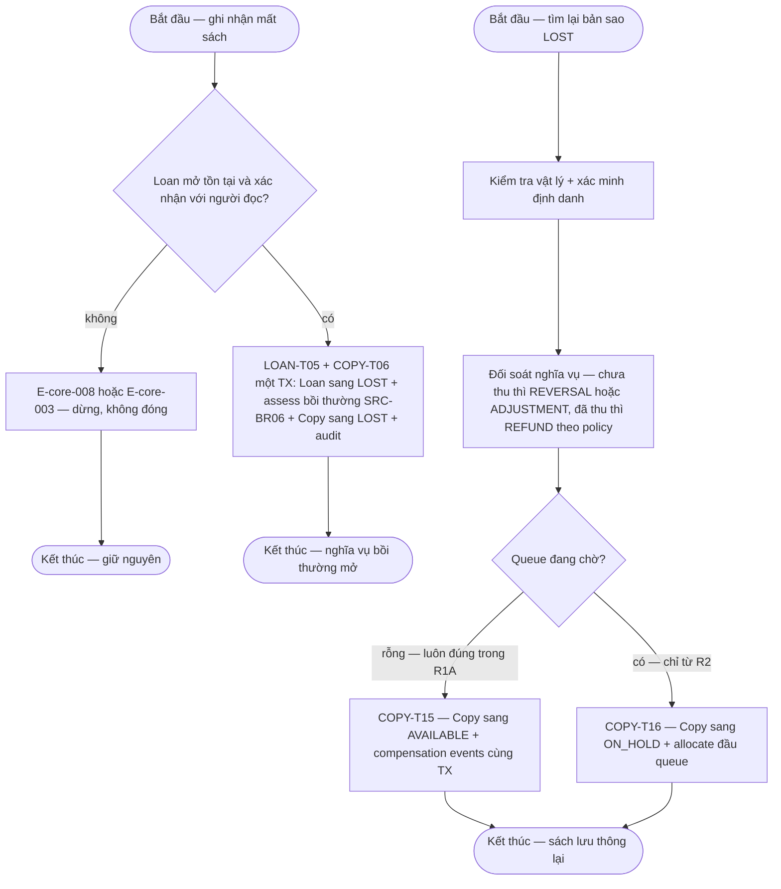

# lost-handling — Flows

## Flow: Ghi nhận mất và tìm lại

### Bảng bước F7b — lost / found

| Bước | Actor | Quyết định / điều kiện | Phản hồi hệ thống | Error path |
|------|-------|------------------------|--------------------|------------|
| 1 | Nhân viên/Thủ thư | Ghi nhận mất trên Loan mở, xác nhận với người đọc | Một TX: Loan→`LOST` (không reopen) + `ASSESSMENT` bồi thường SRC-BR06 + Copy→`LOST` + audit + notify | E-core-008 — loan không mở; báo mất lặp → idempotent (§6.5); CAS conflict → E-core-004 |
| 2 | Nhân viên | Found-after-lost: kiểm tra vật lý + reconcile tài chính **trước** khi copy lưu thông lại (BR-lost-handling-001) | Nghĩa vụ LOST đã ghi **không tự xóa**: chưa thu → `REVERSAL`/`ADJUSTMENT` về 0; đã thu → `REFUND` theo policy; có thể giữ phí xử lý — Open (OQ-fine-collection-adv-001, DEC-D3-05) | Chưa reconcile → không cho Copy→`AVAILABLE` (E-core-008) |
| 3 | Hệ thống | Compensation + Copy transition một TX (AT-FIN-04) | `LOST→AVAILABLE` (COPY-T15); từ R2 có queue → `ON_HOLD` (COPY-T16) + audit bắt buộc | Audit fail → rollback cả compensation (INV-01) |

**Liên kết:** FR-damage-lifecycle-001, FR-lost-handling-001, FR-damage-lifecycle-002, FR-overdue-fines-001, FR-notification-core-001, FR-ops-foundation-001 · BR-damage-lifecycle-001, BR-lost-handling-001, BR-damage-lifecycle-002 · transitions: DMG-T01..T04, COPY-T05..T17, LOAN-T05 · DEC-P2-03/07, DEC-D3-05/06/07 · OQ-fine-collection-adv-001.
