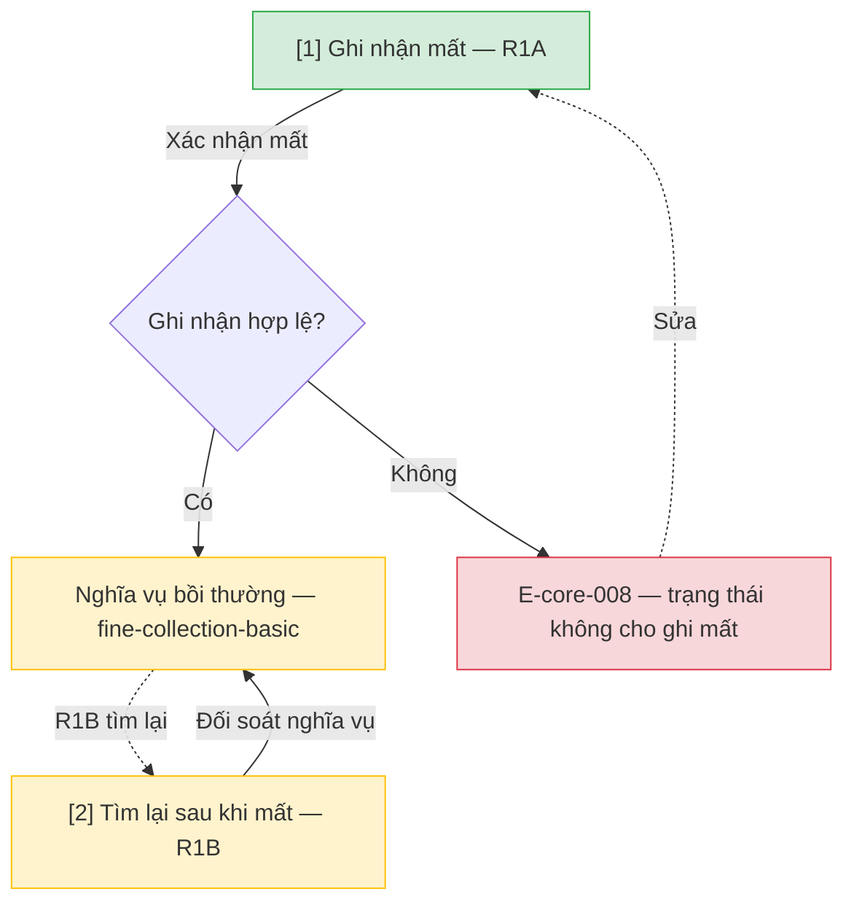

# Ghi nhận mất và tìm lại — User Flow

## 1. User Flow

### Flow: lost-handling-flow — R1A/R1B

## 2. Danh sách màn hình

| [#] | Slug | Màn hình | Mục đích | Thuộc flow |
|-----|------|----------|----------|------------|
| 1 | lost-record | Ghi nhận mất | R1A: đóng khoản mượn theo mất, mở nghĩa vụ bồi thường tối thiểu. | lost-handling-flow |
| 2 | found-after-lost | Tìm lại sau mất | R1B: đối soát nghĩa vụ khi sách được tìm lại. | lost-handling-flow |

## 3. Danh sách flow

| Flow-slug | Tên flow | Màn hình gồm |
|-----------|----------|--------------|
| lost-handling-flow | Mất và tìm lại | lost-record → found-after-lost |

## 3.5. Chuyển màn (transitions)

Chuyển màn sang feature khác ghi bằng chữ khi đích chưa có wireframe; feature R0 dùng `../../{slug}/html-wireframe/`.

| Từ màn [#] | Đến màn [#] | Trigger | Điều kiện |
|-----------|------------|---------|-----------|
| Ghi mất [1] | fine-collection-basic (chữ) | Xác nhận mất | R1A P0 |
| Ghi mất [1] | (giữ) [1] | Xác nhận | E-core-008 |
| Tìm lại [2] | fine-collection-basic (chữ) | Đối soát | R1B |

## 4. Open Questions

- [ ] OQ-lost-handling-001 — Mức bồi thường mất và phí xử lý chính thức (mặc định nguồn 100% giá sách + phí)? Owner: Thủ thư trưởng.
- [ ] OQ-lost-handling-002 — Mất sách khỏi kệ khi không đang mượn xử lý ở đâu? Owner: domain approver.
