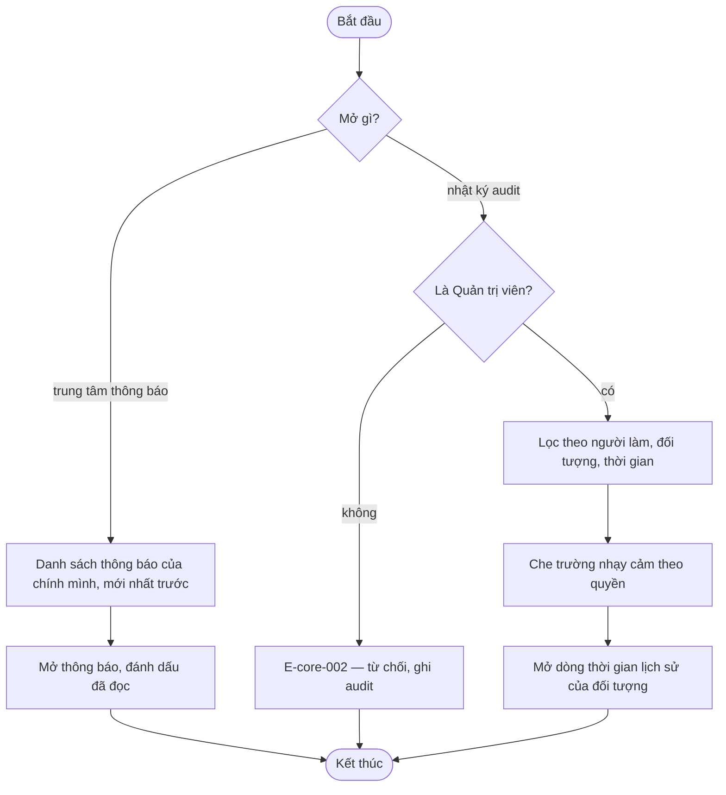

# notification-audit-ui — Flows

## Flow: Trung tâm thông báo và tra cứu nhật ký

**Trigger:** Người dùng mở trung tâm thông báo hoặc nhật ký. · **UC:** uc-notification-audit-view · **Release:** R1B

