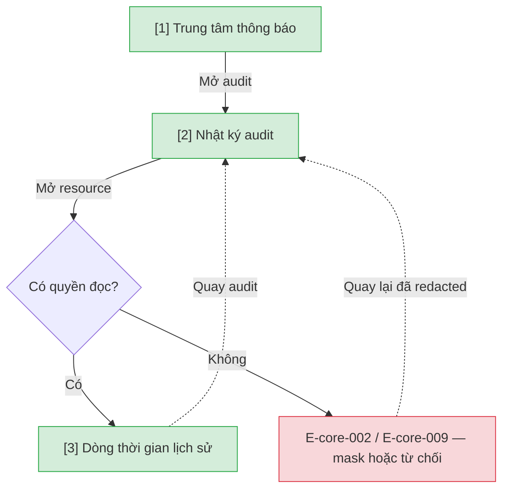

# Trung tâm thông báo và audit — User Flow

## 1. User Flow

### Flow: notification-audit-flow — R1B

## 2. Danh sách màn hình

| [#] | Slug | Màn hình | Mục đích | Thuộc flow |
|-----|------|----------|----------|------------|
| 1 | notification-center | Trung tâm thông báo | Hộp thư in-app mọi vai trò — DEC-SF-09, màn mới. | notification-audit-flow |
| 2 | audit-log | Nhật ký audit | Tra cứu hành động nhạy cảm. | notification-audit-flow |
| 3 | history-timeline | Dòng thời gian | Lịch sử resource đã redacted theo quyền. | notification-audit-flow |

## 3. Danh sách flow

| Flow-slug | Tên flow | Màn hình gồm |
|-----------|----------|--------------|
| notification-audit-flow | Thông báo và audit viewer | notification-center → audit-log → history-timeline |

## 3.5. Chuyển màn (transitions)

Chuyển màn sang feature khác ghi bằng chữ khi đích chưa có wireframe; feature R0 dùng `../../{slug}/html-wireframe/`.

| Từ màn [#] | Đến màn [#] | Trigger | Điều kiện |
|-----------|------------|---------|-----------|
| Trung tâm [1] | Audit [2] | Mở nhật ký | Quản trị viên |
| Audit [2] | Timeline [3] | Mở resource | Có quyền |
| Audit [2] | (giữ) [2] | Mở resource | E-core-002 / E-core-009 |

## 4. Open Questions

- [ ] OQ-notification-audit-ui-001 — Có cho đánh dấu lại 'chưa đọc' không, giữ thông báo bao lâu? Owner: Product Owner.
