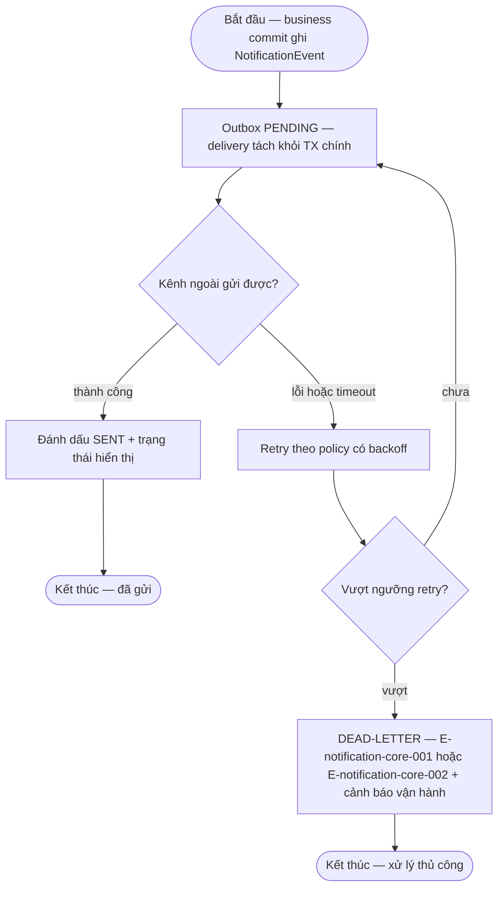

# notification-core — Flows

## Flow: Hàng đợi thông báo, thử lại và hàng lỗi

### Bảng bước

| Bước | Actor | Quyết định / điều kiện | Phản hồi hệ thống | Error path |
|------|-------|------------------------|--------------------|------------|
| O1 | Hệ thống | Business commit có notify | Ghi `NotificationEvent` PENDING trong cùng TX (INV-01); business TX commit độc lập delivery | — |
| O2 | Hệ thống | Deliver qua kênh cấu hình (in-app + email sự kiện quan trọng R1A — PROPOSAL DEC-P2-01; kênh cụ thể Open OQ-notification-core-001) | SENT → trạng thái trên notification-status | E-notification-core-001 — kênh timeout/reject → retry backoff; E-notification-core-002 — channel down → degraded status |
| O3 | Hệ thống | Retry vượt ngưỡng (ngưỡng Open) | DEAD-LETTER + cảnh báo vận hành (escalation PROPOSAL DEC-D3-08); business event đã commit không rollback | Tác vụ nền chạy lại → idempotent, không gửi trùng (§6.4) |
