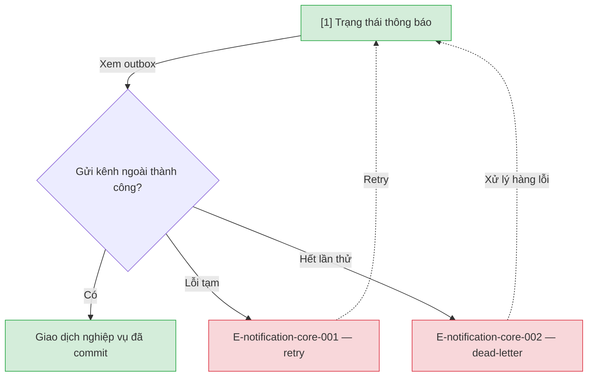

# Trạng thái thông báo — User Flow

## 1. User Flow

### Flow: notification-status-flow — R1A

## 2. Danh sách màn hình

| [#] | Slug | Màn hình | Mục đích | Thuộc flow |
|-----|------|----------|----------|------------|
| 1 | notification-status | Trạng thái thông báo | Outbox, retry, dead-letter; gửi lỗi không làm hỏng giao dịch chính. | notification-status-flow |

## 3. Danh sách flow

| Flow-slug | Tên flow | Màn hình gồm |
|-----------|----------|--------------|
| notification-status-flow | Outbox thông báo | notification-status |

## 3.5. Chuyển màn (transitions)

Chuyển màn sang feature khác ghi bằng chữ khi đích chưa có wireframe; feature R0 dùng `../../{slug}/html-wireframe/`.

| Từ màn [#] | Đến màn [#] | Trigger | Điều kiện |
|-----------|------------|---------|-----------|
| Trạng thái [1] | (giữ) [1] | Retry | E-notification-core-001 |
| Trạng thái [1] | (giữ) [1] | Dead-letter | E-notification-core-002 |

## 4. Open Questions

- [ ] OQ-notification-core-001 — Kênh bắt buộc: chỉ in-app + email hay thêm kênh khác? Owner: Product Owner.
- [ ] OQ-notification-core-002 — Số lần thử lại và khoảng cách thử? Owner: vận hành.
- [ ] OQ-notification-core-003 — Danh sách sự kiện quan trọng gửi email? Owner: Product Owner.
- [ ] OQ-notification-core-004 — Ai xử lý hàng lỗi, có báo Thủ thư trực quầy (DEC-D3-08)? Owner: Thủ thư trưởng.
