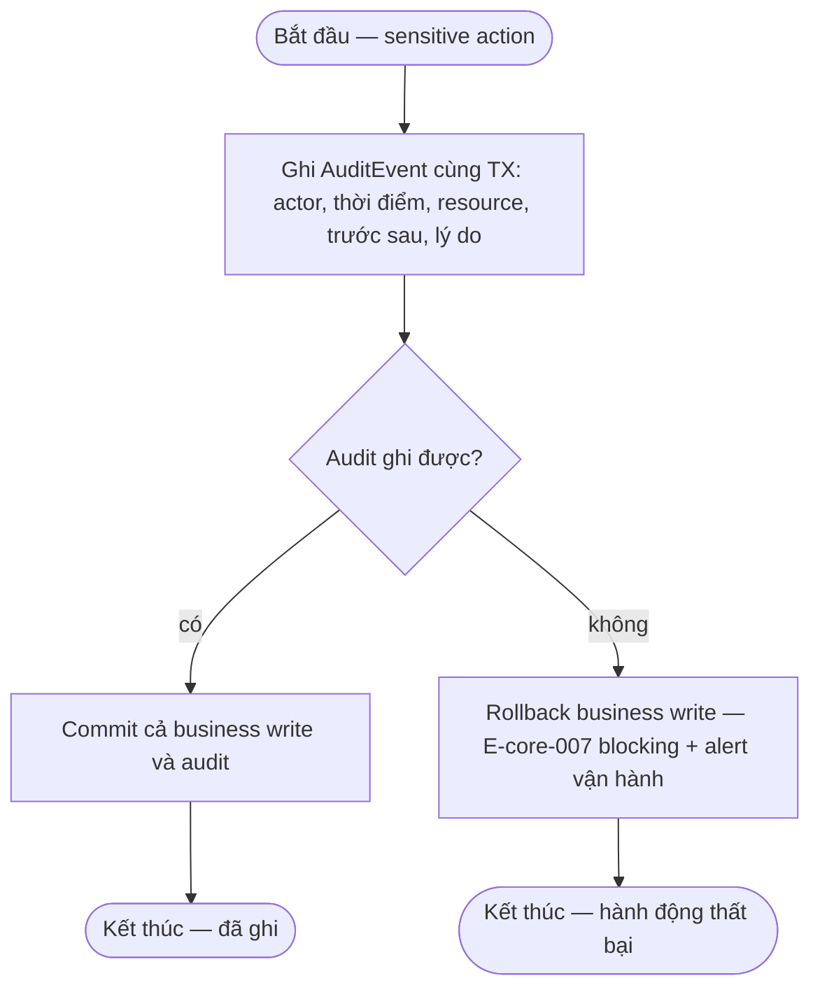
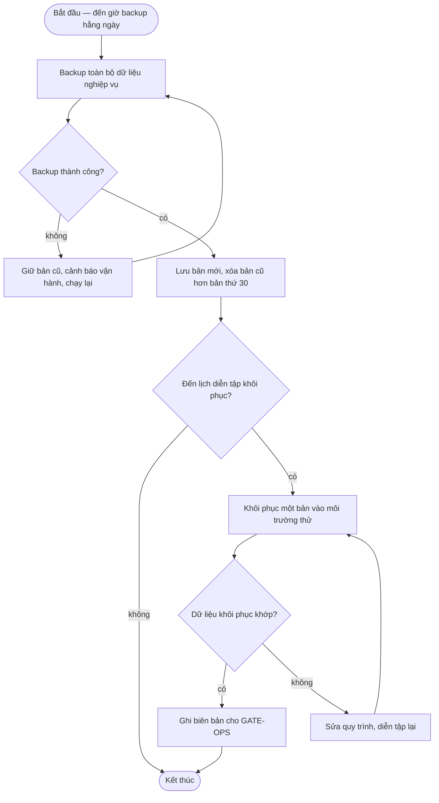

# ops-foundation — Flows

## Flow: Ghi audit trong giao dịch

### Bảng bước

| Bước | Actor | Quyết định / điều kiện | Phản hồi hệ thống | Error path |
|------|-------|------------------------|--------------------|------------|
| A1 | Hệ thống | Sensitive action (checkout, payment, disposition, lock, config, import) | AuditEvent trong cùng TX — fail thì business write fail (fail-closed) | E-core-007 — rollback + alert; không để sensitive action không audit |

## Flow: Backup hằng ngày và diễn tập khôi phục

**Trigger:** Lịch backup hằng ngày; lịch diễn tập trước go-live. · **UC:** uc-backup-restore · **Release:** R0

