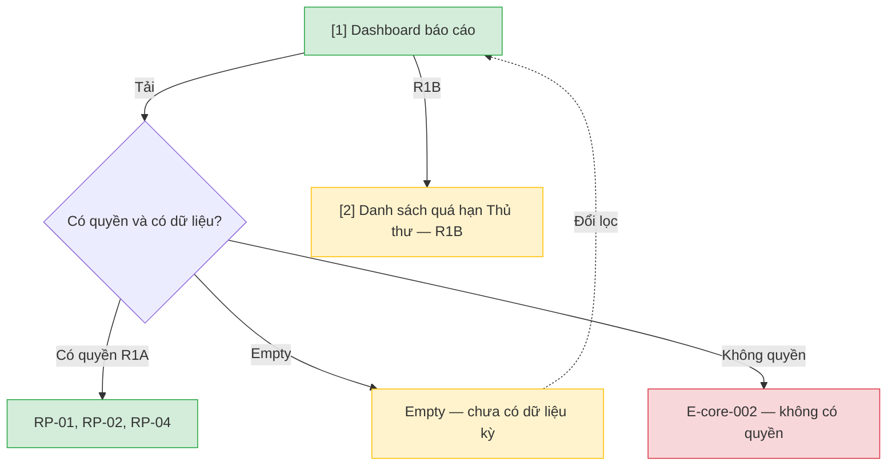

# Báo cáo vận hành — User Flow

## 1. User Flow

### Flow: ops-reports-flow — R1A/R1B

## 2. Danh sách màn hình

| [#] | Slug | Màn hình | Mục đích | Thuộc flow |
|-----|------|----------|----------|------------|
| 1 | report-dashboard | Dashboard báo cáo | RP-01 tài khoản, RP-02 kho, RP-04 quá hạn; lọc; xuất Excel/PDF. | ops-reports-flow |
| 2 | overdue-list-staff | Danh sách quá hạn | R1B Thủ thư xem phiếu quá hạn để nhắc. | ops-reports-flow |

## 3. Danh sách flow

| Flow-slug | Tên flow | Màn hình gồm |
|-----------|----------|--------------|
| ops-reports-flow | Báo cáo vận hành | report-dashboard → overdue-list-staff |

## 3.5. Chuyển màn (transitions)

Chuyển màn sang feature khác ghi bằng chữ khi đích chưa có wireframe; feature R0 dùng `../../{slug}/html-wireframe/`.

| Từ màn [#] | Đến màn [#] | Trigger | Điều kiện |
|-----------|------------|---------|-----------|
| Dashboard [1] | (giữ) [1] | Tải RP-01/02/04 | Có quyền và có dữ liệu |
| Dashboard [1] | (giữ) [1] | Tải | Empty hoặc E-core-002 |
| Dashboard [1] | Quá hạn [2] | Mở danh sách Thủ thư | R1B |

## 4. Open Questions

- [ ] OQ-ops-reports-001 — Thủ thư quầy có quyền xem RP-01, RP-02, RP-04 không? Owner: domain approver.
- [ ] OQ-ops-reports-002 — Priority chính thức P0 (PRD) hay P1 (SRS cũ)? Owner: Product Owner.
