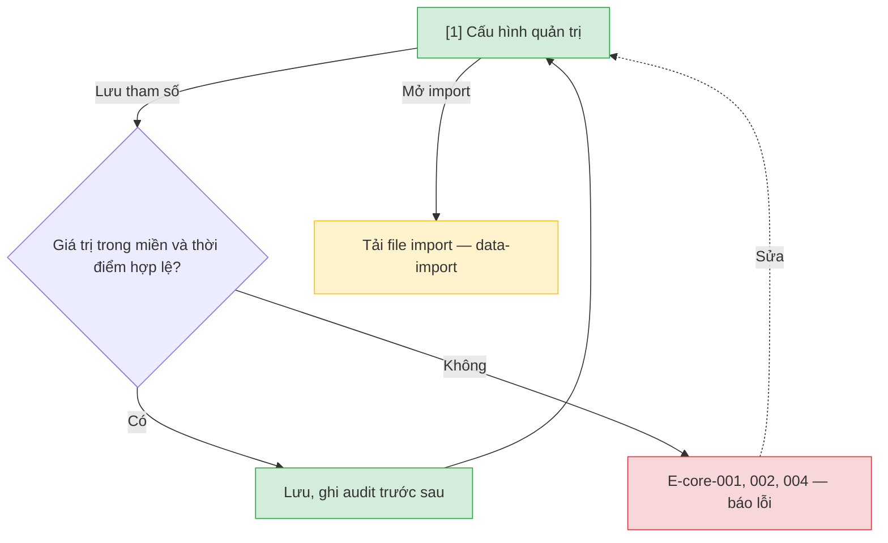

# Cấu hình quy định — User Flow

## 1. User Flow

### Flow: policy-config-flow — R0

## 2. Danh sách màn hình

| [#] | Slug | Màn hình | Mục đích | Thuộc flow |
|-----|------|----------|----------|------------|
| 1 | admin-config | Cấu hình quản trị | Sửa tham số quy định với thời điểm hiệu lực; lối vào import. | policy-config-flow |

## 3. Danh sách flow

| Flow-slug | Tên flow | Màn hình gồm |
|-----------|----------|--------------|
| policy-config-flow | Cấu hình quy định | admin-config |

## 3.5. Chuyển màn (transitions)

Chuyển màn sang feature khác xem `docs/_shared/navigation-map.md`.

| Từ màn [#] | Đến màn [#] | Trigger | Điều kiện |
|-----------|------------|---------|-----------|
| Cấu hình quản trị [1] | (giữ nguyên) [1] | Lưu tham số | Hợp lệ, hoặc E-core-001 hiển thị tại chỗ. |
| Cấu hình quản trị [1] | Tải file import (`data-import`) | Mở import | Có quyền. |

## 4. Open Questions

- [ ] OQ-policy-config-002 — Miền giá trị từng tham số.
