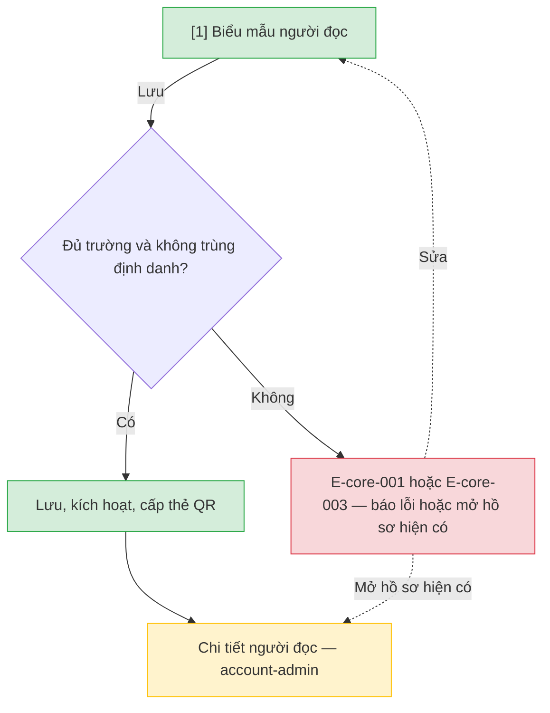

# Cấp và kích hoạt tài khoản người đọc — User Flow

## 1. User Flow

### Flow: reader-onboarding-flow — R0

## 2. Danh sách màn hình

| [#] | Slug | Màn hình | Mục đích | Thuộc flow |
|-----|------|----------|----------|------------|
| 1 | reader-form | Biểu mẫu người đọc | Nhập hồ sơ, kiểm trùng, kích hoạt và cấp thẻ QR. | reader-onboarding-flow |

## 3. Danh sách flow

| Flow-slug | Tên flow | Màn hình gồm |
|-----------|----------|--------------|
| reader-onboarding-flow | Cấp tài khoản tại quầy | reader-form |

## 3.5. Chuyển màn (transitions)

Chuyển màn sang feature khác xem `docs/_shared/navigation-map.md`.

| Từ màn [#] | Đến màn [#] | Trigger | Điều kiện |
|-----------|------------|---------|-----------|
| Biểu mẫu người đọc [1] | Chi tiết người đọc (`account-admin`) | Lưu thành công | Hồ sơ đã kích hoạt. |
| Biểu mẫu người đọc [1] | (giữ nguyên) [1] | Lưu | E-core-001 hoặc E-core-003. |

## 4. Open Questions

- [ ] OQ-reader-onboarding-001 — Bộ thông tin liên hệ bắt buộc.
