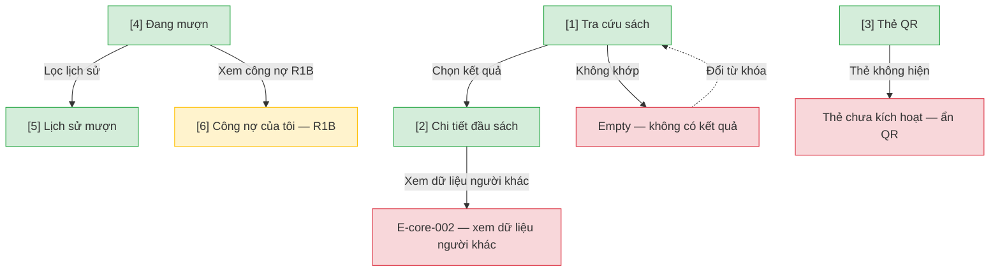

# Cổng người đọc — User Flow

## 1. User Flow

### Flow: reader-portal-flow — R1A/R1B

## 2. Danh sách màn hình

| [#] | Slug | Màn hình | Mục đích | Thuộc flow |
|-----|------|----------|----------|------------|
| 1 | reader-search | Tra cứu sách | Tìm theo tên, tác giả, ISBN, thể loại; lọc còn/hết. | reader-portal-flow |
| 2 | reader-bib-detail | Chi tiết đầu sách | Chỉ xem thông tin, số khả dụng, vị trí kệ. | reader-portal-flow |
| 3 | reader-qr | Thẻ QR | Hiện mã QR khi tài khoản đã kích hoạt và thẻ còn hạn. | reader-portal-flow |
| 4 | reader-current-loans | Đang mượn | Phiếu mở, hạn trả, quá hạn. | reader-portal-flow |
| 5 | reader-loan-history | Lịch sử mượn | Phiếu đã đóng, lọc thời gian. | reader-portal-flow |
| 6 | reader-my-fines | Công nợ của tôi | R1B xem công nợ, không thanh toán online. | reader-portal-flow |

## 3. Danh sách flow

| Flow-slug | Tên flow | Màn hình gồm |
|-----------|----------|--------------|
| reader-portal-flow | Cổng người đọc | reader-search → reader-bib-detail → reader-qr → reader-current-loans → reader-loan-history → reader-my-fines |

## 3.5. Chuyển màn (transitions)

Chuyển màn sang feature khác ghi bằng chữ khi đích chưa có wireframe; feature R0 dùng `../../{slug}/html-wireframe/`.

| Từ màn [#] | Đến màn [#] | Trigger | Điều kiện |
|-----------|------------|---------|-----------|
| Tra cứu [1] | Chi tiết [2] | Chọn kết quả | Có bản ghi |
| Tra cứu [1] | (giữ) [1] | Tìm | Empty |
| Thẻ QR [3] | (giữ) [3] | Mở thẻ | Chưa kích hoạt thì ẩn QR |
| Đang mượn [4] | Lịch sử [5] | Xem lịch sử | Luôn |
| Đang mượn [4] | Công nợ [6] | Xem công nợ | R1B |

## 4. Open Questions

- [ ] OQ-reader-self-service-001 — Thiết bị và hình thức cổng người đọc (mobile-first hay responsive)? Owner: Product Owner.
- [ ] OQ-reader-self-service-002 — Màn công nợ R1B làm tối thiểu hay chờ cổng đầy đủ? Owner: Product Owner.
- [ ] OQ-reader-self-service-003 — Người đọc bị khóa có đăng nhập cổng được không? Owner: domain approver.
- [ ] OQ-reader-self-service-004 — Ai được xem lịch sử mượn, có tự xóa sau N năm (OQ-12 nguồn)? Owner: pháp chế.
