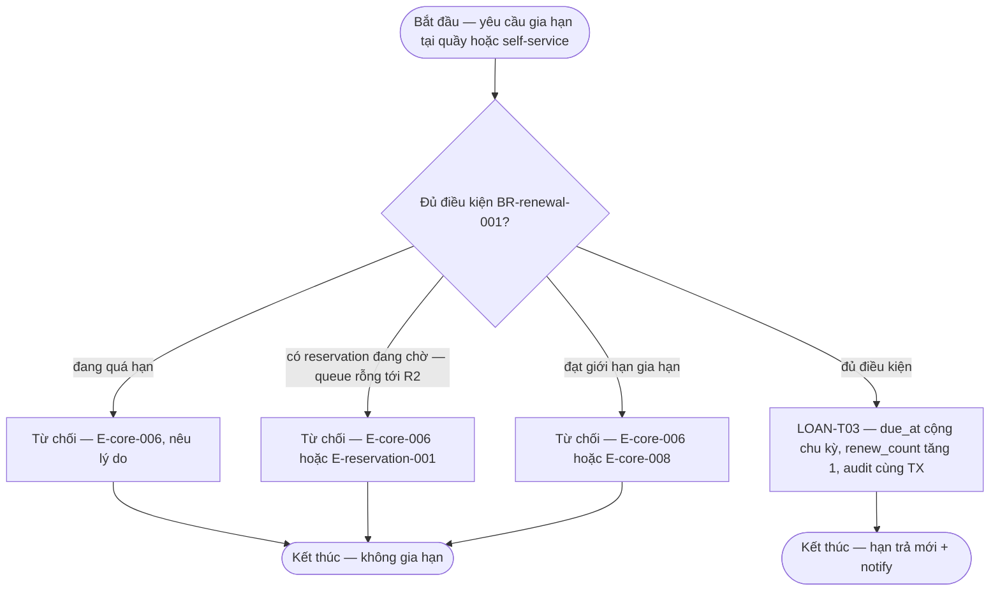

# renewal — Flows

## Flow: Gia hạn

### Bảng bước F4b — gia hạn

| Bước | Actor | Quyết định / điều kiện | Phản hồi hệ thống | Error path |
|------|-------|------------------------|--------------------|------------|
| 1 | Thủ thư/Quản trị viên/Người đọc | Yêu cầu gia hạn trên Loan `ACTIVE` | Load loan + policy tại thời điểm mượn | E-core-002/E-core-009 — self-service chỉ trên loan của chính mình |
| 2 | Hệ thống | BR-renewal-001: chưa quá hạn · `renew_count < limit` · title không có reservation đang chờ (queue rỗng tới R2 — DEC-P2-05) | Đủ điều kiện → LOAN-T03: `due_at += 7 ngày` (baseline), `renew_count++`, audit | E-core-006 — hiển thị lý do từ chối; E-core-008 — loan terminal không gia hạn |
| 3 | Hệ thống | Race với trả/mất | Transition commit trước thắng; transition sau nhận invalid-state | E-core-004 — reload trạng thái mới (lifecycle §3) |
| 4 | Hệ thống | Sau commit | Notify hạn mới qua outbox | INV-04 |

**Liên kết:** FR-return-handling-001, FR-renewal-001, FR-overdue-fines-001, FR-damage-lifecycle-001 (gắn damage), FR-lost-handling-001 (gắn lost), FR-notification-core-001, FR-ops-foundation-001 · BR-renewal-001/BR-reservation-001/BR-core-002/BR-core-005 · transitions: LOAN-T02/T03/T04/T05, COPY-T03/T04/T05/T06 · OQ-policy-config-001 (ngưỡng).
