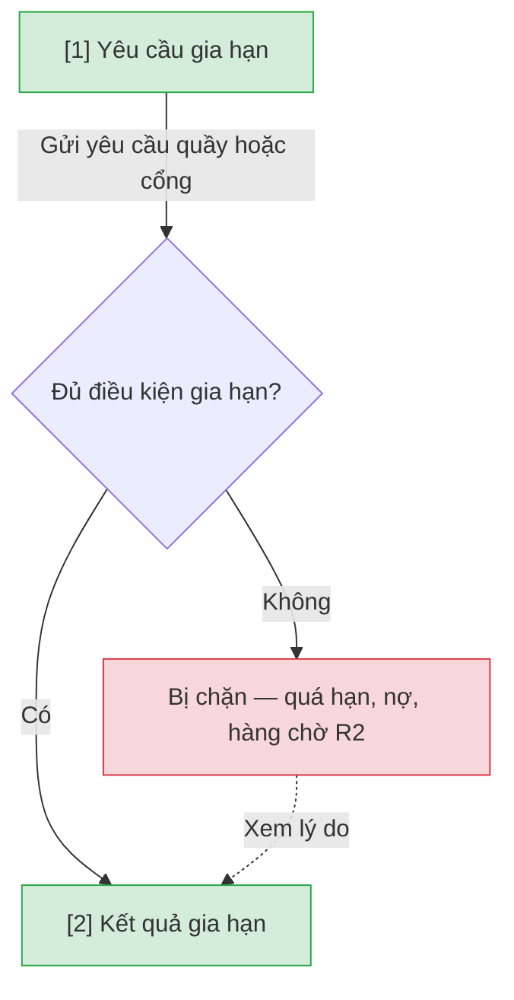

# Gia hạn — User Flow

## 1. User Flow

### Flow: renewal-flow — R1B

## 2. Danh sách màn hình

| [#] | Slug | Màn hình | Mục đích | Thuộc flow |
|-----|------|----------|----------|------------|
| 1 | renewal-request | Yêu cầu gia hạn | Thủ thư tại quầy hoặc Người đọc trên cổng chọn khoản đang mượn. | renewal-flow |
| 2 | renewal-result | Kết quả gia hạn | Thành công hoặc lý do chặn. Số lần/cộng ngày còn OQ-renewal-001. | renewal-flow |

## 3. Danh sách flow

| Flow-slug | Tên flow | Màn hình gồm |
|-----------|----------|--------------|
| renewal-flow | Gia hạn quầy và online | renewal-request → renewal-result |

## 3.5. Chuyển màn (transitions)

Chuyển màn sang feature khác ghi bằng chữ khi đích chưa có wireframe; feature R0 dùng `../../{slug}/html-wireframe/`.

| Từ màn [#] | Đến màn [#] | Trigger | Điều kiện |
|-----------|------------|---------|-----------|
| Yêu cầu [1] | Kết quả [2] | Gửi | Luôn |
| Yêu cầu [1] | Kết quả [2] | Gửi | Bị chặn — hiện lý do |

## 4. Open Questions

- [ ] OQ-renewal-001 — Số lần gia hạn và thời gian cộng thêm chính thức (mặc định nguồn 1 lần / +7 ngày)? Owner: Thủ thư trưởng.
