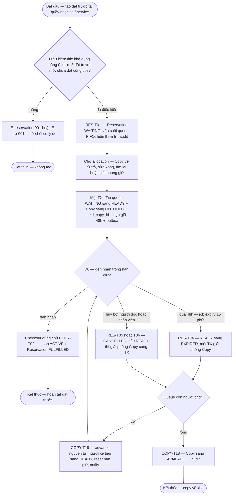

# reservation — Flows

## Flow: Hàng đợi, giữ chỗ, hết hạn và nhận sách

**Trigger:** Người đọc hoặc nhân viên tạo/hủy đặt trước; copy về kho kích hoạt allocation; job expiry mỗi 15 phút. · **UC:** uc-reservation · **Release:** R2 — release owner duy nhất (DEC-P2-05)

**Nhãn:** FIFO queue, giữ 48h, allocation khi có copy, expiry chuyển người kế tiếp là FACT (§6.3, SRC-BR08/09/10, §5.4). Atomic allocation + unique active hold + dedup cùng title là PROPOSAL (AT-RSV-01/02, RES-T01). `skip`/`suspend` **không** có trong baseline (DEC-D3-03 — Open). Re-queue khi copy `ON_HOLD` bị báo hư hỏng là PROPOSAL (DEC-D3-06). Notify fail không hủy `READY` — FACT về yêu cầu, escalation PROPOSAL (DEC-D3-08).

### Bảng bước F5

| Bước | Actor | Quyết định / điều kiện | Phản hồi hệ thống | Error path |
|------|-------|------------------------|--------------------|------------|
| 1 | Người đọc/Nhân viên | Tạo đặt trước trên title | Kiểm BR-damage-lifecycle-002: khả dụng = 0 (SRC-BR08), < 3 reservation mở, không trùng title đang mở (AT-RSV-02) | E-reservation-001 — không đủ điều kiện → cho hủy, đổi edition/copy hoặc quay lại |
| 2 | Hệ thống | Enqueue | `WAITING` cuối queue FIFO theo `created_at` (AT-RSV-05), hiển thị vị trí, audit | — |
| 3 | Hệ thống | Allocation trigger: COPY-T04/T13/T16/T19 | Một TX: đầu queue `WAITING→READY` + `Copy→ON_HOLD` + `held_copy_id` + `hold_expires_at=+48h` + outbox notify "đến nhận trong 48h" (AT-RSV-01) | Notify fail → retry/dead-letter; `READY` **không** tự hủy, `hold_expires_at` vẫn chạy (E-notification-core-001/E-notification-core-002, INV-04) |
| 4 | Người đọc + Nhân viên | **D6**: pickup trong hạn | Checkout đúng chủ (COPY-T02): kiểm `hold_expires_at` chưa qua + reader đủ điều kiện → Loan `ACTIVE` + `FULFILLED` | E-core-008 — sai chủ/qua hạn → từ chối; E-core-004 — reservation vừa expire → reload |
| 5 | Hệ thống (cron 15 phút) | `now > hold_expires_at` | `READY→EXPIRED` nguyên tử + giải phóng copy + advance queue (AT-RSV-03/04) — không có trạng thái trung gian lộ ra ngoài | Job chạy lại → idempotent, không nhân đôi advance/notify (§6.4) |
| 6 | Người đọc/Nhân viên | Hủy khi `WAITING` (T05) hoặc `READY` (T06) | `CANCELLED`; nếu đang giữ → giải phóng + advance trong cùng TX | Race hủy-vs-allocate → CAS trên `Reservation.status`; bên thua nhận trạng thái mới (E-core-004, lifecycle §4) |
| 7 | Hệ thống | Queue advance | Còn người → COPY-T19 re-hold người kế tiếp + notify; rỗng → COPY-T18 `AVAILABLE` | — |

**Liên kết:** FR-reservation-001, FR-reservation-002, FR-reader-self-service-002, FR-notification-core-001, FR-ops-foundation-001, FR-checkout-001 (pickup) · BR-reservation-001, BR-reservation-002, BR-core-005 · transitions: RES-T01..T06, COPY-T02/T04/T13/T16/T18/T19 · AT-RSV-01..05 · DEC-P2-05, DEC-D3-03/06/08.
