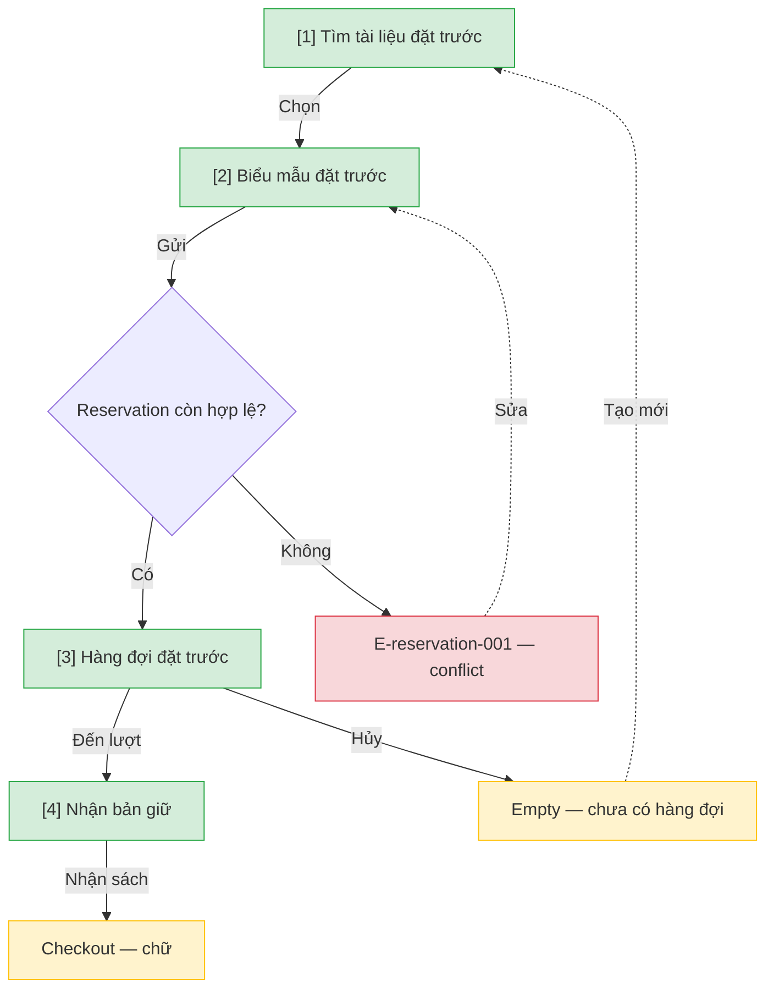

# Đặt trước — User Flow

## 1. User Flow

### Flow: reservation-flow — R2

## 2. Danh sách màn hình

| [#] | Slug | Màn hình | Mục đích | Thuộc flow |
|-----|------|----------|----------|------------|
| 1 | reservation-search | Tìm đặt trước | Chọn tài liệu cho reservation, quầy hoặc cổng. | reservation-flow |
| 2 | reservation-form | Biểu mẫu đặt trước | Gửi yêu cầu giữ chỗ. | reservation-flow |
| 3 | reservation-queue | Hàng đợi | Vị trí, hủy, empty state. | reservation-flow |
| 4 | reservation-pickup | Nhận bản giữ | Pickup, hủy hoặc hết hạn; tiếp tục checkout. | reservation-flow |

## 3. Danh sách flow

| Flow-slug | Tên flow | Màn hình gồm |
|-----------|----------|--------------|
| reservation-flow | Đặt trước trọn vòng | reservation-search → reservation-form → reservation-queue → reservation-pickup |

## 3.5. Chuyển màn (transitions)

Chuyển màn sang feature khác ghi bằng chữ khi đích chưa có wireframe; feature R0 dùng `../../{slug}/html-wireframe/`.

| Từ màn [#] | Đến màn [#] | Trigger | Điều kiện |
|-----------|------------|---------|-----------|
| Tìm [1] | Form [2] | Chọn tài liệu | Luôn |
| Form [2] | Hàng đợi [3] | Gửi hợp lệ | Còn slot |
| Form [2] | (giữ) [2] | Gửi | E-reservation-001 |
| Hàng đợi [3] | Nhận [4] | Đến lượt còn hạn | Hold còn hạn |
| Nhận [4] | checkout (chữ) | Nhận sách | Tiếp tục mượn |

## 4. Open Questions

- [ ] OQ-reservation-001 — Đặt trước thuộc R2 (DEC-P2-05) cần Product Owner duyệt. Owner: Product Owner.
- [ ] OQ-reservation-002 — Giới hạn đặt trước và thời gian giữ chính thức (mặc định nguồn 3 yêu cầu / 48 giờ)? Owner: Thủ thư trưởng.
- [ ] OQ-reservation-003 — Có thời gian ân hạn khi đến nhận sát hạn? Owner: Thủ thư trưởng.
