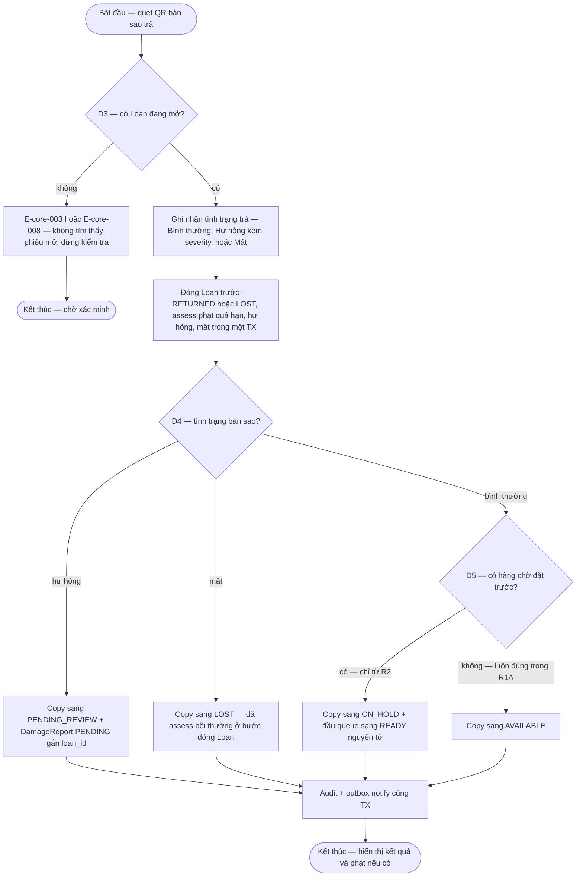

# return-handling — Flows

## Flow: Trả sách và follow-up phạt, hư hỏng

**Trigger:** Nhân viên nhận trả bản sao tại quầy; yêu cầu gia hạn tại quầy hoặc self-service. · **UC:** uc-return · **Release:** R1A (trả + fine follow-up), R1B (gia hạn — FR-renewal-001, CAP-RENEW)

**Nhãn:** Thứ tự bắt buộc "đóng Loan + tính phạt trước, quyết định trạng thái Copy sau" là FACT (§6.2 nguồn). Chi tiết flow trả (D3/D4/D5) là PROPOSAL reconstruction (DEC-D3-02). **D5 trong R1A luôn = "không có hàng chờ"** (DEC-P2-05) — nhánh `ON_HOLD` chỉ từ R2. Gia hạn: điều kiện từ chối là FACT (SRC-BR04); ngưỡng là Open (OQ-policy-config-001); check "có người đặt trước" chạy trên queue rỗng tới R2.

### Bảng bước F4a — trả sách

| Bước | Actor | Quyết định / điều kiện | Phản hồi hệ thống | Error path |
|------|-------|------------------------|--------------------|------------|
| 1 | Nhân viên | Quét QR bản sao (locator) | Locate copy + tra Loan mở | QR sai/mờ/trùng → nhập mã thủ công (§6.5) |
| 2 | Hệ thống | **D3**: Loan mở tồn tại cho đúng copy | Tiếp tục | E-core-003 — "Không tìm thấy phiếu mượn đang mở cho cuốn sách này" → dừng, yêu cầu kiểm tra; double-return → Loan đã `RETURNED` thì idempotent reject, trả kết quả gốc (lifecycle §3) |
| 3 | Nhân viên | Ghi nhận tình trạng: Bình thường / Hư hỏng (severity + ảnh nếu cần → F7) / Mất | Chuẩn bị payload đóng phiếu | E-core-001 — thiếu severity/bằng chứng bắt buộc |
| 4 | Hệ thống | Đóng Loan **trước**: `ACTIVE/OVERDUE → RETURNED` (LOAN-T04) hoặc `→ LOST` (LOAN-T05) + assess phạt: quá hạn SRC-BR05, hư hỏng SRC-BR07, mất SRC-BR06 → FinancialEvent `ASSESSMENT` + Fine `UNPAID` | Nghĩa vụ phạt ghi nhận trong cùng TX | Audit fail → E-core-007 rollback; CAS conflict trạng thái copy/loan → E-core-004 |
| 5 | Hệ thống | **D4**: tình trạng copy | Hư hỏng → `PENDING_REVIEW` + DamageReport `PENDING` gắn `loan_id` (COPY-T05); Mất → `LOST` (COPY-T06); Bình thường → D5 | — |
| 6 | Hệ thống | **D5**: có hàng chờ? — **R1A luôn "không"** (DEC-P2-05) | R1A: `ON_LOAN → AVAILABLE` (COPY-T03); từ R2: có queue → `ON_HOLD` + đầu queue `WAITING→READY` nguyên tử (COPY-T04, AT-RSV-01) | — |
| 7 | Hệ thống | Audit + outbox trong cùng TX (INV-01); hiển thị kết quả | "Đã nhận trả sách và cập nhật trạng thái bản sao." + phạt nếu có | Notify lỗi → outbox retry (INV-04) |
