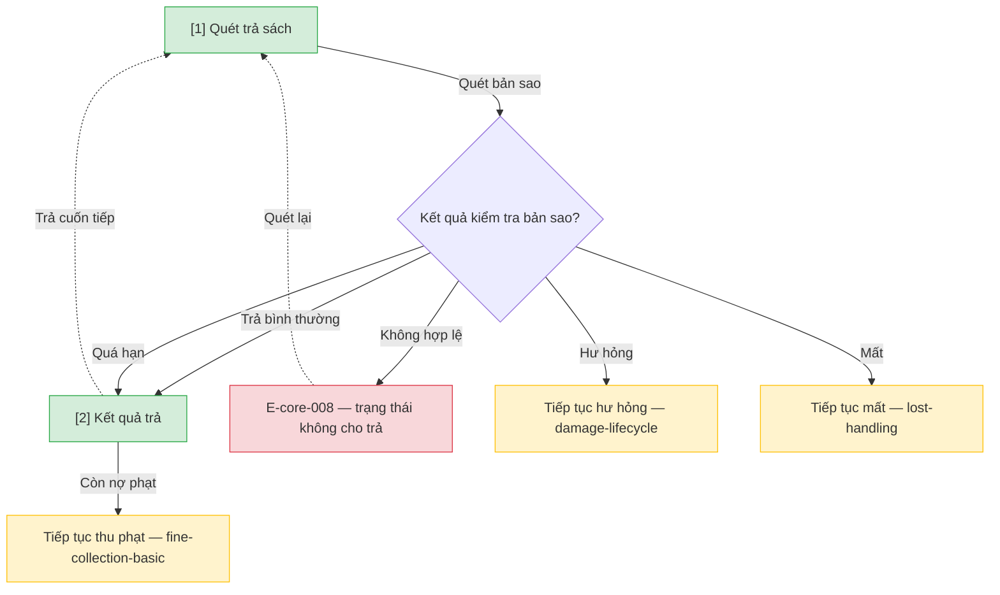

# Trả sách — User Flow

## 1. User Flow

### Flow: return-handling-flow — R1A

## 2. Danh sách màn hình

| [#] | Slug | Màn hình | Mục đích | Thuộc flow |
|-----|------|----------|----------|------------|
| 1 | return-scan | Quét trả sách | Nhận diện bản sao đang mượn và kiểm tra trạng thái. | return-handling-flow |
| 2 | return-result | Kết quả trả | Đóng khoản mượn, báo quá hạn hoặc hướng ngoại lệ. | return-handling-flow |

## 3. Danh sách flow

| Flow-slug | Tên flow | Màn hình gồm |
|-----------|----------|--------------|
| return-handling-flow | Trả tại quầy | return-scan → return-result |

## 3.5. Chuyển màn (transitions)

Chuyển màn sang feature khác ghi bằng chữ khi đích chưa có wireframe; feature R0 dùng `../../{slug}/html-wireframe/`.

| Từ màn [#] | Đến màn [#] | Trigger | Điều kiện |
|-----------|------------|---------|-----------|
| Quét trả [1] | Kết quả [2] | Quét hợp lệ | Bản sao đang mượn |
| Quét trả [1] | (giữ) [1] | Quét | E-core-008 |
| Kết quả [2] | fine-collection-basic (chữ) | Còn nợ | Quá hạn đã ghi fine |
| Quét trả [1] | damage-lifecycle (chữ) | Phát hiện hư | Rẽ báo hư |
| Quét trả [1] | lost-handling (chữ) | Ghi nhận mất | Rẽ mất |

## 4. Open Questions

- [ ] OQ-return-handling-001 — Luồng trả dựng lại (DEC-D3-02) cần domain approver duyệt. Owner: Thủ thư trưởng.
