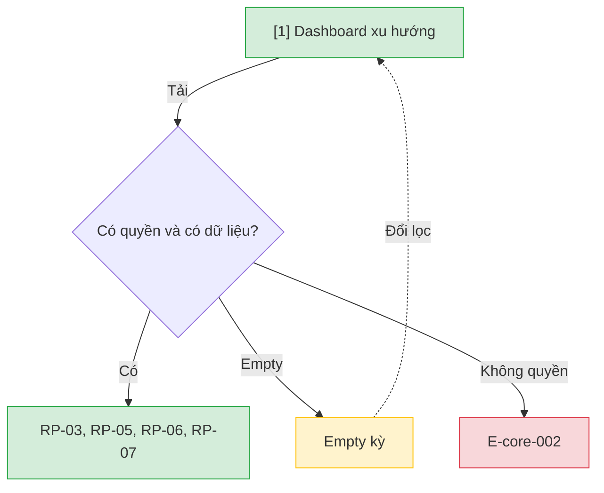

# Báo cáo xu hướng — User Flow

## 1. User Flow

### Flow: trend-reports-flow — R2

## 2. Danh sách màn hình

| [#] | Slug | Màn hình | Mục đích | Thuộc flow |
|-----|------|----------|----------|------------|
| 1 | trend-dashboard | Dashboard xu hướng | RP-03 lưu thông, RP-05 phạt, RP-06 top/không mượn, RP-07 hư hỏng; xuất Excel/PDF. | trend-reports-flow |

## 3. Danh sách flow

| Flow-slug | Tên flow | Màn hình gồm |
|-----------|----------|--------------|
| trend-reports-flow | Báo cáo xu hướng | trend-dashboard |

## 3.5. Chuyển màn (transitions)

Chuyển màn sang feature khác ghi bằng chữ khi đích chưa có wireframe; feature R0 dùng `../../{slug}/html-wireframe/`.

| Từ màn [#] | Đến màn [#] | Trigger | Điều kiện |
|-----------|------------|---------|-----------|
| Dashboard [1] | (giữ) [1] | Tải RP | Có quyền |
| Dashboard [1] | (giữ) [1] | Tải | Empty hoặc E-core-002 |

## 4. Open Questions

- [ ] OQ-trend-reports-001 — Số sách trong danh sách top? Owner: Product Owner.
