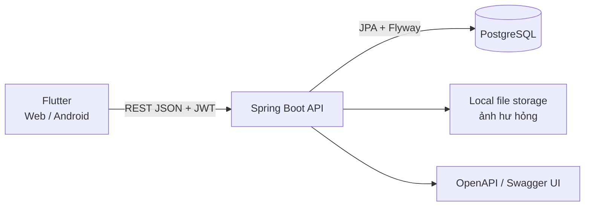

# Kiến trúc hệ thống

## Sơ đồ thành phần

## Ranh giới

| Thành phần | Trách nhiệm | Nguồn thực thi |
|---|---|---|
| Flutter | Màn hình, điều hướng, session phía client và trải nghiệm theo vai trò. | `frontend/lib/` |
| Spring Boot | REST API, xác thực JWT, phân quyền và điều phối nghiệp vụ. | `apps/api/src/main/java/com/quanlythuvien/` |
| PostgreSQL | Lưu dữ liệu bền vững; schema được nâng cấp bằng Flyway. | `apps/api/src/main/resources/db/migration/` |
| Storage | Lưu tệp người dùng tải lên tại đường dẫn do API cấu hình. | `app.storage.dir` trong `application.yml` |
| Docker Compose | Chạy PostgreSQL và API cho phát triển/demo cục bộ. | `deploy/docker-compose.yml` |

## Quyết định kiến trúc

- Dự án dùng modular monolith Spring Boot, không tách microservice. Các package miền là ranh giới tổ chức chính.
- Flutter có mock backend để phát triển giao diện độc lập; cờ build `REAL_API` chuyển sang REST API thật. Đây là lựa chọn phát triển, không phải chế độ offline cho người dùng.
- Mọi schema thay đổi theo migration Flyway để database được nâng cấp có kiểm soát.
- API là stateless và dùng JWT; quyền được kiểm ở API, không chỉ ở điều hướng Flutter.
- Tác vụ quét bảo trì được bật bằng scheduler của Spring Boot; thời gian nghiệp vụ dùng múi giờ Việt Nam theo cấu hình.

## An toàn và vận hành

Các API không công khai yêu cầu JWT; API dùng BCrypt cho mật khẩu và phân quyền theo role. Dữ liệu nghiệp vụ nhạy cảm cần tuân theo các ràng buộc tại [project profile](./_shared/project-profile.md). Chính sách retention và quy trình production vẫn là quyết định mở, vì vậy chưa có tuyến vận hành production trong tài liệu này.

## Nguồn quyết định

[Kế hoạch Flutter + Spring](../plans/261009-0650-flutter-spring-thesis-stack/plan.md) ghi lại lý do chọn stack. Quy tắc nghiệp vụ và quyết định sản phẩm thuộc `docs/_shared/` và `docs/_product/`; kiến trúc không sao chép các quy tắc này.
